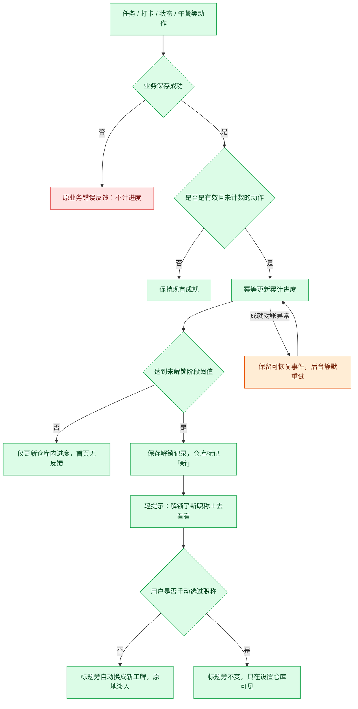
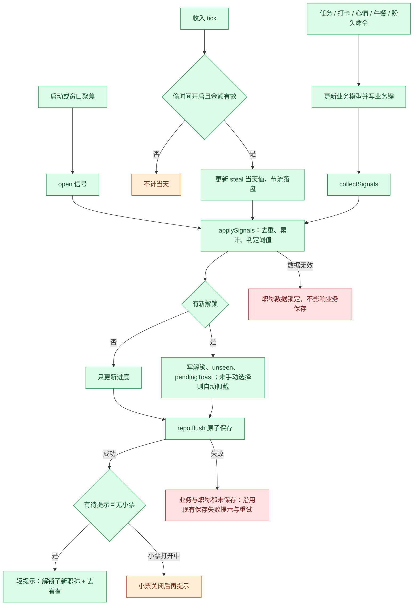

# F09 离谱职称

- 实施状态：v8 实现，v9 改为详情二级浮窗并重设计标题旁标签，修复嵌套弹窗关闭外层的问题；用户已在本地实例确认。
- 版本：v8（2026-11-05）。v8：未解锁称号完全不展示（仓库只放已解锁、无进度、无总数）；新增可维护性架构（规则目录按系列分文件、声明式条件、通用信号与台账）。v7 的 5 项确认已记录。
- v7：v7 新增技术方案：原子写入、新键 `dogcow.titles.v1`、信号与判定、偷出金额结算、界面与备份改动，待批准。
- v6：v6 确认自动佩戴，解锁时复用现有轻提示，只显示称号名和「去看看」，不含数字。
- v5：取消首屏解锁横幅，职称仓库移到设置里的「职称」标签页。
- v4：确定标题旁佩戴（v4 的首页仓库卡片和解锁横幅已在 v5 取消）。
- v3：v3 新增 S7 狗牛营业天数、S8 摸鱼小金库（各 5 阶）、4 个相关隐藏职称和「铭牌」材质；用户已认可 v2 的称号、文案、隐藏职称与工牌样式。
- v2 补充完整称号表、搞怪条件文案、8 个隐藏职称和工牌样式。
- v2 相对 v1 的规则改动：S5 午餐由「有效抽选」改为「成功确认」，因为抽选结果不持久化；S1 第三阶改名为「需求粉碎机」。
- 状态：需求候选计划，未实施；仅授权写入文档。
- 用户明确方向：经常性的日常动作可以解锁称号，进度与称号可以累积。
- 下述称号、阈值、展示及计数方式为建议，待后续确认；不授权代码修改、提交、push 或发布。

## 目标与核心循环

把用户原本就在做的动作变成轻量收集：做一次有反馈，跨天使用有进度，积累后获得更离谱的职称。无需为了领称号多点一个签到按钮。

日常动作 → 后台累计 → 意外解锁 → 自动或自选佩戴。未解锁的称号对用户完全不可见，靠自己发掘。

短目标提供经常获得反馈的机会，长期目标提供积累感。不是每点一次按钮都发奖；未达阈值只在相关操作完成后短暂显示进度，不主动打断操作。不设置断签扣进度、限时绝版或公共排行榜。

## 首版入口与展示

原则：职称是轻量玩法。解锁时只出一条不带数字的轻提示，不弹窗、不出横幅、不打断操作；详细内容去设置里看。

### 职称仓库（在设置里）

- 设置弹窗新增一个标签页「职称」，与现有「外观」「收入」「记录」「数据」并列。仓库只在这里，不做首页模块卡片。
- 视觉是一面工位小仓库：洞洞板加木纹货架，工牌挂在挂钩上。**仓库只放已解锁的称号**：不显示未解锁称号、剪影、进度、阈值或提示，也不透露总数和系列数量。某系列一枚都没解锁时，这层货架不出现。
- 已解锁的按系列分层、按解锁时间排列；隐藏职称解锁后放在「内部消息」那层。
- 一枚都没有时，仓库只显示一面空洞洞板和一句「工牌会在日常里自己冒出来。」
- 顶部门牌：「已获聘 N 个」（不显示总数）、当前佩戴的职称，以及「在标题旁显示职称」开关（默认开启）。
- 点击工牌打开详情：大工牌、条件文案、「正经说法」折叠区、解锁时刻、「佩戴」或「卸下」。
- 新解锁的工牌带一个「新」角标，在仓库里看过后消失。这是唯一的未读标记，设置按钮和标签页上都不加红点。

### 解锁提示

- 解锁时复用现有的底部轻提示 `Toast`，与「午饭有着落啦！」等提示同一位置和样式，不新增横幅或弹窗。
- 提示只说解锁了什么，加一个按钮：「解锁了新职称：待办清道夫」＋「去看看」。按钮打开设置里的「职称」标签页并定位到这枚工牌。
- 提示里不出现任何数字：不显示进度、阈值、累计天数、金额或总数。隐藏职称同样只显示称号名，例如「解锁了新职称：回旋镖认证工程师」。
- 沿用现有提示约 4 秒后自动消失，不需要用户处理；不加音效。
- 同一称号只提示一次。应用在后台时解锁的，下次回到前台提示一次，不补播动画。
- 同时解锁多个时只发一条：「解锁了新职称：待办清道夫 等」＋「去看看」，打开仓库后各自带「新」角标。
- 和下班小票同时触发时，等小票关闭后再提示；与其他提示冲突时排在其后，不覆盖业务提示（尤其是错误提示）。
- 自动佩戴时，标题旁工牌同时原地淡入切换，约 300ms；减少动态效果模式下直接切换。

### 标题旁佩戴

- 已佩戴的职称以胶囊工牌显示在首页标题右侧，与标题基线对齐。窄窗口时换到标题下方一行，不挤压日期行。
- 自动佩戴规则（已确认）：用户从未手动选过职称时，标题旁自动显示最新解锁、稀有度最高的一枚，这样不进设置也能看到进展；用户在仓库里手动佩戴或卸下之后，就不再自动替换。
- 没有任何职称或用户卸下后，标题旁不留空位。
- 点击标题旁工牌，直接打开设置里的「职称」标签页并定位到这枚工牌。
- 「在标题旁显示职称」关闭后只是不显示，佩戴记录保留。
- 其他展示位置（小牛旁、顶栏、小票）作为后续候选，本期不做。
- 一次只能佩戴一个职称，同一称号只收藏一份。

## 称号体系与累计规则

称号分两类：

- **常驻系列**：6 个系列，每个系列 3 阶，共 18 个。条件公开，职称仓库直接显示进度。
- **隐藏职称**：8 个一次性彩蛋。解锁前完全不可见，解锁后公开完整条件。

同一系列的每个阶段都有独立的稳定 ID。解锁低阶后继续累计高阶，收藏里保留全部阶段，旧称号不会被高阶替换。阈值是首轮建议，节奏是否合理还没有验证。

每个称号有两段文字：

- **判定规则**：给实现和测试用，必须精确。
- **条件文案**：展示给用户，可以搞怪，但不能和判定规则矛盾。

职称仓库里默认显示条件文案。点开称号后，在「正经说法」折叠区里显示判定规则，避免用户被文案误导。

### 常驻系列

#### S1 活儿终结者（任务）

判定：不同任务首次进入完成状态，按任务 ID 去重。

| 阶 | ID | 称号 | 阈值 | 条件文案 |
| --- | --- | --- | --- | --- |
| 1 | `done-1` | 这活我熟 | 1 件 | 亲手送走第一件活。它走得很安详。 |
| 2 | `done-10` | 待办清道夫 | 10 件 | 送走 10 件活，没有一件是画的饼。 |
| 3 | `done-50` | 需求粉碎机 | 50 件 | 50 件活已入土。产品经理开始叫你「那位」。 |

#### S2 打卡营业部（上班打卡）

判定：本地自然日内首次成功上班打卡，按日期去重。

| 阶 | ID | 称号 | 阈值 | 条件文案 |
| --- | --- | --- | --- | --- |
| 1 | `clockin-1` | 今日已开机 | 1 天 | 第一次把自己插上电源。 |
| 2 | `clockin-5` | 工位常驻嘉宾 | 5 天 | 连续出场 5 天（不连续也算，牛不记仇）。 |
| 3 | `clockin-20` | 营业部编外主任 | 20 天 | 打卡机已经认得你的指纹和黑眼圈。 |

#### S3 准点撤离学（准点下班）

判定：成功下班打卡，时刻在规定下班后 0–10 分钟内，按日期去重。没有可靠排班终点、非工作日或全天请假的日子不计。

| 阶 | ID | 称号 | 阈值 | 条件文案 |
| --- | --- | --- | --- | --- |
| 1 | `offwork-1` | 到点就走 | 1 天 | 下班铃响后 10 分钟内消失。像一阵风。 |
| 2 | `offwork-5` | 准点撤离专家 | 5 天 | 5 次在老板说「那个谁」之前离开。 |
| 3 | `offwork-20` | 下班时间管理大师 | 20 天 | 你的工位椅已学会自己转回去。 |

#### S4 情绪观察站（精神状态）

判定：当天首次保存一个有效精神状态，按日期去重。所有状态等价，不区分心情好坏。

| 阶 | ID | 称号 | 阈值 | 条件文案 |
| --- | --- | --- | --- | --- |
| 1 | `mood-1` | 状态已上报 | 1 天 | 向组织汇报了一次精神状况。组织表示收到。 |
| 2 | `mood-7` | 情绪气象员 | 7 天 | 播报 7 天心情天气，暴雨也算播报。 |
| 3 | `mood-30` | 精神状态研究员 | 30 天 | 30 天样本，足够写一篇没人审的论文。 |

#### S5 午餐决策局（午餐）

判定：当天至少一次成功确认午餐，按日期去重。只看确认，不看抽了几次。

| 阶 | ID | 称号 | 阈值 | 条件文案 |
| --- | --- | --- | --- | --- |
| 1 | `lunch-1` | 今天就吃这个 | 1 天 | 做出今天第一个、也是最难的决定。 |
| 2 | `lunch-5` | 午餐决策委员 | 5 天 | 5 个中午没有因为纠结而饿着。 |
| 3 | `lunch-20` | 中午吃啥局局长 | 20 天 | 全公司的「中午吃啥」都该来问你。 |

#### S6 周五生存学（周五下班）

判定：当地周五有成功下班记录，且当天是排班工作日，按日期去重。

| 阶 | ID | 称号 | 阈值 | 条件文案 |
| --- | --- | --- | --- | --- |
| 1 | `friday-1` | 周五幸存者 | 1 天 | 活着走出了一个周五。 |
| 2 | `friday-4` | 周末接引员 | 4 天 | 亲手把 4 个周末接回了家。 |
| 3 | `friday-12` | 星期五荣誉居民 | 12 天 | 周五已为你颁发永久居住证。 |

#### S7 狗牛营业天数（打开应用）

判定：本地自然日内应用至少在前台可见一次，按日期去重。只算有打开的日子，不要求连续，也不按时长计。

| 阶 | ID | 称号 | 阈值 | 条件文案 |
| --- | --- | --- | --- | --- |
| 1 | `open-1` | 狗牛新同事 | 1 天 | 第一次打开狗牛。小牛还在认人。 |
| 2 | `open-7` | 试用期观察对象 | 7 天 | 来了 7 天，小牛开始给你留草。 |
| 3 | `open-30` | 狗牛正式员工 | 30 天 | 一个月了，你的桌面已经离不开这头牛。 |
| 4 | `open-100` | 百日工位老友 | 100 天 | 100 天，你和小牛的感情比和工位还深。 |
| 5 | `open-365` | 狗牛终身股东 | 365 天 | 一整年。小牛决定把牧场分你一半（不含草）。 |

数据：现在没有「打开日期」记录，需要新增一个按日期去重的打开记录。只记日期，不记时长、窗口或使用内容。

#### S8 摸鱼小金库（累计偷到的钱）

判定：只在「偷时间」开启的日子计入。每个自然日结束（或下班打卡成功）时，取当天最终的「今日偷出金额（估算）」加进累计，按日期去重；当天重算只覆盖当天的值，不重复累加。累计金额是估算，不是额外工资，文案和详情里都要写明。

| 阶 | ID | 称号 | 阈值 | 条件文案 |
| --- | --- | --- | --- | --- |
| 1 | `steal-1` | 第一块钢镚 | ¥1 | 偷到第一块钱。老板没发现，小牛发现了。 |
| 2 | `steal-100` | 零钱罐保管员 | ¥100 | 偷够一顿火锅的钱，锅底自选。 |
| 3 | `steal-1000` | 带薪发呆理财师 | ¥1,000 | 这一千块，是你一分一秒发呆攒下的。 |
| 4 | `steal-5000` | 摸鱼小金库行长 | ¥5,000 | 小金库开了分行，行长是你。 |
| 5 | `steal-20000` | 摸鱼界巴菲特 | ¥20,000 | 你的长期主义，用在了不上班上。 |

约束：

- 不展示排名，不按单日最高偷出金额奖励，不鼓励延长摸鱼时间。
- 没开启「偷时间」、没有薪资设置或当天数据不完整时，当天不计，不用推测补齐。
- 改薪资设置不会回算历史累计，已解锁称号不收回。
- 数据：现在的偷出金额是实时计算值，没有按日保存。需要新增「每日偷出金额结算」记录，具体时点（零点、下班打卡或下次打开时补结算）在技术方案确认。

#### S7、S8 相关隐藏职称

| ID | 称号 | 解锁前提示 | 判定规则（建议） | 解锁后条件文案 |
| --- | --- | --- | --- | --- |
| `h-weekend` | 周末也想牛 | 休息日，你也来看过它。 | 累计 3 个非排班日打开过应用 | 放假了还回来看小牛。牛很感动，但劝你出去走走。 |
| `h-comeback` | 回归的老员工 | 离开得越久，回来越珍贵。 | 两次打开之间间隔至少 14 个自然日 | 消失了两周以上又回来了。工位还在，草也还在。 |
| `h-coffee` | 一杯奶茶自由 | 有一天，你偷够了一杯奶茶。 | 单日偷出金额（估算）首次达到 ¥20 | 今天偷出的钱够买一杯奶茶。少糖，去冰，记得是估算。 |
| `h-pi` | 圆周率会计 | 有个数字，懂的都懂。 | 累计偷出金额首次落在 ¥314.00–¥314.99 区间 | 小金库停在 314 块，非常圆，非常无理。 |

`h-coffee` 只在首次达到时解锁一次，之后单日金额再高也没有新奖励。

### 隐藏职称

隐藏职称各只有一阶，解锁一次即永久保留，不计入常驻系列的进度。解锁前在任何地方都不可见（v8 起所有未解锁称号都不展示），下表「解锁前提示」列仅作设计备忘，不在界面出现。

| ID | 称号 | 解锁前提示 | 判定规则（建议） | 解锁后条件文案 | 数据依赖 |
| --- | --- | --- | --- | --- | --- |
| `h-boomerang` | 回旋镖认证工程师 | 有些活，送走了还会自己回来。 | 同一任务被取消完成后再次完成。只解锁一次，不给 S1 加进度 | 一件活被你送走又接回来。它回来的时候，带着新需求。 | 需要「取消完成」事件或完成状态变化记录，待核对 |
| `h-museum` | 拖延博物馆馆长 | 有件活在你这住了很久。 | 一件任务从创建到首次完成，跨越至少 7 个自然日 | 一件活在你的清单里过了个周年小庆。今天终于送它出馆。 | 需要任务创建时间，待核对 |
| `h-exact` | 踩点艺术家 | 时间的缝隙里，有你的身影。 | 上班打卡时刻与规定上班时间在同一分钟内，累计 3 天，按日期去重 | 3 次精确卡在规定时间那一分钟。分秒不差，也分秒不早。 | 需要排班开始时间；不奖励迟到 |
| `h-nail` | 牛肉面钉子户 | 有一道菜，你不想换。 | 同一个菜名累计确认 5 天，按日期去重；称号里的菜名取用户自己的选项 | 同一道菜吃了 5 天。菜单在你面前失去了意义。 | 午餐确认记录需保留菜名历史，待核对 |
| `h-mixer` | 精神状态调色盘 | 一周里，你不止一种牛。 | 连续 7 个自然日内记录了至少 5 种不同的精神状态 | 一周换了 5 种状态。情绪很丰富，牛很坚强。 | 现有 `moodHistory` 按日期记录状态 ID，可满足 |
| `h-monday` | 周一抗体携带者 | 每周最难的那天，你也来了。 | 累计 4 个周一成功上班打卡，且当天是排班工作日 | 4 个周一都没能打倒你，周一开始怀疑自己。 | 打卡记录，可满足 |
| `h-dreamer` | 盼头囤积户 | 你的心里装着很多远方。 | 盼头清单里同时存在至少 5 个未过期的盼头 | 同时攒下 5 个盼头。打工的动力，已经囤够一季度。 | 现有盼头数据，可满足 |
| `h-collector` | 职称收藏夹本夹 | 收集够多，自然就有了。 | 已解锁任意称号（含隐藏）累计 10 个 | 你的工牌已经挂不下了，只好再申请一个职称来装它们。 | 成就数据自身 |

隐藏职称的约束：

- 条件只读取已持久化的业务事实，不读输入框内容、窗口焦点或点击次数。
- 不设置会鼓励加班、迟到、久蹲、暴食或熬夜的条件，比如「晚走 2 小时」「午餐 3 份」。
- `h-boomerang` 不能让用户通过反复切换来刷常驻进度。它只解锁一次，S1 仍按任务 ID 去重。
- `h-nail` 的展示名可带入用户的菜名，例如「饺子钉子户」，但稳定 ID 不变。菜名超过 6 个字时截断，并在详情里显示全名。
- 「数据依赖」标为待核对的称号，在技术方案阶段确认现有数据能否判定。不能判定就移到后续版本，不用推测数据补齐。

### 带薪拉屎联动候选（后续）

待 F01 实施且计时口径确定后，可以新增一个系列：

| 阶 | ID | 称号 | 阈值 | 条件文案 |
| --- | --- | --- | --- | --- |
| 1 | `toilet-1` | 临时工位体验官 | 1 天 | 在另一个工位完成了一次带薪思考。 |
| 2 | `toilet-5` | 带薪蹲班专员 | 5 天 | 5 天都抽空去了一趟「二号会议室」。 |
| 3 | `toilet-20` | 瓷器办公研究员 | 20 天 | 对公司每一个隔间的信号强度了如指掌。 |

判定：当天至少有一条已结束、有效偷出时间大于零的拉屎记录，按日期去重。不按蹲坑分钟数、次数或单次最长时长排名，不鼓励久蹲。取消、待核对、保存失败或没有有效时长的记录不触发。此系列依赖 F01，F01 未实施前不虚构进度。

### 规则补充

- 首版建议 8 个常驻系列（S1–S6 各 3 阶，S7、S8 各 5 阶，共 28 个称号）加 12 个隐藏职称，共 40 个。打卡相关称号只在有对应有效打卡事实时计数，不根据打开应用或系统时间推断已经上班或下班。
- 「准点」10 分钟窗口和「踩点」同一分钟窗口都是玩法阈值，不是公司考勤合规判断。跨夜排班的支持范围在实施前核对。
- 补录记录按业务发生的日期和时间判断，记录来源不影响资格。同一天补录、编辑或删除重建，不获得第二次日计数。补录可以在保存时一次解锁多个阶段，合并展示。
- 午餐重抽不重复累计，状态当天修改多次不重复累计，任务取消完成后再完成不重复累计。
- 连续使用可作为未来单独玩法，本期只做累计天数。周末、请假和忘记打开应用都不会重置进度。
- 不以任务文字长度或主观难度评判贡献，不强迫读取或分享任务内容。

## 称号样式

称号统一做成「工牌」。稀有度用工牌材质区分，系列用图标和底色区分。所有样式用 CSS 和现有 lucide 图标实现，不引入图片素材或新依赖。

### 稀有度与材质

| 稀有度 | 对应 | 工牌材质 | 视觉要点 | 解锁章 |
| --- | --- | --- | --- | --- |
| 实习 | 各系列第 1 阶 | 牛皮纸卡 | 暖米色底、细虚线边、轻微纸张颗粒，挂绳为细麻绳 | 圆形蓝章「已录用」 |
| 正式 | 各系列第 2 阶 | 塑封卡 | 系列色底、白色内框、顶部一条高光，挂绳为系列色织带 | 方形红章「转正」 |
| 编外 | 各系列第 3 阶 | 亚克力卡 | 半透明玻璃底、系列色描边、斜向反光条，悬停时反光条缓慢扫过一次 | 椭圆金章「特聘」 |
| 铭牌 | S7、S8 第 4–5 阶 | 黄铜铭牌 | 拉丝金属底、刻字效果、四角铆钉，第 5 阶加一圈细花纹边 | 钢印「终身」 |
| 内部 | 隐藏职称 | 牛皮档案袋 | 深墨绿底、烫金字 | 斜盖红章「绝密 · 已解密」 |

稀有度只表示获取难度，不表示付费或限时，也不会被收回。

### 系列识别

| 系列 | 图标（lucide） | 系列色 | 来源 |
| --- | --- | --- | --- |
| 活儿终结者 | `ListChecks` | `#3c8fd6` | 任务列表模块色 |
| 打卡营业部 | `AlarmClock` | `#e2735a` | 打卡模块色 |
| 准点撤离学 | `DoorOpen` | `#5b6fe0` | 下班倒计时模块色 |
| 情绪观察站 | `Coffee` | `#dd858a` | 今日精神状态模块色 |
| 午餐决策局 | `UtensilsCrossed` | `#e28b47` | 今天吃什么模块色 |
| 周五生存学 | `PartyPopper` | `#46a898` | 盼头清单模块色 |
| 狗牛营业天数 | `CalendarHeart` | `#c4569a` | 月历模块色 |
| 摸鱼小金库 | `PiggyBank` | `#7a5bc4` | 偷出金额模块色 |
| 隐藏职称 | `FileLock2`（未解锁）/ `Sparkles`（已解锁） | `#2f4a3a` 加金色 `#c9a227` | 新增 |

系列色复用现有模块色，用户能把称号和对应卡片联系起来。每个系列同时用图标和文字区分，不只依赖颜色。深色主题下，材质底色降低亮度，文字保持现有 `--c-ink` 对比度。

### 三种尺寸

| 用途 | 尺寸 | 内容 |
| --- | --- | --- |
| 标题旁佩戴 | 高 22px 的胶囊 | 系列图标加称号名，最多 8 个字，超出截断；左侧 3px 色条表示稀有度 |
| 仓库货架 | 约 96 × 128px 竖版工牌 | 顶部挂绳孔、系列图标、称号名、稀有度小字、解锁日期 |
| 详情弹窗 | 约 220 × 300px 大工牌 | 大工牌、条件文案、「正经说法」折叠区、解锁时刻、「佩戴」或「卸下」按钮 |

工牌上的固定文字建议：

```
┌──────────────┐
│      ○       │  ← 挂绳孔
│   [图标]      │
│  待办清道夫    │  ← 称号名
│  正式 · 活儿终结者 │  ← 稀有度 · 系列
│  2026.11.05 获聘 │
└──────────────┘
```

### 未解锁状态

不展示。仓库、标题旁、提示、详情里都不出现未解锁称号的任何信息。

## 经常性反馈与长期积累

- 首次有效动作即可有第一枚称号；之后的阶段不预告，到了自然解锁。
- 达到阶段阈值只解锁一次，已达最高阶后后台继续累计（不展示），供未来新增更高阶时使用；不临时生成未经设计的新称号。
- 任何地方都不显示进度，包括仓库。
- 非解锁时不每次全屏庆祝，不把剩余目标做成红点催促。
- 阈值节奏需用户体验后调整，规则必须版本化；上线后不能改名改阈值就抹掉已获得的称号。

## 解锁、佩戴与趣味文案

| 场景 | 文案候选 | 行为 |
| --- | --- | --- |
| 新职称解锁 | 恭喜，工位履历又厚了一页。 | 展示职称名与触发条件，允许稍后查看 |
| 任务系列 | 这次不是画饼，是真做完了。 | 仅用作短副文案 |
| 上班系列 | 营业记录，逐渐离谱。 | 不评价早到或加班时长 |
| 准点下班系列 | 下班这门学问，你有点东西。 | 不把提前离岗包装成准点 |
| 精神状态系列 | 状态不必满格，记录就算数。 | 不奖励特定心情，所有有效状态等价 |
| 午餐系列 | 今日重大决策，已完成。 | 不鼓励重复抽取 |
| 佩戴成功 | 职称已挂，继续随意。 | 原位置立即更新 |
| 无收藏 | 第一枚职称，藏在下一次日常操作里。 | 展示可达成条件，不新增强制签到 |
| 记录保存失败 | 本次进度未保存，请重试。 | 保留重试上下文，不展示已解锁 |

解锁反馈见「解锁提示」：一条不带数字的轻提示加「去看看」，仓库中保留「新」角标。新称号佩戴由用户主动选择；不与其他设置争夺焦点。

## 动画方向

- 解锁：首页不播放动画。在设置仓库里第一次看到新工牌时，按稀有度盖一次对应的章（已录用 / 转正 / 特聘 / 绝密 · 已解密），约 600ms，之后不再重复。
- 佩戴：标题旁工牌原地淡入切换一次，保持原有布局稳定。
- 多称号同时解锁：只发一条轻提示，仓库里各自带「新」角标。
- 下班打卡同时解锁时，先显示小票，关闭后再出轻提示。
- 减少动态效果模式改为静态状态切换；失焦时不播放，重新打开不补播一串历史动画。
- 首版默认静音，不高频闪烁；系列以图案及文字共同区分，不仅依靠颜色。

## 数据、去重与业务边界

建议维护独立成就数据：规则版本、有效动作标识/日去重标识、累计进度、解锁记录（称号 ID 与解锁时刻）、当前佩戴 ID、未读解锁 ID。具体类型及存储方式待技术方案确认，不复制任务或薪资全文。

- 仅业务动作成功持久化后评估成就；业务失败不加进度，渲染完成或点击次数不能作为奖励依据。
- 业务事实与成就记录需要原子保存，或使用可恢复的幂等事件机制，二选一在技术方案确认；不允许业务成功但重试造成重复计数。
- 任务按稳定任务 ID、日系列按日期与系列 ID 去重，解锁按称号 ID 去重；重复事件、应用重启和重复导入均不能重复发奖。
- 成就记作已发生动作的纪念：正常成功后再取消完成、删除任务或编辑历史，不回收已解锁职称，也不允许重做同一个去重单位刷进度。该规则需在帮助中明确。
- 对任意导入数据，不能仅信任其提供的累计数；校验数据结构、规则版本和称号 ID。导入究竟替换还是合并，必须沿用项目已有备份语义，不能擅自新增合并策略。
- 首版建议从功能启用后开始累计，避免历史完成事实不完整导致虚假回溯；已有存档不一次性补发未知历史称号。启用后提交的补录可按前述规则计数。
- 本机成就不是防作弊系统；不上传数据、不做账号验证，也不承诺抵抗用户修改本地文件。
- 成就反馈失败不能阻断主业务保存；若采用可恢复事件方式，重启后重试对账，但不重复弹已经展示过的反馈。
- 隐藏职称仓库、卸下职称不清除进度；备份导出需包含成就记录。完整恢复旧备份可能回到旧进度，应明确其属于备份恢复结果。
- 不修改实际工资、偷出时间、任务进度或打卡状态，不用领取称号作为完成业务动作的前提。

## 流程

需求阶段的流程如下；实施以「v7 技术方案」里的流程图为准（采用原子写入后不再需要对账重试）。



图中对账恢复仅适用于最终选择的事件方案；如采用原子保存，须在技术方案改成统一写入失败流程，不能宣称已有事件基础设施。

## 首版与后续

首版建议：8 个常驻系列 28 个称号，加上数据可满足的隐藏职称（最多 12 个）；累计进度、收藏柜、自选佩戴、轻量解锁反馈和本地备份兼容。无需新增在线服务。

后续候选：F01 上线后的蹲班系列、手动查看个人职称时间线、称号工牌图片导出、小游戏成绩系列。小游戏要待玩法和持久化规则确定后接入，不在首版虚构达成事件。

本期不做随机称号、AI 自动命名、每日强制任务、连续签到奖励、付费稀有度、公共排行榜或自动分享。

## 维护与实施前核对

- 核对现有任务完成奖励、精神状态连续记录/壁纸奖励，避免同一动作弹出两套互相竞争的庆祝。
- 现有 `Toast` 只有文字，没有按钮；需要扩展一个可选的操作按钮，并让职称提示排在业务提示之后。此改动属于公共组件，技术方案中单独说明影响范围。
- 复用当前趣味卡片入口、受控主进程命令、持久化与动效偏好；规则定义与进度评估独立于 UI。
- 称号以稳定 ID 关联素材和文案；新增同类称号原则上扩展规则表，不复制条件判断到各个按钮。
- 动作资格由业务事实提供，评估器不自行重算薪资或考勤；数据保存、兼容和恢复方式须单独提出具体方案。
- 本计划尚未完成专项竞品与实现源码调研，不能直接认定现有架构已满足幂等事件或原子事务要求。

## 验收清单

- [ ] 打开天数按日期去重；偷出金额只在开启偷时间的日子按日结算一次，重算不重复累加，文案标明估算。
- [ ] 解锁时只出一条轻提示，只含称号名和「去看看」，不含任何数字；「去看看」定位到对应工牌；多项合并为一条；不覆盖错误提示；设置「职称」标签页可查看全部；「新」角标看过即消失；自动佩戴在手动选择后停止；标题旁工牌开关、窄窗口换行与未佩戴时无占位。
- [ ] 隐藏职称各自只解锁一次，`h-boomerang` 不给 S1 加进度；数据不足的隐藏职称不出现在首版。
- [ ] 四种工牌材质在浅色、深色主题与三种尺寸下文字可读，系列可凭图标和文字区分。
- [ ] 各系列首阶、中阶、最高阶与超出最高阶的累计值正确。
- [ ] 仓库、标题旁、提示和快照中都不出现未解锁称号；仓库不显示总数和进度。
- [ ] 目录护栏测试覆盖 ID 唯一、信号已注册、`custom` 条件有用例。
- [ ] 任务重复完成、当天多次打卡/重抽/改状态、重启及重复导入不刷进度。
- [ ] 工作日、周五、准点窗口、补录、跨日及不完整排班边界符合规则。
- [ ] 任意有效精神状态同等计数，不奖励正面情绪、不因负面状态扣进度。
- [ ] 主业务或成就保存失败可恢复，不能出现重复解锁或虚假成功。
- [ ] 佩戴/卸下、历史收藏、未读状态与隐藏模块后的累计行为一致。
- [ ] 下班小票同时触发时先显示小票，关闭后再出轻提示。
- [ ] 减少动态效果、静音与小尺寸卡片状态完整。
- [ ] 旧数据、备份导入导出、规则升级及已解锁保留策略正确。
- [ ] 实施时完成相关逻辑测试、类型检查、构建和唯一的本地实例检查；视觉与功能体验待用户验收。

## 技术方案（v7 已确认，v8 增补待确认）

依据：源码核实。v7 基于 `3f419b0`；v8 复核于 `1cb48e0`（F01 已提交为 `83d78a7`，与 `origin/main` 一致），下列现有实现要点未变。

v7 确认结果：①采用方案 A 原子写入；②S8 沿用现有偷出金额口径（含迟到、早退）；③`h-museum` 按任务所属日期判断；④F01 已提交；⑤同意新增逻辑测试。

### 现有实现要点（源码核实）

- 所有业务数据是 `Repository.values` 里的若干键，`repo.flush()` 一次把整个 `snapshot.json` 写临时文件、fsync、rename、读回校验。同一次命令里写入的多个键天然原子保存。
- 主进程 `invoke()` 先改内存模型、`repo.storage.setItem`，最后统一 `finish()` → `repo.flush()`。任务完成已在这里给牧场发草（`rewardTask`），精神状态已在这里解锁壁纸（`result.code = 'wallpaper-unlocked'`），职称评估沿用同一位置。
- 任务没有创建时间；只有 `date`（所属日期）和 `done`。完成事件由 `result.completion` 给出。
- 打卡事实在 `income.attendance.days`，每天的排班、工作日、全天请假由 `calculateSnapshot(settings, now, context, leaves, attendance)` 计算；当前只对「今天」算出 `income.snapshot`。
- 今日偷出金额 `income.snapshot.stolenAmount` 是实时计算值，不按日保存。其口径包含迟到、早退、午休超出和带薪拉屎。
- 午餐只保存当天的 `lunch.chosen`，不保留历史；精神状态有按日的 `moodHistory`；盼头有 `hopes[].date`。
- 备份白名单在 `src/migration/transfer.js` 的 `allowedKey`，导入走 `beginRestore` 整键替换。
- `Toast` 只有文字；设置弹窗标签页为 `look / income / records / data`。

### 方案选择

| 方案 | 做法 | 结论 |
| --- | --- | --- |
| A 同次原子写入 | 在 `invoke()` 里业务改动之后、`finish()` 之前评估职称并 `setItem` 新键，随业务一起 flush | 采用。复用现有原子快照，不需要事件队列或对账 |
| B 可恢复事件队列 | 业务先存，再异步消费事件更新职称 | 不采用。项目没有事件基础设施，新增复杂度高，收益只是解耦 |

采用 A 后，v6 流程图里的「对账异常 → 后台重试」不再需要：业务和职称要么一起保存成功，要么一起失败，沿用现有保存失败提示与重试。

### v8 可维护性架构

目标：以后加称号、加系列、加新的触发事实，改动集中在一两个文件，不碰引擎、存储和界面。

**分层与依赖方向**（只能向下依赖）：

```
界面 renderer/features/titles   ── 只读 Snapshot.titles + 目录元数据，发 titles 命令
主进程 main/titles.ts           ── 调用各 collector 产生信号，调用引擎，写存储键
采集器 shared/titles/collectors ── 纯函数：业务 before/after → 信号列表
引擎   shared/titles/engine.ts  ── 纯函数：去重、记台账、按目录判定、自动佩戴；不认识任何业务
目录   shared/titles/catalog/*  ── 纯数据 + 少量声明式条件；不认识存储和界面
```

**目录结构**：

```
src/shared/titles/
  types.ts            TitleDef、SeriesDef、Condition、Signal、TitlesState
  signals.ts          信号注册表：每种信号的 ID、去重键含义、可选台账
  catalog/
    index.ts          汇总所有系列，启动时校验 ID 唯一、信号存在
    work.ts           S1 活儿终结者 + 任务类隐藏职称
    clock.ts          S2、S3、S6 + 打卡类隐藏职称
    fun.ts            S4、S5 + 心情/午餐/盼头类隐藏职称
    app.ts            S7 + 打开应用类隐藏职称
    money.ts          S8 + 金额类隐藏职称
    meta.ts           h-collector 等基于解锁数的称号
  collectors/
    task.ts clock.ts fun.ts app.ts money.ts   每个领域一个采集器
  engine.ts           applySignals、evaluate、autoWear
  storage.ts          parse / validate / migrate（按 version 逐级迁移）
```

**称号定义是数据**：

```ts
interface TitleDef {
  id: TitleId;              // 永久稳定，删除后也不复用
  series: SeriesId;         // 系列提供图标、颜色、货架顺序
  tier: 1 | 2 | 3 | 4 | 5 | 'hidden';
  name: string;             // 可改名，只影响展示
  copy: string;             // 条件文案（解锁后才显示）
  rule: string;             // 正经说法（解锁后才显示）
  when: Condition;          // 判定条件
  since?: number;           // 引入时的规则版本，便于排查
}
type Condition =
  | { count: SignalId; atLeast: number }                 // 去重键数量
  | { sum: LedgerId; atLeast: number }                   // 台账求和
  | { any: LedgerId; atLeast: number }                   // 任一天台账值
  | { unlocked: number }                                 // 已解锁数
  | { custom: (view: TitleView) => boolean };            // 少数特殊规则
```

- 绝大多数称号用 `count` / `sum` / `any`，一行配置；只有「同菜 5 天」「7 天 5 种心情」「¥314」这类用 `custom`。
- `custom` 只能读 `TitleView`（只读的去重集合、台账、当天事实），拿不到业务原始状态，避免目录和业务模型耦合。

**通用存储**（替换 v7 里按用途命名的 `steal`、`lunch` 字段）：

```ts
interface TitlesState {
  version: 1; rules: number; enabledAt: string;
  keys: Record<SignalId, string[]>;                 // 去重集合
  ledgers: Record<LedgerId, Record<string, number | string>>; // 日期 → 值，如 steal 金额、lunch 菜名
  unlocked: Array<{ id: TitleId; at: number }>;
  worn: TitleId | ''; manual: boolean; showInHeader: boolean;
  unseen: TitleId[]; pendingToast: TitleId[];
}
```

新增事实只需在 `signals.ts` 注册一个信号或台账 ID，不改结构、不升版本。

**扩展规则**：

| 想做的事 | 要改的地方 |
| --- | --- |
| 给已有系列加一阶或改文案 | 对应 `catalog/*.ts` 加一条 |
| 新增一个系列（数据已有信号） | `catalog/*.ts` 加系列和称号 |
| 新增一种触发事实（如 F01 拉屎、小游戏成绩） | `signals.ts` 注册 + 对应 `collectors/*.ts` + `main/titles.ts` 接一行 |
| 调阈值 | 改目录、`rules` +1；已解锁不收回，新阈值向后生效 |
| 下线称号 | 从目录移除但把 ID 记入 `RETIRED_IDS`；已解锁的仍在仓库显示（保留名称与文案快照） |

**护栏测试**（`tests/desktop/titles.test.mjs`）：

- 目录：ID 全局唯一、不与 `RETIRED_IDS` 冲突；每个称号的信号/台账已注册；每个系列有图标和颜色；名称和文案长度在限制内。
- 引擎：通用用例覆盖 `count`/`sum`/`any`/`unlocked`，新称号不用写新测试也能被校验；只有 `custom` 条件需要自带用例（测试会检查每个 `custom` 称号至少有一个用例）。
- 存储：旧版本数据可迁移，未知 ID 丢弃，非法结构拒绝。

**主进程接入点固定为一处**：`main/titles.ts` 导出 `recordTitles(kind, before, after)`，`invoke()` 里在 `finish()` 前调用一次；`main.ts` 不出现任何具体称号或阈值。

### 首版信号与判定

| 信号 / 台账 | 产生位置 | 去重键或台账值 | 用于 |
| --- | --- | --- | --- |
| `done` | `task` 命令 `result.completion` | 任务 ID | S1；已在集合中再次完成 → `h-boomerang` |
| `done-late` | 同上，`task.date` 比完成当天早 ≥ 7 天 | 任务 ID | `h-museum`（按任务所属日期判断） |
| `clockin` / `clockout` / `ontime` / `exact` / `friday` / `monday` | `clock` 命令保存后，对比前后 `attendance.days` | 日期 | S2、S3、S6、`h-exact`、`h-monday` |
| `mood` | `fun` 命令 `action: 'mood'` | 日期 | S4；最近 7 天 `moodHistory` 去重 ≥ 5 → `h-mixer` |
| `lunch` + 台账 `lunch` | `fun` 命令 `action: 'lunch'` 成功 | 日期 → 菜名 | S5；同菜名天数 ≥ 5 → `h-nail` |
| `hopes` | `fun` 命令保存盼头后 | 无（读当前未过期数） | `h-dreamer` |
| `open` / `open-rest` | 应用启动和窗口获得焦点 | 日期 | S7、`h-weekend`；与上次打开间隔 ≥ 14 天 → `h-comeback` |
| 台账 `steal` | 收入 tick 订阅 | 日期 → 金额（分） | S8、`h-coffee`、`h-pi` |
| 解锁数 | 引擎内部 | — | `h-collector` |

- 打卡类判定需要某天的排班：在 `app/income/src/controller.js` 增加只读 `dayFacts(date)`，用现有 `calculateSnapshot` 以该日中午为 `now` 求 `scheduledStartAt`、`scheduledEndAt`、是否工作日、是否全天请假。补录其他日期也能判定。
- 准点：`clockOut.at - scheduledEndAt` 在 0–10 分钟；踩点：`clockIn.at` 与 `scheduledStartAt` 同一分钟。弹性、无排班、非工作日、全天请假的日子不计。
- 补录、编辑打卡按日期去重，同一天只计一次；编辑后不再满足条件也不回收。
- 早于 `enabledAt` 的业务日期一律不计；`enabledAt` 在首次加载时写入。

### 偷出金额结算

- 订阅收入快照：偷时间开启、今天是工作日且 `stolenAmount` 有效时，把今天金额（分）写进台账 `ledgers.steal[today]`。
- 落盘节流：与已存值相差 ≥ 100 分、下班打卡、日期变化、退出前，才 `setItem`；崩溃最多丢失不到 ¥1 的当天增量。
- 只覆盖当天，不累加；日期变化后旧日期不再更新，改薪资不回算历史。
- S8 沿用应用现有「偷出金额」口径，包含迟到、早退、午休超出和带薪拉屎（见待确认）。

### 写入流程

1. `invoke()` 内业务模型更新、业务键 `setItem` 后，调用 `collectSignals(method, before, after)`；没有信号就跳过。
2. `applySignals` 返回新状态与新解锁 ID；有变化则 `setItem('dogcow.titles.v1', …)`。未手动选择过且有新解锁时，自动佩戴最新、稀有度最高的一枚。
3. `finish()` 一次 flush。成功后 `result.titles = { unlocked }`；失败则业务与职称一起保持未保存，沿用现有错误提示，不显示解锁提示。
4. `open` 与 `steal` 不经过 `invoke()`：在主进程内直接 `setItem` 后走现有 `repo.flush()`，失败时只记日志，不打断用户，下次写入时一起重试。
5. 新命令 `titles`：`wear`、`unwear`、`seen`、`show`、`toast-shown`，带 `expectedRevision`（复用 `home` 版本号）。

### 界面

- `src/renderer/features/titles/`：`TitlesPane`（设置「职称」标签页，只渲染已解锁的货架和详情；快照只下发已解锁称号的展示数据，未解锁目录不进入渲染进程）、`TitleChip`（标题旁胶囊）、`titles.css`。
- `App.tsx`：`Tab` 增加 `'titles'`；标题 `h1` 后渲染 `TitleChip`，点击 `openSettings('titles')` 并定位。
- `Toast`：增加可选 `action: { label, onClick }`，现有调用不传则行为不变。`notify` 增加一个小队列：职称提示排在业务提示和错误提示之后；下班小票打开期间暂缓，关闭后再出。
- 提示文案：「解锁了新职称：待办清道夫」，多个时「解锁了新职称：待办清道夫 等」，按钮「去看看」。显示后发送 `toast-shown`，清除 `pendingToast`。
- 动效复用现有 `motionAllowed` 与 CSS 过渡；减少动态效果时直接切换。

### 备份与导入

- `allowedKey` 加入 `dogcow.titles.v1`；`validateLegacy` 调用 `validateTitles`：结构、版本、称号 ID 在目录内、日期格式、金额为非负整数，失败则拒绝导入（与带薪拉屎键一致）。
- `beginRestore` 中缺失该键时置为 `null`，即恢复旧备份会回到备份时的进度；不新增合并策略。
- 导入后不信任备份中的 `unlocked` 以外的推导：载入时用 `keys`/`steal` 重新校验已解锁列表与阈值一致，多出的 ID 丢弃。

### 改动位置与维护边界

| 文件 | 改动 |
| --- | --- |
| `src/shared/titles/*`（新） | 类型、信号注册、目录、采集器、引擎、存储，均为纯函数 |
| `src/main/titles.ts`（新） | 唯一接入点：调用采集器与引擎、写存储键、处理 `titles` 命令 |
| `src/shared/contracts.ts` | `Snapshot.titles`、`Result.titles`、`methods` 加 `'titles'` |
| `src/main/main.ts` | 加载/恢复新键；`task`、`clock`、`fun` 后收集信号；`open`、`steal` 写入；`titles` 命令 |
| `app/income/src/controller.js` | 只读 `dayFacts(date)` |
| `src/migration/transfer.js` | 白名单、校验、恢复默认值 |
| `src/renderer/App.tsx`、`ui/index.tsx` | 设置标签页、标题旁工牌、`Toast` 按钮、提示队列 |
| `src/renderer/features/titles/*`（新） | 仓库、工牌、样式 |
| `tests/desktop/titles.test.mjs`（新）、`tests/migration/transfer.test.js` | 判定、去重、阈值、导入校验 |

扩展方式见「v8 可维护性架构」中的扩展规则。

### 流程



`Y`：本机职称数据读取失败时，与任务数据失败的处理一致，职称只读并停止写入，原数据不覆盖，业务命令照常保存。

### 验证计划

- 逻辑测试（需随方案批准）：各系列首阶、中阶、最高阶及超出；任务重复完成、当天多次打卡/改心情/重确认午餐不重复计数；补录、跨日、非工作日、全天请假、弹性日；`steal` 只覆盖当天；导入校验与恢复；自动佩戴在手动选择后停止。
- `npm run typecheck`、`npm test`、`npm run build`。
- 重启唯一本地实例 `npm run dev`，从实际入口完成任务、打卡、记心情，观察提示、标题旁工牌和设置「职称」页；视觉与体验由你验收。

### 风险与未覆盖

- F01 已提交（`83d78a7`），文件重叠风险已解除；实施前仍需再次检查上游。
- `dayFacts` 依赖节假日数据；某年日历未加载时按设置工作日判断，可能与实际调休不符，此时不计打卡相关的周五/周一判定。
- 节流写入的 `steal` 在异常退出时可能少记不到 ¥1。
- 系统时间被修改时可能多计一天打开，本机成就不防作弊。

### 待确认（v8）

1. 未解锁称号完全不展示：仓库只放已解锁，无进度、无总数、无预告；快照也只下发已解锁的数据。
2. 采用上述可维护性架构（目录按系列分文件、声明式条件、通用台账、单一接入点、护栏测试）。

批准后再开始写代码；批准不包含提交、push、打包或发布。

## 待讨论确认

已确认：称号与文案、隐藏职称、工牌样式、S7/S8、不带数字的解锁轻提示、仓库放在设置里、默认标题旁自动佩戴。仍待确认：阈值节奏、从启用后累计的策略、删除/编辑不回收的纪念规则，以及「数据依赖待核对」的隐藏职称与两项新数据在技术方案中的结论。确认后再提交具体交互与技术实施方案；本次不启动应用。
