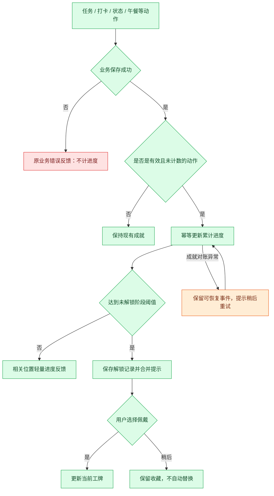

# F09 离谱职称

- 版本：v1（2026-11-05）。
- 状态：需求候选计划，未实施；仅授权写入文档。
- 用户明确方向：经常性的日常动作可以解锁称号，进度与称号可以累积。
- 下述称号、阈值、展示及计数方式为建议，待后续确认；不授权代码修改、提交、push 或发布。

## 目标与核心循环

把用户原本就在做的动作变成轻量收集：做一次有反馈，跨天使用有进度，积累后获得更离谱的职称。无需为了领称号多点一个签到按钮。

日常动作 → 累计有效进度 → 解锁称号 → 自选佩戴 → 查看下一阶。

短目标提供经常获得反馈的机会，长期目标提供积累感。不是每点一次按钮都发奖；未达阈值只在相关操作完成后短暂显示进度，不主动打断操作。不设置断签扣进度、限时绝版或公共排行榜。

## 首版入口与展示

- 模块库提供可选「职称柜」卡片：当前佩戴职称、最近解锁及一个置顶的下一目标。
- 小牛旁可显示一枚已佩戴职称；默认不自动替换新称号，未选择时不强制占位。
- 点击职称柜展开收藏列表：已解锁/进行中分组；用图标、进度条与锁定状态表达，条件点击后查看。
- 一次只能佩戴一个职称，支持卸下；同一称号只收藏一份。
- 第一版不改顶栏一期数据，不自动把职称塞进顶栏；小游戏、牧场和小票上的展示另行确认。

## 称号体系与累计规则

同一系列不同阶段使用独立稳定 ID，解锁低阶后继续累计高阶；收藏保留全部阶段，不吞掉旧称号。阈值是首轮建议，不代表已经验证节奏合理。

| 系列 | 有效动作与去重单位 | 第一阶 | 第二阶 | 第三阶 |
| --- | --- | --- | --- | --- |
| 活儿终结者 | 不同任务首次进入完成状态；按任务 ID 去重 | 1 件：这活我熟 | 10 件：待办清道夫 | 50 件：需求终结者 |
| 打卡营业部 | 本地自然日内首次成功上班打卡；按日期去重 | 1 天：今日已开机 | 5 天：工位常驻嘉宾 | 20 天：营业部编外主任 |
| 准点撤离学 | 成功下班打卡，时刻位于规定下班后 0–10 分钟；按日期去重 | 1 天：到点就走 | 5 天：准点撤离专家 | 20 天：下班时间管理大师 |
| 情绪观察站 | 当天首次保存一个有效精神状态；按日期去重 | 1 天：状态已上报 | 7 天：情绪气象员 | 30 天：精神状态研究员 |
| 午餐决策局 | 当天至少一次有效午餐抽选；按日期去重 | 1 天：今天就吃这个 | 5 天：午餐决策委员 | 20 天：中午吃啥局局长 |
| 周五生存学 | 当地周五有成功下班记录，且当天是排班工作日；按日期去重 | 1 天：周五幸存者 | 4 天：周末接引员 | 12 天：星期五荣誉居民 |

说明：

- 首版建议以上 6 系列、18 个称号；打卡相关系列仅在具有对应有效事实时计数，不根据打开应用或系统时间推断已经上班/下班。
- 「准点」10 分钟窗口是玩法阈值，不是公司考勤合规判断；没有可靠排班终点、非工作日或全天请假不计该系列。跨夜排班支持范围在实施前核对。
- 补录记录以其业务发生日期和时间判断，记录来源不影响资格；同一天补录、编辑或删除重建不获得第二次日计数。补录可以在保存时一次解锁多个阶段，合并展示。
- 午餐重抽不重复累计；状态当天修改多次不重复累计；任务取消完成后再完成不重复累计。
- 连续使用可作为未来单独玩法，本期只做累计天数，周末、请假和忘记打开应用不会重置进度。
- 不以任务文字长度或主观难度评判贡献，不强迫读取或分享任务内容。

### 带薪拉屎联动候选（后续）

待 F01 实施且计时口径确定后，可以新增一条系列：

| 有效动作 | 第一阶 | 第二阶 | 第三阶 |
| --- | --- | --- | --- |
| 当天至少一条已结束且有效偷出时间大于零的拉屎记录，按日期去重 | 1 天：临时工位体验官 | 5 天：带薪蹲班专员 | 20 天：瓷器办公研究员 |

不按蹲坑分钟数、次数或单次最长时长排名，不鼓励久蹲。取消、待核对、保存失败以及无有效时长的记录不触发。此系列依赖 F01，不在未实施时虚构进度。

## 经常性反馈与长期积累

- 首次有效动作即可有第一枚称号；首阶后展示下一阶进度，例如「待办清道夫 6/10」。
- 达到阶段阈值只解锁一次，已达最高阶后进度可继续累计，显示「累计完成 68 件」，不临时生成未经设计的新称号。
- 每次有效动作只在其相关位置短暂显示一次增量，例如「情绪气象员 4/7」；提供关闭日常进度反馈的设置建议，解锁记录仍保留在职称柜。
- 非解锁时不每次全屏庆祝，不把剩余目标做成红点催促。
- 阈值节奏需用户体验后调整，规则必须版本化；上线后不能改名改阈值就抹掉已获得的称号。

## 解锁、佩戴与趣味文案

| 场景 | 文案候选 | 行为 |
| --- | --- | --- |
| 新职称解锁 | 恭喜，工位履历又厚了一页。 | 展示职称名与触发条件，允许稍后查看 |
| 任务系列 | 这次不是画饼，是真做完了。 | 仅用作短副文案 |
| 上班系列 | 营业记录，逐渐离谱。 | 不评价早到或加班时长 |
| 准点下班系列 | 下班这门学问，你有点东西。 | 不把提前离岗包装成准点 |
| 精神状态系列 | 状态不必满格，记录就算数。 | 不奖励特定心情，所有有效状态等价 |
| 午餐系列 | 今日重大决策，已完成。 | 不鼓励重复抽取 |
| 佩戴成功 | 职称已挂，继续随意。 | 原位置立即更新 |
| 无收藏 | 第一枚职称，藏在下一次日常操作里。 | 展示可达成条件，不新增强制签到 |
| 记录保存失败 | 本次进度未保存，请重试。 | 保留重试上下文，不展示已解锁 |

解锁反馈建议使用不遮挡操作的小横幅：图章、称号名、「佩戴」「稍后」；无需用户处理才可继续工作。横幅约 4 秒后收起，职称柜中保留未读记录。新称号佩戴由用户主动选择；不与其他设置争夺焦点。

## 动画方向

- 解锁：一张小工牌从侧边滑入，盖上「获聘」章，称号文字出现；总计约 700–1000ms，不播放全屏撒花。
- 累计进度：进度条从旧值平滑更新至新值，约 200–300ms，固定数字宽度；不播放持续循环动效。
- 佩戴：小牛身旁工牌短暂亮起一次，保持原有布局稳定。
- 多称号同时解锁：合成一条「新获聘 3 个职称」反馈，点击展开列表，不连弹多个通知。
- 下班打卡同时解锁时，小票优先呈现；称号反馈延后或仅在职称柜留记录，不叠加遮挡。
- 减少动态效果模式改为静态状态切换；失焦时不播放，重新打开不补播一串历史动画。
- 首版默认静音，不高频闪烁；系列以图案及文字共同区分，不仅依靠颜色。

## 数据、去重与业务边界

建议维护独立成就数据：规则版本、有效动作标识/日去重标识、累计进度、解锁记录（称号 ID 与解锁时刻）、当前佩戴 ID、未读解锁 ID。具体类型及存储方式待技术方案确认，不复制任务或薪资全文。

- 仅业务动作成功持久化后评估成就；业务失败不加进度，渲染完成或点击次数不能作为奖励依据。
- 业务事实与成就记录需要原子保存，或使用可恢复的幂等事件机制，二选一在技术方案确认；不允许业务成功但重试造成重复计数。
- 任务按稳定任务 ID、日系列按日期与系列 ID 去重，解锁按称号 ID 去重；重复事件、应用重启和重复导入均不能重复发奖。
- 成就记作已发生动作的纪念：正常成功后再取消完成、删除任务或编辑历史，不回收已解锁职称，也不允许重做同一个去重单位刷进度。该规则需在帮助中明确。
- 对任意导入数据，不能仅信任其提供的累计数；校验数据结构、规则版本和称号 ID。导入究竟替换还是合并，必须沿用项目已有备份语义，不能擅自新增合并策略。
- 首版建议从功能启用后开始累计，避免历史完成事实不完整导致虚假回溯；已有存档不一次性补发未知历史称号。启用后提交的补录可按前述规则计数。
- 本机成就不是防作弊系统；不上传数据、不做账号验证，也不承诺抵抗用户修改本地文件。
- 成就反馈失败不能阻断主业务保存；若采用可恢复事件方式，重启后重试对账，但不重复弹已经展示过的反馈。
- 隐藏职称柜、卸下职称不清除进度；备份导出需包含成就记录。完整恢复旧备份可能回到旧进度，应明确其属于备份恢复结果。
- 不修改实际工资、偷出时间、任务进度或打卡状态，不用领取称号作为完成业务动作的前提。

## 流程

图中对账恢复仅适用于最终选择的事件方案；如采用原子保存，须在技术方案改成统一写入失败流程，不能宣称已有事件基础设施。

## 首版与后续

首版建议：6 个系列、18 个固定称号；累计进度、收藏柜、自选佩戴、轻量解锁反馈和本地备份兼容。无需新增在线服务。

后续候选：F01 上线后的蹲班系列、手动查看个人职称时间线、称号工牌图片导出、小游戏成绩系列。小游戏要待玩法和持久化规则确定后接入，不在首版虚构达成事件。

本期不做随机称号、AI 自动命名、每日强制任务、连续签到奖励、付费稀有度、公共排行榜或自动分享。

## 维护与实施前核对

- 核对现有任务完成奖励、精神状态连续记录/壁纸奖励，避免同一动作弹出两套互相竞争的庆祝。
- 复用当前趣味卡片入口、受控主进程命令、持久化与动效偏好；规则定义与进度评估独立于 UI。
- 称号以稳定 ID 关联素材和文案；新增同类称号原则上扩展规则表，不复制条件判断到各个按钮。
- 动作资格由业务事实提供，评估器不自行重算薪资或考勤；数据保存、兼容和恢复方式须单独提出具体方案。
- 本计划尚未完成专项竞品与实现源码调研，不能直接认定现有架构已满足幂等事件或原子事务要求。

## 验收清单

- [ ] 各系列首阶、中阶、最高阶与超出最高阶的累计值正确。
- [ ] 任务重复完成、当天多次打卡/重抽/改状态、重启及重复导入不刷进度。
- [ ] 工作日、周五、准点窗口、补录、跨日及不完整排班边界符合规则。
- [ ] 任意有效精神状态同等计数，不奖励正面情绪、不因负面状态扣进度。
- [ ] 主业务或成就保存失败可恢复，不能出现重复解锁或虚假成功。
- [ ] 佩戴/卸下、历史收藏、未读状态与隐藏模块后的累计行为一致。
- [ ] 多项同时解锁和下班小票同时触发时不连弹、不遮挡主操作。
- [ ] 减少动态效果、静音与小尺寸卡片状态完整。
- [ ] 旧数据、备份导入导出、规则升级及已解锁保留策略正确。
- [ ] 实施时完成相关逻辑测试、类型检查、构建和唯一的本地实例检查；视觉与功能体验待用户验收。

## 待讨论确认

称号名字与阈值、首版系列数量、从启用后累计的策略、删除/编辑不回收的纪念规则、职称柜与小牛旁的展示位置。确认后再提交具体交互与技术实施方案；本次不启动应用。
