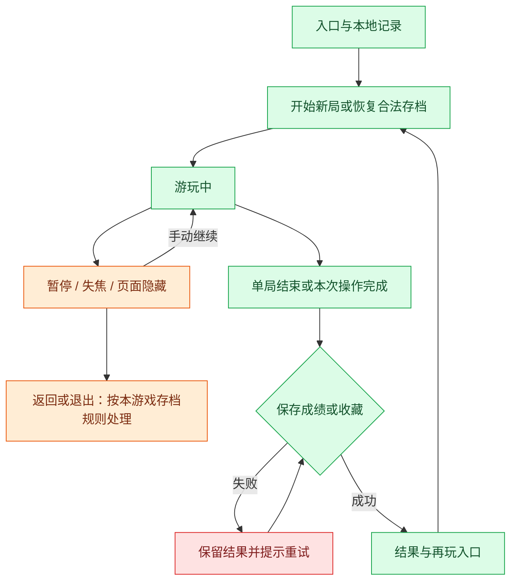

# G01 小牛接草

- 版本：v2（2026-11-05，展开玩法、文案与动画）。
- 状态：候选计划，未实施；参数、素材与可玩性尚未验证。
- 授权：本对话只讨论计划；写入本文不授权开发、安装依赖、提交、push 或发布。
- 来源边界：以下为讨论构想与建议规则，不代表用户已批准所有设计；未完成专项竞品、源码或许可证调研。

## 目标与首版范围

30 秒的接物挑战。小牛左右移动接草，躲开公文包；适合短时间主动玩一局。

## 入口与布局

建议从首页可选「摸鱼游乐场」卡片进入独立游戏面板，首页只放入口和简短个人记录，不直接运行多个游戏。面板保留返回、暂停/继续、重开和必要的成绩区。具体面板形式与尺寸在后续交互方案确认。

布局、图形、选中/禁用状态优先表达规则；首次进入提供一行操作提示，可随时查看帮助。错误、关键操作后果和未保存状态必须明确展示。

## 核心规则

- 草团：接到 +10 分；奶茶：+20 分，不附加复杂技能。
- 公文包：碰到扣 10 分，最低为 0；显示「临时加活」，不延长游戏或真实工作时间。
- 漏接不扣分，不设生命值，30 秒有效游玩时间结束统一结算。
- 每 0.8–1.2 秒生成一件物品；草团/奶茶/公文包初始权重建议 70%/15%/15%。速度固定，先保证可辨认和可躲避；参数待试玩。
- 同一物品只结算一次；仅小牛接物区与物品相交时判定，不以装饰边缘碰撞。

## 操作方式

方向键或 A/D 移动；鼠标在场地内移动也可控制位置。屏幕底部提供左右按钮，长按连续移动。每次只响应最近使用的输入方式，防止鼠标与键盘抢控制。

输入仅在游戏面板有焦点时生效，不抢全局快捷键；弹出确认框时冻结游戏输入。窗口改变大小时建议先暂停，调整场地后再由用户继续，避免坐标变化影响判定。

## 趣味文案与动画

| 场景 | 文案候选 |
| --- | --- |
| 开始 | 今天的草料，自己接。 |
| 接到奶茶 | 续命成功。 |
| 碰到公文包 | 怎么还有临时任务！ |
| 结算 | 本轮草料已入筐。 |

小牛移动时轻微倾斜，草落入筐后缩小消失，分数在命中位置短暂浮出；撞到公文包仅局部顿一下，不闪屏。结束时篮筐轻落地，展示得分和本地最高分。

通用要求：默认静音；减少动态效果时取消装饰、翻转、视差及夸张弹跳，保留玩法必需的位置变化和清晰静态反馈。反应类游戏不承诺可完全取消运动。说明或播报不逐帧更新，不用高频闪烁制造刺激。每次最多一句趣味反馈，成绩与操作优先。

## 暂停、退出与存储

保存个人最高分；主动退出本局不保留，退出前简短确认，取消则保持暂停；切后台保留内存中的暂停局，重启从新局开始。

所有游戏在窗口失焦、最小化或页面隐藏时自动暂停；返回后显示「继续」，不自动突然恢复。计时以有效游玩时间为准，不补算后台经过时间。主动暂停不会产生分数或奖励。

持久化仅通过现有主进程受控接口；存档版本、输入校验、默认值与旧数据兼容在技术方案确定。保存失败显示「成绩未保存」或「收藏未保存」，保留可重试数据；读档失败先提示，不静默覆盖原存档。

## 与业务模块的边界

- 不修改任务、考勤、计薪收入或现有偷出统计；游玩时长不自动计入偷时间。
- 与带薪拉屎计时并存时，游戏暂停或结束不控制拉屎记录；偷出时间仍由 F01 的业务规则独立计算。
- 不用工资金额做下注，不引入付费、广告、公共排行榜或连续签到惩罚。
- 不打断真实上下班流程。若下班小票呈现，当前游戏应暂停并让出焦点。
- 第一版无跨游戏货币或强制串联；接入牧场、主题或其他奖励需另列方案。

## 状态流程

图示为通用生命周期；本游戏是否支持恢复、退出是否丢失本局，以前述存档规则为准；钓鱼的结果节点指每竿结算，解谜与翻牌则指关卡结束。

## 实施与维护边界

- 后续先检查当前 `src/renderer/features/fun/`、首页模块机制、动效/减少动态设置及主进程存储契约，复用已验证的入口和基础控件。
- 玩法状态、规则计算和表现层分开；计分、随机来源、时钟和暂停行为应可独立验证，渲染不直接写业务数据。
- 每个游戏使用独立状态与存档命名空间；只共享已证实相同的暂停、面板和存储能力，不提前搭建大型游戏框架。
- 物理、绘图或额外素材依赖均待评估；本文不授权引入新引擎或复制外部素材。

## 验收清单

- [ ] 专项规则：30 秒结束、分数下限、漏接无罚、边界移动、长按释放、一次碰撞只记一次，以及不同帧率下速度一致。
- [ ] 开始、暂停、手动继续、退出、重开及重复输入符合约定。
- [ ] 切后台和窗口缩放不推进游戏，恢复后不瞬间丢失反应机会。
- [ ] 成绩/收藏去重持久化，保存失败可重试，损坏数据不静默清除历史。
- [ ] 键盘焦点与鼠标操作清晰，减少动态效果、默认静音和小窗口布局可用。
- [ ] 游戏与真实考勤、工资、偷出时间隔离，下班小票优先呈现。
- [ ] 实施时完成相关规则测试、类型检查和构建，检查本项目唯一的本地实例；视觉与玩法体验待用户验收。

## 开发前待确认

是否选择此游戏进入首版、上述规则参数与存档取舍、具体面板布局、原创素材和动画节奏。随后提交该游戏的具体交互与技术方案，获明确批准后才能实施；本轮不启动应用。
