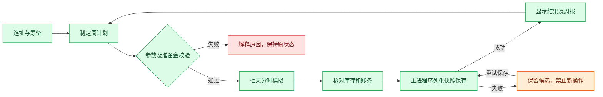

# G09 狗牛咖啡馆 — v2 实施记录

## 当前范围与授权

用户确认 v2：参考 BizCafe 的经营决策循环，从选址、筹备、每周计划到分时模拟和报表；明确追加“所有代码模块化、为持续扩展留接口”。本次没有提交、推送或发布授权。

首阶段：三处铺位，三种饮品，两类员工，店主排班，两个机型，座位与定位，品质采购、分批到货、临时采购、保鲜损耗、定价、营销、周报、资产负债、有限贷款、设备处置及停业清算。八周为阶段目标，之后允许继续，最多保留最近 52 份完整周报。

v2-F1：用户批准修正设备指令的 TypeScript 空值检查，以局部引用保留已验证店铺。
v2-F2：用户批准修正资金不足测试场景；使用四类原料各 100 包及写字楼铺位，确保实际预算超过可用资金。

## 入口与交互

主窗口摩天轮 → 游乐场 → 狗牛咖啡馆。选址后签约不可换址。经营页包含本周计划、经营手记和店务。经营计划分菜单、排班、采购、推广四组，按需打开帮助。经营结果和资金操作自动持久化；未提交的计划编辑保留在当前游戏页面内，退出游戏不保存草稿。

原创新 SVG 街角插画；所有样式限于 `.cf-*`。店铺采用固定纸色场景，与宿主亮暗主题隔离。角色列和时薪标签跟随员工目录生成。视觉及玩法体验由用户验收，不以 build 代替。

## 模块与依赖

| 位置 | 职责 | 后续同类变更 |
| --- | --- | --- |
| `src/shared/cafe/types.ts` | 内容、计划、状态、账务及请求契约 | 新实体先定义稳定 ID 和契约 |
| `content.ts` | 铺位、配方、原料、设备、员工配置 | 增加目录条目，避免名称/数组下标决定规则 |
| `demand.ts` | 客群、价格弹性、定位与推广影响、种子随机数 | 新客群、竞品/市场需求模型 |
| `operations.ts` | 排班产能和全周准备金 | 新岗位能力、营业政策 |
| `inventory.ts` | 在途、先进先出、耗用成本、到期与品质 | 冷藏能力、供应商、更多原料 |
| `finance.ts` | 整数分、平衡分录、资产负债恒等式 | 新费用科目/财务报表 |
| `simulation.ts` | 调度七天逐时段模型，返回完整新状态 | 事件系统、时段策略接入编排 |
| `commands.ts` | 开店、资金、设备及清算的纯状态变换 | 新经营指令只经统一写入入口 |
| `state.ts` | 新游戏、完整载入校验与计划校验 | 存档迁移集中在此入口，禁止页面自行补值 |
| `src/main/cafe.ts`、`main.ts` | 幂等、版本冲突、候选锁、可信 IPC、共享队列、保存及诊断 | 复用既有 Repository，不另建数据文件 |
| `renderer/.../cafe/useCafe.ts` | 请求串行、关联编号、结果不确定时原请求重试 | 不在 React 中计算真实收入/库存 |
| `Setup/Plan/Report/Office/Scene.tsx` | 对应交互和纯呈现 | 新经营页局部增加，不扩写根组件 |

依赖方向：界面 → 类型/目录/只读预算；主进程 → 指令 → 模拟 → 需求/产能/库存/账务。领域层不依赖 Electron、DOM、系统时间、网络或全局 `Math.random`。财务和库存没有第二套 UI 真值。继续扩展采用局部模块和显式参数，不引入尚无实际用途的插件框架。

资产登记簿独立保留每项资产的账面净值及每周折旧额。后续烤箱、冷柜可使用独立资产 ID；咖啡机更换仅处置当前机型对应资产，不能误扣装修价值。

## 存档和扩展规则

- `dogcow.cafe.v1` 纳入现有快照、导出、恢复白名单；独立咖啡馆资金，不与狗牛币兑换。
- `version` 表示数据结构，`rulesVersion` 表示模拟规则，`contentRevision` 表示内容目录版本。当前三者为 1；任何后续升级必须提供明确迁移，不能静默重建用户存档。
- 存档记录稳定内容 ID、初始种子、状态修订号、最近 128 个操作编号、批次成本和品质、资产及最近 52 份周报。
- 加饮品/原料/岗位：目录、契约及相应规则局部扩展；已有用户的旧计划与历史周报也需要迁移补齐新增字段。新增 ID 不得替换旧 ID；移除内容应保留兼容读取或实施迁移。
- 新规则先在纯领域函数实现，再接入指令和界面。更新 `rulesVersion` 时保留历史报表，不用新系数重算旧结果。
- 当前对未知结构、规则或内容版本拒绝写入；不支持的版本和损坏数据保留原始字节，通过现有备份恢复流程处理。
- 周结算是一条原子业务指令。重复操作编号不重复结算；过期修订号拒绝；保存失败保留候选且锁定新写入，重试仅保存相同候选。

## 模型口径与限制

- 初始资金 ¥100,000，贷款余额上限 ¥30,000，周息 0.15%。价格、租金、系数均为游戏参数，未经实际市场数据校准。
- 一周七天、每日三段可选班次，每段四小时；店主每日最多两班且不领工资。未实现个体招聘/离职、劳动法规、税务或支付账期。
- 租金按月租×12/52，每周计费并付款；签约支付两个月可退押金。装修设备资本化，按各自寿命折旧。租约及清算是简化模型。
- 全周支出必须预留，未发生营业收入不能用来覆盖准备金。原料采购先记库存，耗用/报废才计费用；贷款本金不计损益。
- 计划采购拆成三批，在周二/四/六到货；临时采购可选预留，加价 50%，次日到货；未使用预留不扣现金。
- 配方按份消费；原料批次带实际成本和品质。品质宣传影响购买意愿，实际出杯满意度按已有豆批次品质及新鲜度计算。
- 客群选择、价格、品质、推广、定位、竞争、口碑影响购买；杯型固定。天气与工作日/周末影响人流。
- 排队按到店顺序计算制作与人员工作量；每小时重置工作队列，不能在本小时内完成的需求归入排队流失。座位占用跨小时延续，闭店时清空。并非精确的逐秒排队系统。
- 店铺插画为经营背景，当前没有随分时日志播放的顾客进出动画；结算直接返回周报。多店、自由装修、动态竞争对手、随机管理事件待后续独立方案。
- 周报最多保留 52 周；非周经营分录最近 256 条。累计资产和损益不因历史明细裁剪而重置。

## 参考与采用边界

- [BizCafe 官方](https://www.interpretive.com/faq-for-bizcafe/)：经营周、采购、人事、价格、营销及报表；机制参考，未复制受保护内容或私有公式。选址为本游戏扩展。
- [Nezz/lemonade-tycoon](https://github.com/Nezz/lemonade-tycoon/blob/99c1df19450ead9dedb961ab235b6d5c7e3f8684/engine/simulation.ts)：MIT，参考日计划与库存批次，无直接代码采用。
- [tigerpointe/Lemonade-Stand](https://github.com/tigerpointe/Lemonade-Stand/blob/b3d98d98b69aa74f068bb364c77d75d2e077f2ac/lemonade.py)：MIT，参考需求曲线，无直接代码采用。
- [coffee-flow](https://github.com/dave-hillier/coffee-flow/blob/c8d8e6c78955c40b1fa012fd21d054968edc15ef/src/sim.js)：参考产能及确定性模型，未确认许可证，未采用代码。

## 验证与交付状态

2026-11-17：`dev` / `origin/dev` 均为 `4d89383`，多轮 fetch 无当前上游更新。保留已有发布、便签及市场修改，不提交本地 Agent 文件；无 commit/push/发布。

- `npm run build`：通过（类型、renderer、Electron）。
- `node --test tests/desktop/cafe.test.mjs tests/desktop/game-progress.test.mjs tests/migration/*.test.js`：39/39 通过（咖啡馆 16、游戏进度 11、迁移 12），包括真实 Repository 写入失败及重试。
- `node scripts/calibrate-cafe.mjs`：三处铺位各 12 种子×8 周，共 288 经营周，参考策略均累计盈利、现金非负、账务平衡、存档可重新载入；不是市场实证或难度验收。
- 新增饮品不修改模拟引擎的扩展测试通过。设备资产、现金/利润区分、库存先进先出、在途/过期、重复/过期请求、损坏存档和临时补货已覆盖。
- 最终维护性 review：已检查模块依赖、指令/存储职责、稳定 ID、角色列扩展、库存成本、独立资产及账务恒等式、样式作用域和无关 diff；删除重复库存品质计算与冗余报表字段，主进程承担实际存储适配。
- 本地实例：已结束确认属于本项目的旧进程树，使用 `npm run dev` 启动最新实例；已观察 `app-ready`、`protocol-ready`、`main-dom-ready`、`main-loaded`；游乐场入口 HTTP 200，确认一个 dev 启动进程及一个 Electron 主进程。视觉与玩法待用户验收。
- 本任务实现修改累计 6 轮。没有新增运行依赖；仅临时调用固定版本 Prettier 格式化新增文件。

## 本轮 dev 交付

用户已明确授权将狗牛市与咖啡馆一并提交并推送 dev。通过基于最新 origin/dev 的隔离检出校验提交范围；不包含本地 Agent 指令、发布配置或便签样机。技术验证和用户视觉/玩法验收分开，推送 dev 不代表正式发布。

提交仅保留最终校准Markdown摘要；完整JSON、中间失败快照和截图是本地生成材料，不纳入本次源码提交。详细结果可运行校准脚本重新生成。
