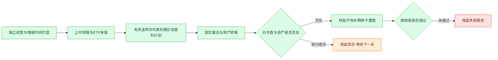

# 狗牛市 G08 — v2.2 交易接入 / v2.3 分析图表

用户已确认：240 家公司、12 行业、18 只 ETF、12 策略，先校准、再试跑。当前只实现独立模拟引擎与校准，不修改真实钱包或游戏存档。

> 上述为v2/v2.1历史范围。用户随后以“接上吧”批准v2.2，以“是MACD，按此接上”批准v2.3；当前本地入口、钱包、持仓、存档和分析图表均已实现，见文末。

## 机制与边界

- `src/shared/market/model.ts`：整数百分之一狗牛币、证券/公司/基金/账户契约、公开财报估值与可重复随机数。
- `auction.ts`：每分钟统一价集合竞价、跨证券预留现金/股份、撮合与手续费。无对手盘不改变价格；拒绝无效委托，不允许负现金、裸卖或自成交。
- `simulation.ts`：240 家公司、18 只实际持仓 ETF、300 个账户（含分群散户资金池）、12 种策略。每分钟报价，每30分钟经营，每240分钟披露与分红。
- 公司参数按经营阶段约束；需求、产能、成本和债务影响经营。经营亏损耗尽现金后，未付义务累积为负债并收缩产能，不向交易账户发放救助资金；破产退市暂缓。
- ETF 初始篮子固定，净值包含真实底层股份与基金现金；实物申赎转移股份与现金，不能凭空创建资产。做市账户根据折溢价调整库存，仍需对手盘才能赚到差价。固定篮子、无定期调仓是本轮校准边界。
- 所有策略只接收公开信息。主力影响由资金与持仓决定；量化、价值、成长、红利、反转、趋势、轮动、事件、游资、情绪与做市分别使用不同规则。
- 行情历史限289点，新闻限100条。纯计算，不读取系统时钟、网络、钱包或存储。ETF单份由多只成分股组成，单价较高；正式接入前需校准对普通钱包的购买门槛。

## 重现与参数选择

```sh
npm run build:electron
node --test tests/desktop/market.test.mjs
node scripts/calibrate-market.mjs
```

`--smoke` 仅用于快速执行检查，不能替代完整校准。训练种子11/29；回归及扩展场景101/202/401/502，长周期303/603；等资产和小钱包701/809。比较三组参数后只用训练结果选择。v2.1报告位于 `output/dogcow-market/v2.1/calibration.{json,md}`，原v2报告保留在上级目录，两次中间失败结果保存在 `attempt-1/2.{json,md}`。阈值失败退出码2，逻辑异常直接报错。

最终模型冻结后另以从未参与修正的1009/1201（5场景）及1601（7日）运行11组验证；结果及源码SHA256在 `fresh-holdout.{json,md}`。401/502/603已用于迭代反馈，最终验收不将其冒充未见样本。没有更改原八项目标阈值。

验收包含：跨种子资金和股份守恒、现金持仓非负、ETF资产支撑与折溢价、分红除息、报价预留、无自成交、可重复性、公开信息边界、成交率、长时间无成交占比、手续费损耗、极端波动和计算耗时。

## 后续集成前的门槛

校准报告诚实保留失败项。不同策略初始资产不同，NPC汇总收益仅描述市场结果；已补22组等初始资产对照、按每次实际行情计价的不交易基线、6组普通钱包试验。各策略仍影响自己的价格路径，对照不是同一固定行情的策略排名。两组种子不足以证明策略均衡或正式钱包经济平衡。

本轮不包含：真实钱包接入、持久化/迁移/备份、玩家委托队列、保存失败恢复、ETF调仓、离线推进与游戏页面。正式接入复用现有 Repository 原子保存、共享命令队列和钱包确认边界；菜单、页面与钱包接口细化后按项目流程确认。应用运行时后台市场与游玩时长统计需要分开，不改变其他游戏的暂停规则。

视觉与功能体验待用户验收；模拟通过不代表游戏已可玩或已发布。

## 首轮实测与第二轮 review

- 分支 `dev`，首次写入前 fetch 后 HEAD/上游均为 `4d8938364d44cbbf6bf9ac1697b53871e2cfb5fb`，无上游更新。已有8个跟踪文件修改及其他未跟踪文件保留，未修改真实钱包、主进程和游戏入口。
- 桌面编译、全项目类型检查、renderer生产构建、9项市场业务测试通过。业务测试覆盖公开/私有财报隔离、跨证券预留、分红除息、ETF申赎、固定种子重现，以及5场景跨财报期守恒。
- 完整校准执行6组训练、10组单日留出场景、1组七日场景，共28800个模拟分钟。选定 patient 参数，所有场景资金与份额守恒；留出单步P95约0.48–1.30ms。常态委托数量成交率约10%，超过30分钟无成交股票采样占比约4%。
- **未通过**：14个阈值失败，归为下列3个独立问题。失败保留在 `output/dogcow-market/calibration.json` 与 `.md`，脚本退出码2。

| ID | 证据 | 源码/replay分析 | 状态 |
|---|---|---|---|
| M01 ETF脱锚 | 单日常态绝对折溢价P95约12%–22%，七日156.55% | `arbitrageFunds`只按折溢价做单份库存转换，无配套买篮子、买ETF、出售所得资产的订单计划；行业ETF做市商通常缺少完整篮子，无法恢复供给；ETF沿用股票增长/红利输入的零值，也会形成不合适的需求偏向 | 待修正方案确认 |
| M02 恐慌过强 | 两组单日指数分别-48.98%、-50.97% | 恐慌同时持续改变行业经营环境与情绪订单；行业变量直接影响经营、轮动和事件交易，冲击通过多个渠道重复放大 | 待修正方案确认 |
| M03 长期漂移 | 七日常态指数+127.46%，部分行业数倍上涨、另一些接近归零 | 披露时将含周期冲击的收入增长写回下一期结构增长，没有独立的长期增长锚与市场容量约束；现金积累也持续进入估值 | 待修正方案确认 |

第二轮静态review覆盖3个引擎文件、校准脚本与测试：引擎无界面/存储依赖，固定数组索引与契约一致；策略规则集中，未引入依赖或重复钱包逻辑。存在上述机制缺口，不能宣称验收通过。`stepMarket`的撮合注释声称ETF撮合前重算净值，但实际只在全部撮合后重算；当前委托统一基于开盘信息，这一注释应随M01厘清。收益表不是策略平衡证据：初始资产不同、不同分支消耗随机数也不同，行业路径不是严格控制变量实验。

## v2.1 修正方案（用户“修正”批准，已实施）

1. M01：ETF独立使用净值/成分股聚合的公开指标；做市商按净值形成报价，并在库存和资金约束下执行完整多步套利计划。溢价时买入所缺篮子、实物申购、出售ETF；折价时买ETF、赎回、出售篮子。仅已成交资产可进入下一步，不保证成交、不凭空注入资金、不强制改成交价格。新增申赎失败/部分成交/库存耗尽测试。
2. M02/M03：拆开结构增长、均值回归的行业景气与短期市场情绪。经营增长向公司阶段和竞争力决定的长期锚回归，受市场容量约束；恐慌情绪按明确持续时间衰减，永久经营损失另由事件表达。保留真实亏损、反转失败和个股分化，不通过硬改指数或放宽阈值通过校准。
3. 校准增强：经济随机流和交易随机流分离；增加等初始资产、同市场不交易对照和普通钱包规模的交易实验；原失败样本用作回归，新增留出种子验证，保持原报告可追溯。
4. 修改边界：限本目录引擎、市场测试、校准脚本及本计划文档；保留用户数据。重跑类型检查、相关测试与完整模拟，通过后再细化玩家界面和钱包接入。



## v2.1 最终结果与独立第二轮 review

- 共新增4轮修改，任务累计5轮：首轮修正、ETF净值报价校准、报价库存/任务回执校准、适配多ETF任务并存的过期测试。每轮写入前 fetch `origin/dev`，始终0领先/0落后，HEAD未变；未触碰其他功能、钱包或本地Agent文件。
- `npm run build` 完整通过（类型检查、renderer生产构建、Electron编译）；市场业务测试16/16通过。中途咖啡馆并行工作曾导致编译失败，最后整体构建复核已消除该阻碍，未修改其文件。
- 最终版本56组训练/回归/策略与小钱包试验，加11组冻结后新种子，共67组模拟。61组非训练验证均满足原八项检查；资金、股份和ETF资产账守恒；不是针对所有未来种子的保证。
- 最终选定参数为 patient：`feeBps=5`、`spreadBps=30`、`orderFraction=0.003`、`fundamentalWeight=0.04`。**通过结论绑定此参数组**；引擎 `DEFAULT_PARAMETERS` 仍是对照用 balanced 参数，未来游戏接入必须显式使用选定参数并重新验收，不把所有参数组合宣称为通过。
- M01关闭：ETF由已披露成分股聚合基本面；参与者按净值报价，成交价仍只由撮合更新；做市目标库存按3倍常规报价量设置，只赎回超额库存，缺货通过实际篮子采购/申购补货。任务分获取/分发两阶段，通过成交回执扣减剩余量，60分钟过期时保留资产；不在同一分钟重开过期任务。股票腿随等待增加报价紧迫度（最大3.5%），ETF腿限1%净值偏离，承担实际成交风险。单日回归ETF绝对折溢价P95约0.62%–0.95%；冻结后新种子约0.64%–0.87%，均低于3%。个别瞬间仍可超过3%，通过的是原P95阈值。
- M02关闭：恐慌仅进入衰减的短期情绪，不直接改写所有企业长期收入路径；冻结后两组单日恐慌指数约-2.93%、-1.75%。
- M03关闭：经营结构增长独立，行业景气为均值回归的需求水平扰动，需求受企业市场容量限制，不将实际增长反复回灌；原七日种子303指数+12.96%，扩展603为+13.24%，最终未见1601为+11.68%。指数均不含分红。
- 第二轮review覆盖3个引擎文件、校准脚本及16项测试：无存储/网络/UI副作用，无新增依赖；资产变动继续集中在撮合、公司分红、实物申赎三个边界，任务订单复用现金/库存预留与撮合，不另造钱包逻辑。经济随机流与交易流分离测试通过；注释已与撮合顺序一致。未发现需增加本轮范围的冗余或职责冲突。
- README与计划归档边界已检查：仍无玩家页面或真实钱包接入，因此不将“狗牛市”写为已可玩或归档到已实现游戏。

### 保留的产品限制

1. **小额ETF门槛（待下一阶段方案）**：100/1000币试验账户均不能买1份ETF；100币只能买1–4家公司的1股，甚至可能整段无成交。10000币能买8–10只ETF。正式试玩前建议做份额面值/拆分方案，资产与净值守恒另验，不在本轮私自更改单位或送币。
2. 对照中单个策略变化曾造成不同的全市场反馈（例如701成长/趋势场景），市场具有路径敏感性；未证明策略强弱均衡，也未做长期真实用户行为验收。
3. 仍缺游戏UI、真实钱包、持久委托与保存恢复、ETF调仓、离线推进；视觉与功能体验待用户验收。本轮通过的是独立模型和所测参数/样本，不等于可发布。

## v2.2 已批准并完成的本地接入

- 入口：主窗口摩天轮 → 游乐场 → **狗牛市**（首位）。`registry.ts`懒加载`games/market/`，不替换已有咖啡馆、德州或钓鱼。
- 页面：市场/自选/持仓，258只证券检索、行业/ETF筛选、涨跌排序、真实趋势历史、公开财报、新闻、12种资金策略汇总、资金窗口、当前委托与成交记录。暖场240个历史分钟不含玩家资金；公开接口不暴露NPC持仓、公司隐藏经营数据或随机数状态。
- `src/main/market.ts`拥有市场状态。应用运行期间主进程每10秒检查单调时间，每分钟推进1轮；切换游戏、关游乐场、最小化不停止。休眠/长时间阻塞不补算，退出后重开续接保存的市场。暂停按钮明确为“暂停操作”；不靠renderer计时驱动交易。
- 市价委托下一轮撮合，股票3.5%/ETF1%参考价保护，剩余IOC撤销；限价持续有效。买单预留最坏手续费与本金，卖单预留股份；最多32笔，禁止同证券反向委托并存。所有玩家委托必须与真实NPC资产成交，玩家账户不会被AI代操。
- 钱包：`Coins.market`新增market流水，证券账户使用整数分，1狗牛币=100分。仅整币转入/转出，零头保留。余额、预留、持仓、成本与分红分别显示；无赠送启动资金、借款、杠杆或做空。
- 保存：复用主进程串行队列及Repository原子快照。未确认保存时展示之前的资产并锁定操作；重试保存不重做转账。请求ID+参数回执/过期水位阻止重放；renderer有持久outbox，丢失响应可重试原请求。未知服务错误保留outbox，不冒充明确拒绝。后台推进错误会阻断交易并提供重试/诊断。
- 恢复：`src/migration/market.js`是源代码迁移及运行时共用的深校验器，验证账户、订单、财报结构、ETF篮子、资金/份额守恒。损坏数据锁定保留，不创建新市场覆盖。迁移包必须同时带钱包；不带钱包的老包保留本机钱包及市场状态。
- ETF：每个原交易份额拆为1000份，底层篮子不变，一级申赎只接受1000份的整数倍；二级市场可交易1份。主进程使用明确的patient校准参数。新游戏实测最低ETF约5.69币；两组小钱包试验100币可买17只、1000币可买18只。原v2.1的小额ETF限制关闭。

### v2.2 技术验证

- `npm run build`通过：全项目类型检查、renderer生产构建、Electron编译；产物中存在market独立页面chunk。
- 46项原市场/钱包/时长/德州兑换相关测试通过，10项新增`market-game.test.mjs`通过。涵盖ETF拆份/分红/完整篮子约束，转账待保存与跨重启去重，资金股份预留、撤单、真实成交成本归集、IOC/限价、过期/损坏存档、公开信息边界、单调时钟及真实Repository保存失败重试。
- `node scripts/calibrate-market.mjs --playable`完成56组训练、回归、等资产和小钱包试验，50组非训练试验均通过原八项目标；原v2.1结果保留。报告在`output/dogcow-market/v2.2/calibration.{json,md}`。该报告的生成模板标题仍写v2.1，但JSON`modelVersion=v2.2`及目录/执行方式可辨识，本次验证使用拆分后的实际模型。
- 新增存档典型约0.55MiB，低于20MiB迁移限制。业务测试使用临时目录/模拟钱包，不修改用户资产。
- 第二轮review检查契约→preload→授权→主进程队列→Repository→钱包确认、市场后台时钟、客户端outbox、样式作用域与生命周期。新增逻辑复用现有边界，无新依赖；保留咖啡馆、桌面便签、构建发布相关的已有修改。未提交、push或发布，本地Agent文件未暂存。
- 本轮代码新增3轮，任务累计8轮；首次及后续写入检查上游，仍为dev/4d893836，与origin/dev一致。一次fetch短暂SSL失败后重试成功，无引入上游提交。

### v2.3 分析图表（已确认，已实施）

用户追加“趋势图、K线蜡烛、各种均线、MAD”，并明确回复“是MACD，按此接上”，批准趋势/K线、MA5/10/20/60、成交量、MACD和十字光标扩展。

- `src/shared/market/indicators.ts`负责真实5分钟OHLCV记录、5/15/30/60分钟聚合、SMA/EMA与MACD。`stepMarket`在成交后记录观察到的开高低收与实际成交量，空成交保留零成交量；不复权，分红除息造成的价格缺口保留。记录不消耗随机数，不参与NPC报价或公司经营。
- 每只证券最多289根底层5分钟K线；按选择的周期计算均线。EMA用SMA起算，DIF=EMA12−EMA26，DEA=EMA9(DIF)，柱值=2×(DIF−DEA)，起算不足保留null，不画假零值。
- `AnalysisChart.tsx`提供趋势/蜡烛切换、5/15/30/60分钟、可见24/48/96/全部K线、独立均线开关、成交量和MACD副图、鼠标十字线及方向键逐根查看OHLCV。指标说明按需展开，当前未收盘K线明确标注。
- 新市场暖场改为480个无玩家资金的历史分钟，提供96根真实5分钟K线，MA60与MACD可起算。**旧存档仅含收盘价时不造历史K线**：显示原趋势，并提示从下一轮开始真实记录。较长周期的慢指标可能仍不足，显示“—”。
- IPC只给当前选择证券发送完整K线，其余证券保留原小趋势，避免每次轮询发送所有OHLC数据。切换证券请求详情，后端不暴露隐藏经营数据；持久化对旧存档的可选candles字段向后兼容并新增OHLC结构约束。
- 最终完整构建通过；85项市场/钱包/进度/兑换/游乐场测试、12项迁移、4项CSS检查共101项通过。新增指标测试以线性数列的解析结果验证DIF=7、DEA=7和柱=0，另核对真实拍卖成交量/价格极值、聚合守恒、容量限制及旧存档兼容。测试不触碰用户资产，未执行大量UI自动验收。
- 新市场实测：258只证券、96根5分钟K线、MACD可用、典型存档2552595字节（约2.4MiB），最低ETF约5.49币；低于20MiB迁移限制。旧v2.2的0.55MiB记录是加图表前的历史数值。v2.2校准报告标题已修正并使用独立目录，v2.1报告保留。
- 本阶段新增1轮，任务累计9轮。第二轮review覆盖真实数据记录→指标纯函数→详情IPC→图表呈现与键盘事件；K线有容量限制，不创建新的时钟、钱包或行情生成逻辑，不新增依赖。未发现需扩大本轮范围的问题。

视觉与实际玩法由用户验收；未执行大量截图、页面遍历或UI自动验收。技术通过不代表用户体验已通过。


## 本轮 dev 交付

用户已明确授权将狗牛市与咖啡馆一并提交并推送 dev。通过基于最新 origin/dev 的隔离检出校验提交范围；不包含本地 Agent 指令、发布配置或便签样机。技术验证和用户视觉/玩法验收分开，推送 dev 不代表正式发布。

提交仅保留最终校准Markdown摘要；完整JSON、中间失败快照和截图是本地生成材料，不纳入本次源码提交。详细结果可运行校准脚本重新生成。
