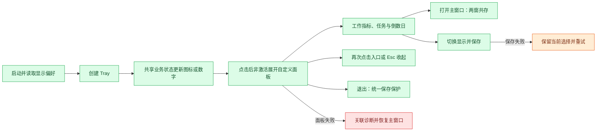
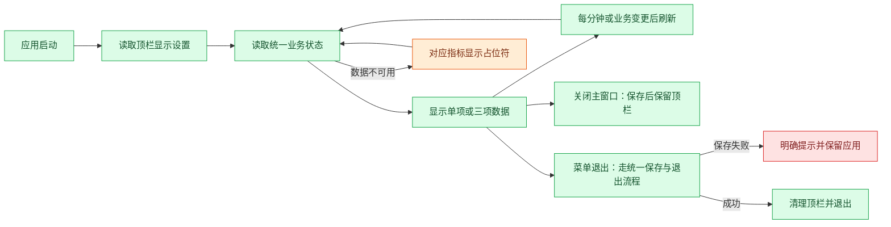

# F08 菜单栏状态面板

- 归档日期：2026-11-05。
- 当前方案：v7，含 v7.1 状态映射修正；用户已明确授权实施。
- 状态：已实现并推送，功能提交 `126e0100b826fc629b59079831f1732c8a928e98`。
- 发布边界：本次证据为源码提交，不据此认定已进入正式安装包。
- 用户验收：窗口层级与 Dock 图标消失问题已获用户确认修复；最终紧凑布局、颜色与动效仍待用户验收。

## 最终实现范围

- macOS 菜单栏默认显示应用狗牛吉祥物的单色剪影，可切换今日收入或下班倒计时，选择本地保存。
- 点击展开自定义 React 面板，带指向菜单栏入口的小尾巴；面板与主窗口独立显示，失焦不收起，再次点击入口或面板内按 Esc 收起。
- 关闭主窗口隐藏并后台常驻；退出图标和 Cmd+Q 走现有草稿、业务数据与窗口偏好保存保护。
- 面板显示今日收入、真实工作状态、已工作时长、下班倒计时、本月收入估算、今日任务进度及下一项未完成任务。
- 盼头复用已有日期与重复规则，最近三项优先，支持展开更多；新增/管理在主窗口复用现有编辑器。
- 打开主窗口与退出使用共用图标按钮，悬停与键盘聚焦提供提示；退出无常驻文字。
- 使用现有主题变量、emoji 和动效；逐秒数字不反复跳动，支持系统减少动态效果与应用关闭动效设置。
- 无薪资配置、计算失败、任务读取失败、节假日数据缺失、保存失败均保留对应状态或恢复入口，不用零值冒充成功。

## 代码职责与维护入口

| 位置 | 职责 |
| --- | --- |
| `src/main/tray-controller.ts` | 单一 Tray 生命周期、图标及标题差异更新 |
| `src/main/tray-panel-controller.ts` | 独立面板加载、显隐状态机、屏幕定位、箭头位置、错误恢复 |
| `src/main/main.ts` | 业务摘要组装、面板 IPC 来源/白名单校验、偏好及退出入口 |
| `src/main/window-state.ts` | 沿用窗口偏好的串行原子保存、损坏文件备份及重试 |
| `src/shared/tray.ts` | 显示契约、错误文案、受控命令、定位纯函数 |
| `src/shared/tray-summary.ts` | 任务、工时与盼头摘要；不创建另一套计价或定时器 |
| `src/shared/status-metrics.ts` / `income-status.ts` | 胶囊与面板指标格式化、首页共用真实状态文案 |
| `src/shared/hope-summary.ts` | 首页和面板共享盼头排序 |
| `src/renderer/features/tray/` | Header、Metrics、WorkStatus、TaskSummary、Countdowns、DisplayPicker、IconButton、Actions、Feedback、Arrow；hook 负责面板订阅与命令 |
| `src/renderer/features/fun/HopeManagerLauncher.tsx` | 从原生入口打开已有 HopeManager，不复制编辑表单 |
| `assets/tray-cow.svg` / `trayTemplate*.png` | 面板与菜单栏共用剪影，含 Retina 模板图 |

下一次新增指标优先修改共享摘要；改变窗口行为修改面板控制器；新增 UI 状态修改对应组件；不要把计价、日期规则或文件写入放进 React 组件。

## 诊断与已处理问题

- 首次展开曾调用 `setVisibleOnAllWorkspaces()`，进程类型转换可能短暂隐藏窗口与 Dock；现采用 macOS `type: panel` 和 `showInactive()`，移除转换调用与主动原生 focus。
- 主窗口的置顶偏好保持原样；用户已确认上述交互问题修复。
- 面板加载、渲染进程失败采用 `TRAY_PANEL_FAILED` 和关联 ID，恢复主窗口入口；保存失败保留当前选择并提供重试。
- 展开日志记录主窗口可见性、焦点、置顶及 Dock 状态，不记录薪资、任务标题和完整快照。面板异常详情可复制诊断。
- 工作状态按收入模型映射，不能由“存在数值倒计时”推断工作中；午休、上班前、待补卡均保留真实语义。

## 验证记录与边界

- 实施快照：类型检查、完整构建、33 项相关测试通过；其中包含工作状态、任务范围与排序、重复盼头规则、持久化与窗口生命周期。
- 推送前将暂存内容导出到隔离目录验证：完整构建、31 项相关测试通过。数量差异来自实施工作区另外两项工资换算器测试未纳入该提交；隔离验证不依赖这些本地改动。
- 提交与 `origin/main` 的 SHA 在推送完成时核对一致；未将本地 Agent 指令、输出和其他未提交功能夹带提交。
- `npm run dev` 唯一开发实例启动检查通过，HTTP 入口返回 200；不将启动与自动化测试视为视觉或完整用户体验通过。
- 最终 UI 的字密度、主题、动画、各类实际数据、跨屏/全屏、键盘体验与系统菜单栏空间限制仍待用户验收。
- 本次不包含开机自启、三项同时常驻标题、面板打卡、小游戏或跨平台同等菜单栏能力。

## 当前流程



## 历史 v1 方案（已被当前方案替代）

以下原文仅保留当时的一期讨论与约束；默认倒计时、三项模式、系统菜单、分钟刷新及“未授权实施”等历史结论均不代表当前实现。当前授权和验收状态以本文开头为准。

## 目标

不打开主窗口，也能随时查看收入和上下班状态。第一期保持轻量：一个图标、简短数据、系统原生菜单，不做自定义展开面板。

## 显示模式

### 单项模式（默认）

默认显示下班倒计时，格式为小时:分钟：

```text
🐮 下班 01:23
```

可在菜单切换为以下任意一项：

- 下班倒计时。
- 今日已赚估算，例如 `🐮 ¥128.60`。
- 今日偷出时长，例如 `🐮 偷出 18分`。

### 三项模式（可选）

```text
🐮 ¥128.60 · 下班 01:23 · 偷出 18分
```

第一期固定数据和顺序：今日已赚估算、下班倒计时、今日偷出时长；不增加任意组合、拖动排序或多入口。

示意中的牛图标仅表达视觉意图；实现时使用适配 macOS 明暗顶栏的简洁图标，文字保持紧凑。具体宽度、小屏及刘海屏空间适配待用户验收，不保证系统始终有足够空间显示完整三项。

## 点击菜单

使用系统原生菜单，选项以勾选状态表达，不堆放解释段落。以下为结构示意，分组采用子菜单：

```text
显示模式          > 单项 ✓ / 三项
单项内容          > 下班倒计时 ✓
                    今日已赚（估算）
                    今日偷出时长
────────────────────────
打开狗牛
退出狗牛
```

- 三项模式下「单项内容」禁用；保留上次单项选择，切回后恢复。
- 「打开狗牛」恢复并聚焦已有主窗口；窗口已销毁时按现有入口重建，不重复打开多个主窗口。
- 显示模式与单项选择保存在本机，重启后恢复。
- 默认单项倒计时，避免默认常驻暴露收入；用户选择三项或收入后按其选择显示，不擅自切换。

## 数据与刷新

- 复用主程序已有收入、排班、考勤和偷出时间计算，不单独维护另一套计时与金额累计。
- 正常运行时每分钟刷新；打卡、薪资/排班/请假设置变化或影响统计的活动结束后立即刷新。
- 这里的「实时」指业务事件触发更新及分钟级展示，不承诺秒级动态或系统睡眠期间持续刷新。
- 收入显示两位小数，沿用现有金额口径与舍入规则；偷出时长第一期按完整分钟显示，不向上虚增。长时长的紧凑格式在实施方案中确认。
- 主窗口关闭或隐藏后，顶栏仍从统一业务状态获取数据，不能依赖主窗口渲染定时器。
- 系统唤醒、日期切换后重新按时间戳和当前日期计算，不累计定时器触发次数。
- 拉屎计时第一期不自动抢占顶栏；未来 F01 实施后，其有效时间通过现有偷出合计体现，专门的活动计时入口另行确认。

## 状态显示

| 情况 | 展示规则 |
| --- | --- |
| 正常工作时段 | 下班剩余小时:分钟 |
| 到达规定下班时间但尚未打卡下班 | 已到下班时间，不显示负数 |
| 实际已下班 | 已下班 |
| 今日休息 | 今日休息 |
| 薪资或排班配置不完整 | 无法确定的指标显示 `—`，菜单仍可打开主程序 |
| 收入数据不可用 | 收入显示 `—`，不伪造为 0 |
| 偷时间模式关闭 | 偷出项显示 `未开启`，不展示旧累计冒充当前结果 |
| 数据加载或读取失败 | 对应指标显示 `—`；保留打开主程序入口查看和处理问题 |

如现有业务还有请假、待补卡等特殊状态，实施前沿当前状态定义确认映射，不在顶栏重新推断；无法可靠确定的值显示占位。

## 应用生命周期

- 点击主窗口关闭按钮后保留顶栏与后台进程，明确改变原有退出语义；顶栏菜单提供可发现的「退出狗牛」。
- 主窗口关闭、应用退出均须沿用现有草稿保存与退出保护，不能直接销毁尚未保存的编辑状态。
- 「退出狗牛」走应用统一退出流程，保存失败或存在未完成活动时按既有规则处理；不得绕过保存和核对机制。
- 同一应用进程只创建一个顶栏实例；明确退出后清理图标、事件监听与刷新定时器。
- 本期不做开机自启；应用未运行或明确退出后不再展示状态。

## 技术方向与维护边界

前轮源码核对：项目基于 Electron，尚未接入 Tray；主进程现有受控命令与窗口来源校验围绕主窗口组织。实施前须重新核对当前实现。

- 主进程使用 Electron `Tray`、`setTitle` 和原生菜单，无需为本期增加第二个渲染窗口。
- 业务快照由统一来源产生；原生菜单切换显示选项不直接修改考勤或收入数据。
- 将展示格式、状态映射与刷新生命周期保持清晰边界，避免把规则塞入窗口构建函数。
- 如现有统一状态依赖主窗口，先提出具体拆分方案确认，不在本计划中隐含授权重构。
- 不引入第三方顶栏框架，不添加独立业务存储副本。

官方资料（2026-11-05 调研）：

- [Electron Tray：图标、标题与菜单接口](https://www.electronjs.org/docs/latest/api/tray/)。接口文档支持技术可行性，不代表本项目已接入或验证。
- [Electron Tray 教程](https://www.electronjs.org/docs/latest/tutorial/tray)。

## 流程



## 第一阶段不包含

- 自定义展开面板、桌面悬浮窗或 WidgetKit 系统小组件。
- 顶栏动画、滚动文案、轮播数据、秒级跳动或提示音。
- 顶栏快捷打卡、开始/结束拉屎，以及游戏入口。
- 开机自启、隐藏 Dock 图标、跨平台同等顶栏文字显示。
- 自动判断屏幕共享或自动隐藏隐私信息。

## 验收清单

- [ ] 默认单项倒计时，三项内容及顺序固定；切换、勾选和本地保存正确。
- [ ] 数值与主窗口同口径，分钟刷新和业务变更触发正确。
- [ ] 已到点、实际下班、休息日、配置缺失及读取失败状态不误导。
- [ ] 主窗口关闭后顶栏继续更新，重开不创建重复窗口或重复图标。
- [ ] 草稿保存与明确退出流程正常，退出失败不会丢失编辑状态。
- [ ] 睡眠唤醒、跨日、修改排班和活动结算后正确重算。
- [ ] 明暗外观、小屏/刘海屏及较长文字的实际可见性待用户验收。
- [ ] 实施时完成格式/状态/生命周期相关检查、类型检查和构建，检查唯一的本地实例；不以技术通过代替用户体验验收。

## 下一步

本文仅落盘已讨论的一期方向。开发前重新核对代码与分支，给出具体改动范围、特殊状态映射和保存/关闭处理方案，取得实施批准后再写代码。本轮不启动或重启应用。


返回[已实现索引](README.md)或[功能计划](../README.md)。
