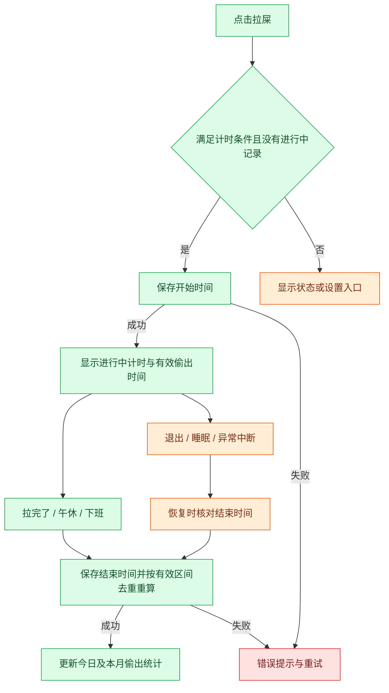
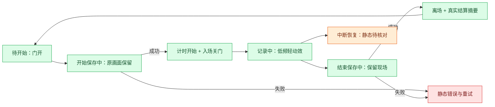
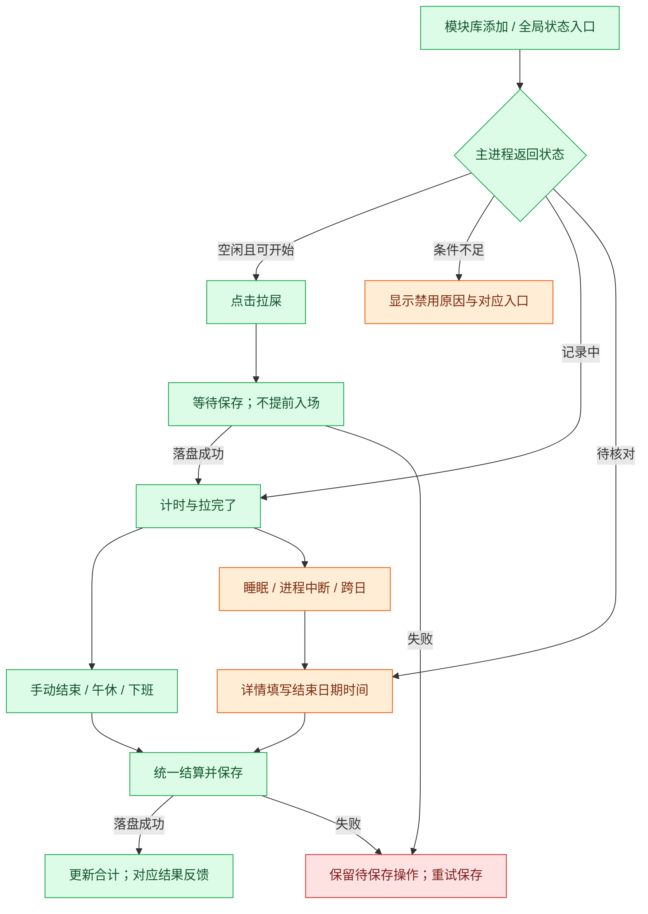
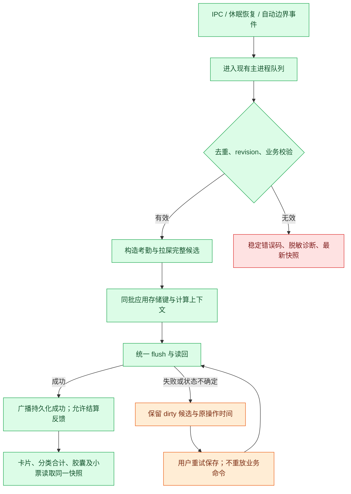

# F01 带薪拉屎

- 版本：v3（2026-11-05，补充交互定案建议、数据契约、计薪兼容、持久化与验收方案）。
- 状态：v3 主方案及 v3.1、v3.2 修正已获批准并实现；技术验证与关键入口验收见下文，用户本人体验待验收。
- 授权：用户已授权实施及本次修正；未授权提交、push、打包安装或发布。


## 实施与验收记录（2026-11-05）

- 批准：用户依次批准 v3 实施、v3.1 修正、v3.2 修正；代码累计 3 轮。未获跨任务的连续修复例外。
- 上游：每轮检查 `main` / `origin/main`，领先/落后 0/0，无快进同步；保留其他方案和本地 AGENTS.md 的既有改动。
- 入口：常规开发实例 `npm run dev` 已启动，打开「模块库 → 添加带薪拉屎」。不自动改变已有看板，也不将隔离测试活动写入日常资料。
- 实现：独立活动存储；增量区间归属；开始/结束/取消及历史修正；主进程和 preload 受控命令；午休/下班组合保存；中断核对；可选卡片、全局入口及记录详情；备份白名单与旧包恢复兼容。
- v3.1：补齐命令返回类型和智能布局注册；新键只在活动事实变化时写入；金额断言采用浮点容差；落盘重试的下班小票结果只消费一次。
- v3.2：补齐 preload 白名单并测试全部受控命令；分开本次和今日金额；仅对已落盘、手动结束且有效增量大于零的结果显示结算动效；详情使用半开日期区间；四类偷出金额在一行内布局。

### 技术验证

| 检查 | 结果 | 证据 |
| --- | --- | --- |
| `npm run typecheck` | 通过 | `/tmp/dogcow-f01-typecheck.log` |
| `npm run build` | 通过 | `/tmp/dogcow-f01-build.log` |
| `npm test` | 417 项，415 通过、2 失败 | `/tmp/dogcow-f01-tests.log` |
| F01 业务测试 | 11/11 通过 | 有效区间、去重、请假午休、打卡边界、状态转换、异常恢复、组合提交、跨月 |
| 桥接与表现边界 | 3/3 通过 | 所有白名单方法真实执行 preload 转发；未知通道拒绝；午夜与零增量动效 |
| 备份及仓库 | 新增场景通过 | 可选域导入导出、旧包清空活动、坏包拒绝、组合事实写盘失败重试 |
| `git diff --check` | 通过 | 无空白错误 |

剩余两项失败为 `tests/desktop/build-dependencies.test.mjs` 中的 temp 兼容补丁幂等性与 Windows installer/packager ASAR 路径一致性检查。本轮未修改依赖或补丁脚本；将 HEAD 原版测试与脚本放入临时目录、使用当前依赖复跑，同样出现这两项失败，证据 `/tmp/dogcow-f01-baseline.log`。未扩展为依赖修复任务。

### 实际入口验收（隔离资料，不代表用户本人认可）

- 原生 Electron 的真实「拉屎」按钮可开始，显示「拉完了」、本次用时、有效金额与顶部进行中入口。
- 详情中结束记录后，保存成功且今日/本月及分类金额一致；结束时间修正后时长和金额重算。
- 移除卡片后计时继续，全局入口仍能打开原记录；模块库重新添加后读回相同累计。
- 保留进行中记录并正常退出，重开后变为待核对；未核对部分不计入，日期时间字段保持空白。点击「按现在结束」后统一重算。
- 无效时间输入有可见错误，不能提交；关闭详情后焦点回触发入口。
- 常规实例已恢复，仅一个项目 Electron 主进程和一个 dev 启动进程；模块库中可见新模块。正式安装版已正常退出，没有并行运行。

未实测边界：真实 macOS 睡眠/时区跳变、所有五种尺寸与极窄窗口、减少动效开关、磁盘故障下完整 UI 重试、打卡模式下小票联动的端到端操作。已有纯业务/仓库测试不替代这些入口验收；首版未实现低频循环装饰、纸片飞行动效或大卡最近三条摘要，采用静态场景与开关门/结算轻反馈。上述视觉候选仍待后续用户评审，不宣称完整还原候选动画。

维护性 review：计薪公式留在 calculator；活动校验与转换独立；renderer 不直接访问磁盘；沿用既有命令队列、revision、Result、Modal 和选择器；未增加依赖。后续活动口径改 `paid-toilet.js` 与 calculator，表现边界改共享 `toilet.ts` 和限定作用域样式。未做范围外清理。

## 用户已明确的要求

新增「带薪拉屎」模块，点击「拉屎」后开始计时，计入偷出时间，并联动现有偷出统计。

## 建议的首版交互

可选首页卡片，模块库中可开启。主区使用马桶/小牛图形、计时数字和单一主按钮，不常驻说明段落。

| 状态 | 卡片内容 | 操作 |
| --- | --- | --- |
| 待开始 | 今日累计时长、今日对应金额估算 | 拉屎 |
| 记录中 | 本次时长、累计有效时长、估算金额 | 拉完了 |
| 保存中 | 原有内容与保存状态 | 按钮禁用，防止重复提交 |
| 保存失败 | 简短错误，保留操作上下文 | 重试 |
| 不满足条件 | 对应状态，例如尚未上班、午休中、已下班 | 开始按钮禁用，必要时提供设置入口 |

点击「拉屎」立即记录开始时间，保存成功后进入计时状态；不额外要求确认。点击「拉完了」保存结束时间并刷新累计。一天可以多次记录，同时只能有一条进行中的记录。

## 偷出时间与金额口径

以下为建议口径，实施前结合现有计薪与打卡模式确认：

1. 沿用偷时间模式开关，不偷偷自动开启；未开启时提供开启入口。未配置薪资时先引导设置。
2. 开启上下班打卡模式时，只有已经上班、尚未下班且不在午休/请假中的有效工作时段可开始；不启用打卡模式时，使用现有排班的有效工作时段，不凭空制造上班记录。
3. 有效拉屎时间为记录区间与现有可计薪工作窗口的交集；排除休息日、排班休息窗口及请假区间。提前到岗等非标准工作窗口首版不计入，避免改变现有计薪边界。
4. 本次计时展示实际经过时长；计入偷出统计的有效时长可能更短，详情按需解释差异。
5. 今日偷出总时间按现有偷出区间与有效拉屎区间取并集，重叠只算一次。不能简单在现有 `stolenSeconds` 上叠加整段时长。
6. 金额复用现有时间价值计算函数和舍入规则。拉屎金额是固定收入的时间价值拆分，不额外加工资，也不减少今日计薪收入。
7. 今日、本月偷出合计同步更新；明细新增「带薪拉屎」。分类归属须互斥或明确增量口径，保证明细与合计一致。
8. 首版建议与现有午休区间分开存储和展示，不能把拉屎直接当午休，避免改变午休和实际工作时长的既有含义；实际工时是否扣除拉屎时间留待确认。

例：10:00 点击拉屎，10:08 点击拉完了，8 分钟全部处于有效工作窗口且未与其他偷出记录重叠，则今日偷出增加 8 分钟，对应金额沿用现有口径估算，计薪收入不因此增加。

## 中断与恢复

- 连点开始或重复结束不得生成重复记录、重复累计；主进程校验状态，按钮禁用仅是交互反馈。
- 下班时建议在同一次持久化操作中结束进行中的拉屎记录，再生成下班小票；保存失败不展示成功结算。补录更早下班时间时重算有效区间。
- 午休开始时建议同时结束拉屎记录，避免出现两个互斥的进行中状态。
- 隐藏卡片不结束记录，重新开启后恢复同一状态；需要有可发现的进行中提示。
- 退出、崩溃或系统睡眠后，不将无人确认的长时间全部累计；重新打开时要求核对结束时间，待核对区间不进入正式合计。时间戳计时，不依赖渲染帧数。
- 跨日记录按本地自然日及有效工作窗口切分，未确认的跨日尾段不自动结算。
- 修改排班、请假、薪资或打卡记录后，以原始拉屎记录重新计算；不保存一份容易失真的累计金额。
- 误点开始应能取消本次，取消后不计入；建议详情支持修正结束时间和删除记录，重新计算合计。
- 系统时间回拨或异常结束时间不得产生负时长；保留记录并提示核对，不静默清空。

## 交互流程



## 趣味文案方案

风格建议：用「临时工位」「带薪蹲坑」等轻松职场梗，画面保持干净可爱。按钮始终使用明确动作「拉屎」「拉完了」；趣味短句放在状态位，每次最多一句，不取代计时、金额、错误或必要解释。不使用具象排泄物、羞辱或催促久蹲的文案。

### 首版推荐组合

| 场景 | 主文案 | 辅助内容与操作 |
| --- | --- | --- |
| 待开始 | 换个工位，继续领薪。 | 今日累计时长、估算金额；按钮「拉屎」 |
| 开始保存成功 | 临时工位，入座成功。 | 开始计时；按钮变为「拉完了」 |
| 进行中 | 人在隔间，薪在工位。 | 本次计时、有效偷出时间及估算金额 |
| 手动结束且保存成功 | 工位切回，轻装上阵。 | 本次有效时长、对应金额估算 |
| 本次没有有效时长 | 本次已记录，未计入偷出时间。 | 可展开原因；不播放收益动画 |
| 下班联动结束 | 今日蹲班已收工。 | 直接进入原定下班小票，不加一道弹窗 |
| 午休联动结束 | 蹲班结束，午休接棒。 | 状态转为午休，显示实际结束结果 |
| 误点取消成功 | 本次已取消。 | 不计入时长与金额，不播放庆祝 |

### 可替换的趣味短句库

以下是编辑候选，首版不必全部上线。待开始或每次新记录时择一，同一次记录内保持稳定，不滚动切换。

- 待开始：「工位坐累了？换个瓷的。」「有些会议，适合一个人开。」「下一站，个人办公室。」
- 进行中：「会议室：一人满员。」「门已关好，世界静音。」「今日工位，自带冲水。」「身体在忙，消息稍后。」
- 结束：「会议结束，不写纪要。」「从容出关，继续营业。」「这趟，轻装返回。」

### 数字与收益措辞

- 实时数字使用「本次用时 03:26」「有效偷出 03:26」「对应金额 ≈ ¥1.28」，不使用「额外赚了」「到账」等会被理解为新增工资的字眼。
- 结束反馈可写「本次偷出 8 分钟 · 对应约 ¥X.XX」，金额必须来自有效区间的现有计算结果。
- 金额显示为零或重叠后没有新增统计时，如实显示；不凑整、不设虚构最低收益。
- 本次时长与有效时长不一致时，提供按需详情「仅有效工作时段计入，重叠时段不重复计算」。

### 禁用、异常与恢复文案

必要状态用直白文案，避免用玩梗掩盖问题。

| 场景 | 文案 | 操作 |
| --- | --- | --- |
| 未开启偷时间模式 | 开启偷时间模式后可记录。 | 去设置 |
| 未配置薪资 | 先设置薪资，再估算时间价值。 | 设置薪资 |
| 打卡模式下尚未上班 | 上班打卡后可开始。 | 去打卡 |
| 午休、请假、非有效工作时段 | 午休中 / 请假中 / 当前不在有效工作时段 | 禁用开始 |
| 已下班 | 今日已下班。 | 禁用开始 |
| 开始保存失败 | 没能开始记录，请重试。 | 重试 |
| 结束保存失败 | 结束时间未保存，请重试。 | 重试；不先展示结算成功 |
| 中断后待核对 | 上次记录尚未结束，请核对结束时间。 | 核对时间 / 取消本次 |
| 时间异常 | 记录时间异常，请核对。 | 核对时间 |

## 动画方案

### 视觉方向：小牛的临时工位

采用简化侧面的马桶、小隔间门和小牛角色，延续项目现有配色与角色风格。小牛入座后由隔间门遮挡身体，仅露牛角或头部；不画排泄细节。卡片内完成全过程，不全屏遮挡，不自动播放声音。

| 阶段 | 动画设计 | 建议节奏与边界 |
| --- | --- | --- |
| 待开始 | 马桶与半开的隔间门静态展示，小牛站在门边 | 不循环招手，不靠持续晃动吸引点击 |
| 点击开始、保存中 | 按钮显示保存状态，小牛先留在门外 | 不提前关门或显示成功 |
| 开始保存成功 | 小牛走入、门轻轻合上，门牌翻成「使用中」 | 总计约 600–900ms；计时在成功后立刻显示，不等动画结束 |
| 进行中 | 牛角偶尔轻动，门牌保持「使用中」；可有一小段翻报纸动作 | 每 12–18 秒一次、每次不超过 1 秒；计时数字固定宽度，避免跳动挤压布局 |
| 点击结束、保存中 | 保持当前隔间画面，按钮禁用 | 保存失败保留现场和错误提示，不播放离场 |
| 结束保存成功 | 门打开，小牛走出、抖抖耳朵，门牌回到「空闲」 | 约 700–1000ms；结束摘要可立即阅读 |
| 有新增有效偷出时间 | 结算摘要出现后，纸片「8 分钟」轻移至累计数字，累计区轻亮一次 | 约 400–600ms；仅成功结算且统计确有增量时播放，不飘金币、不重复庆祝 |
| 午休或下班自动结束 | 门牌平稳切为空闲，短暂显示结果 | 不等待完整离场动画；下班小票优先呈现，避免双重庆祝叠加 |
| 取消记录 | 门牌复位、小牛回到门边 | 约 150–250ms，不展示收益 |
| 错误或待核对 | 保留静态角色和明确状态 | 不闪红屏、不抖动整张卡片；待核对不显示运行中的收益动画 |

### 尺寸、性能与无动画模式

- 小卡片：保留门牌/角色图标、计时、主按钮；隐藏装饰与趣味副文案，不挤掉数值和错误。
- 中大卡片：展示完整隔间场景，趣味短句一行；具体布局需后续交互方案确认。
- 减少动态效果开启时，改为静态图切换与直接更新数字；状态不依赖动画或颜色单独表达。
- 卡片不可见、窗口最小化或页面进入后台时停止装饰动画；业务计时由持久化时间戳计算。系统睡眠后的记录仍按前述核对规则处理。
- 动画必须可中断，快速操作不排队、不阻塞结束按钮或下班；重开应用不补播历史动画。
- 建议先复用现有小牛素材和动效机制，以少量姿态和门牌变化完成首版；素材不足先确认静态设计，不直接引入动画引擎或新依赖。
- 无障碍状态播报仅在开始、结束、失败等事件发生时触发，不逐秒朗读计时或金额。

### 动画与真实状态流程



### 文案与动画验收补充

- [ ] 所有趣味文案从属于状态表达，按钮保持明确动作；小尺寸不裁切关键数字和错误。
- [ ] 保存失败时没有成功动画、收益动画或虚假累计；重试不会重复播放结算或累计。
- [ ] 无有效增量、取消、历史重看均不播放收益动效。
- [ ] 午休/下班自动结束与原流程衔接顺畅，不新增强制确认或阻塞小票。
- [ ] 减少动态效果、切后台、隐藏卡片与重启后均有完整静态状态表达。
- [ ] 实际素材、布局、文案和动画节奏待用户验收，本文不代表视觉效果已验证。

## 现有实现依据与后续扩展位置

本次仅源码检查，未执行行为验证：

- `src/shared/board.ts`：首页模块 ID、尺寸及布局规则，新增卡片需按现有模块机制扩展。
- `src/shared/contracts.ts`：当前考勤有上下班事实及 `breaks` 午休区间；新记录建议保持独立类型，不复用午休语义。
- `app/income/src/attendance.js`：事实校验、考勤状态与区间处理；后续评估开始/结束及下班联动边界。
- `app/income/src/calculator.js`：当前偷出时间包含迟到、早退和午休；新增拉屎区间需统一去重计算。
- `src/renderer/features/attendance/Offwork.tsx`：当前工作区已有下班小票代码，联动须确保结算先完成。
- 持久化、备份导入、旧数据兼容及主进程命令校验必须纳入技术方案。未来新增同类休息活动应复用已验证的区间计算，不复制计薪逻辑；首版不提前建立通用活动平台。

## 验收清单

- [ ] 开始、实时展示、结束、一天多次记录与重复点击正确。
- [ ] 有效工作时段内的 8 分钟只增加 8 分钟偷出时间；收入不额外增加。
- [ ] 与午休、迟到、早退、请假、非工作时间重叠时不重复或错误计入。
- [ ] 偷时间模式、打卡模式、缺失薪资与未打卡等状态符合规则。
- [ ] 下班结算后的小票与首页及本月合计一致。
- [ ] 保存失败可重试，开始/结束及下班联动不产生半写入数据。
- [ ] 退出重开、睡眠、跨日、时间回拨、误点取消与历史修正可恢复。
- [ ] 旧数据、导入导出与重新计算保持兼容。
- [ ] 实施时完成相关业务测试、类型检查和构建，并按仓库要求检查唯一的本地实例；视觉与功能体验由用户验收。

## v3 交互与技术方案（推荐，待批准）

本节细化并修订前文候选规则；有冲突时以本节为准。此次授权仅完善文档，尚未批准实现，也未制作可点击原型。现有项目源码为设计依据，本轮没有新增外部竞品研究。

### 1. 范围与推荐决策

- F01 首版包括：首页可选卡片、开始/结束/取消、记录详情、结束时间修正、删除、中断核对、午休及下班联动、今日/本月统计、备份兼容。
- 默认不自动加入已有看板；从模块库添加，默认中卡。使用「小牛临时工位」方向及前述推荐文案，不增加声音或动画依赖。
- 允许非打卡模式在有效排班窗口使用；不创建虚构打卡事实。打卡模式必须已上班且未下班。
- 保留现有实际工时、午休和固定收入定义；拉屎只作为独立的偷出分类，不扣实际工时，不增加收入。
- 正常结束不弹确认；取消和删除只在详情内出现，并使用带明确后果的确认操作。正在记录时始终允许结束/取消，即使薪资、模式或排班已改变。
- 本次实际时长、有效时长、合计新增时长分别计算。卡片显示实际用时和对应去重金额；详情解释有效区间及未计入原因。
- 不增加完整活动平台、排行榜、健康提醒、跨设备同步或新胶囊指标。已有胶囊的偷出指标随统一快照更新。

### 2. 布局、入口与可操作状态

| 尺寸/入口 | 信息层级 | 操作 |
| --- | --- | --- |
| 小卡 | 状态标签 → 等宽计时 → 主按钮；今日累计在详情查看 | 拉屎/拉完了、详情；错误替换装饰区域 |
| 中卡（默认） | 左侧小隔间，右侧本次用时；下方今日累计与对应金额 | 主按钮、记录详情；趣味短句仅一行 |
| 大/竖卡 | 完整隔间、主数字、今日累计；最多最近三条摘要 | 主按钮、全部记录 |
| 长卡 | 门牌图标、用时、今日累计、主按钮横排 | 窄窗口按现有布局折行，不缩到难以点击 |
| 卡片被移除 | 展开主窗口顶部保留「蹲班中 · 03:26」或「有记录待核对」状态按钮 | 点击直接进入详情，不强制重新添加卡片 |
| 胶囊模式 | 继续计时；展开回主窗口后恢复上述入口 | 首版不改胶囊紧凑布局或右键菜单 |

全局状态入口挂在 App 层，不能依附卡片生命周期。移除卡片、切换页面和收成胶囊不结束记录；系统睡眠和进程中断才进入待核对。两者需要严格区分。

详情复用 Modal、日期/时间选择器与按钮。分为今日记录、按日期查看；每条展示开始、结束、实际时长、有效时长、合计新增时长、对应金额及自动结束原因。首版允许修正结束时间，不支持补造开始记录或修改开始时间；删除后立即重算。

恢复核对：显示原开始时间与「结束日期 + 时间」，支持「按现在结束」「保存时间」「取消本次」。不预填一个被误认为真实事实的结束时间；最晚不能晚于当前时间，最早不能早于开始时间。已下班时仍可记录真实结束时间，但有效统计截断到下班边界。跨日选择有日期，不只使用 HH:mm。

正常开始前的禁用状态按以下优先级取一个：数据损坏/读取失败 → 有待核对记录 → 未开启偷时间 → 缺少有效薪资 → 未上班/已下班 → 请假/午休 → 非有效工作时段。已有进行中记录优先展示结束入口，不被这些开始条件遮住。

键盘：按钮支持 Enter/Space，弹窗打开聚焦首个操作控件；校验失败聚焦错误字段；关闭后回到触发入口，入口消失则回全局状态按钮。Esc 关闭详情不取消计时。状态变化通过现有提示及礼貌播报表达，不逐秒播报。



### 3. 已核实的调用链与技术约束

基线：`main` / `origin/main`，HEAD `3f419b0`；本轮 fetch 后领先/落后均为 0，无代码快进同步。工作区原有 `README.md` 索引、`absurd-titles.md` 和未跟踪 `AGENTS.md` 改动应保留；此处 README 指功能计划目录索引。实现开始前必须再次检查上游与工作区。

| 现有位置 | 源码事实 | F01 处理 |
| --- | --- | --- |
| `src/main/main.ts` | IPC 用 `commands` 串行；收入修改校验 `expectedRevision`，成功请求记入最近 128 条 receipts | 复用队列、请求去重、收入 revision，不另建服务 |
| `src/main/repository.ts` | 多键统一写 snapshot，经临时文件、sync、rename、读回；失败可能内存已改且 dirty | 同批设置考勤与拉屎记录；严禁把 applied 当作 persisted |
| `app/income/src/controller.js` | `calculateSnapshot` 由 controller 计算，每秒 tick；`commitAttendance` 走 apply/saveSettings | 新增拉屎上下文与组合提交入口，保持计算唯一来源 |
| `app/income/src/calculator.js` | `summarizeDay` 已处理排班、弹性窗口、请假、实际打卡；早退是结算补足秒数 | 保留旧分类公式，添加不重叠增量；不重写计薪 |
| `src/shared/offwork.ts` | 小票庆祝要求 `applied && persisted` 等条件 | 原条件保留，附加 F01 联动结算状态，不绕过成功门槛 |
| `src/migration/transfer.js` | 备份键有白名单；旧格式要求固定键存在 | 新键可选，旧包导入需显式清空该新域，防止残留 |
| `src/main/main.ts` 的 powerMonitor | 当前 resume 只 tick | 补充 suspend 标记及 resume 核对；不宣称已有恢复支持 |

注意：现有 controller 订阅会广播并在 dirty 时触发 flush。组合提交必须先组装完整候选，再一次发布，不能先广播考勤、下一次再发布拉屎记录，否则会出现中间状态。

### 4. 数据与命令契约（拟新增）

新增独立可选存储键 `dogcow.paid-toilet.v1`，由业务模块验证，不放进 `breaks` 或看板 `fun`。原始时间戳作为事实，金额不持久化。

```ts
type ToiletRecord = {
  id: string;
  startAt: number;
  endAt: number | null;
  status: 'running' | 'needs-review' | 'completed';
  endReason?: 'manual' | 'lunch' | 'offwork' | 'schedule-end' | 'review';
  interruption?: 'sleep' | 'restart' | 'cross-day' | 'clock-change';
};
type ToiletStore = { version: 1; records: ToiletRecord[] };
```

- 最多一条 running 或 needs-review，二者互斥；已完成必须有有效 endAt，未完成必须为 null；时间戳为有限、合法 Date 范围内的毫秒值，ID 唯一。取消/删除移除记录，不保留可识别个人活动的额外审计副本。
- 独立快照字段承载已验证记录、可开始原因、pending-save 状态及派生展示；不要让组件读取本机存储。损坏数据保留原值并禁用此域写入，不能静默用空数组覆盖。
- 新 IPC 方法建议 `toilet`，action 为 start/end/cancel/review/editEnd/remove；复用请求 ID、expectedRevision 与 Result。开始时间/普通结束时间由主进程取时；修正/核对才接受客户端时间。
- end/cancel/editEnd/remove 必须带 recordId，主进程重新检查记录状态。相同请求 ID 重发返回已有处理状态，不能创建新记录；超出去重窗口仍由 recordId 和状态约束阻止重复结束。过期 revision 返回最新快照，保留用户草稿且不自动重放。
- 复用 Result 的 `applied`、`persisted`、`errorCode`、`correlationId`。新增业务错误码统一在共享命令模块定义和映射，不混用现有作为打卡 token 的 `code`。
- 更新收入域 revision 的时机为事实变动，不是每秒 tick；新记录、核对、修正、删除均使旧草稿过期。

### 5. 计时与计薪算法

修订前文第 5 条：不把现有早退补足金额强行转换为时间区间。保留 lateSeconds、earlySeconds、lunchStolenSeconds 以及 earnedSeconds 全部原逻辑。

1. 在 `summarizeDay` 内复用现有 standard（包含弹性打卡窗口）、allLeaves、breaks、expectedSoFar 与真实上下班边界，不在 UI 复制工作日/请假算法。
2. 将本日已完成记录切片；正常运行记录以 now 为临时终点，结果标记为实时预估；needs-review 整条不参与合计。每条按本地自然日边界切分，不能用固定 24 小时代表一天。
3. 有效窗口为 standard 扣除全部请假及午休，再与已经经过的时间相交；打卡模式再限制在真实上班到下班范围内，缺上班事实不计。首版排除标准窗口外的提前到岗/加班，非打卡模式不要求考勤事实。
4. 对本日拉屎片段排序并合并交叠，然后扣掉已归属 late/lunch 的区间，得到 toiletAddedIntervals。打卡模式下在下班点截断，确保不进入早退补足区间。保留早退原金额语义，不从 earlySeconds 推造边界。
5. `toiletAddedSeconds = intervalSeconds(toiletAddedIntervals)`；`stolenSeconds = 原 lateSeconds + 原 earlySeconds + 原 lunchStolenSeconds + toiletAddedSeconds`。没有 F01 数据时，新旧结果必须一致。
6. 新增 `toiletStolenSeconds / toiletStolenAmount` 等明确字段；今日、本月、胶囊偷出指标和下班小票共享同一计算结果。月合计逐日求秒数，再使用原 incomeFor 口径计算金额。
7. 明细分类秒数互斥；分别展示的金额按原精度舍入，可能产生 0.01 元显示差。总额以总秒数计算为准，详情按需提示舍入，不篡改时长凑数。
8. 运行中的统计是预估，保存成功才播放一次结算反馈；中断转待核对时预估可能回落，显示「待核对，暂未计入」。历史核对、修正、删除不触发收益庆祝。

`actual`、`actualBreakSeconds`、earnedSeconds 及固定工资不因 F01 改变。修改薪资、排班、请假或历史考勤后从原始时间重新派生；沿用项目已有历史配置规则，不额外声称能还原历史工资配置。

边界用半开区间 `[start,end)`，毫秒合并/相减后统一换秒，避免每个碎片单独取整。相邻记录不重叠；同一天多次和跨月记录分别验证。

### 6. 保存、联动和中断恢复

采用「完整候选 → 同批内存应用 → 单次 flush → 按持久化结果反馈」，复用仓库机制，不引入数据库事务。仓库原子替换提供完整文件版本，不等于所有磁盘异常都能证明未写入。

| 动作 | 时间事实与提交规则 | 保存失败时 |
| --- | --- | --- |
| 开始 | 主进程取 startAt，保存记录及请求收据；成功后开始入场动画 | 保留 pending-save 候选和原 startAt；显示「开始记录未保存」；重试相同保存，不重新开始 |
| 手动结束 | 首次处理时冻结 endAt，候选变 completed | 显示冻结时长与「结束未保存」，不继续假装运行；只重试保存，不用重试时刻改 endAt |
| 午休开始 | 考勤 pause 与 F01 结束使用同一主进程 now；全候选先校验再发布 | 两者共同标记待保存，禁用冲突操作；不播放结束成功 |
| 现在下班 | 使用原 prepareClock 捕获的结束时刻，而不是确认按钮提交时刻；同批保存考勤、F01 和请求收据 | 保留整个候选，通过 retrySave 补落盘；成功后用原结算上下文决定是否展示一次小票 |
| 补录/修改下班 | 若新下班点在 startAt 之前或等于 startAt，记录保留但不计入；在其后则按该点联动结束 | 不出现 endAt < startAt；完成态的真实结束事实不因考勤修改而改写，只重算有效值 |
| 改设置/请假 | 重算有效值；若关闭偷时间/打卡或新排班使 running 不再满足条件，将其转 needs-review | 和本次设置修改同批保存；停止新增操作直到解决待保存 |

待保存门禁仅覆盖 F01 及会影响其结算的考勤/设置/请假修改，不阻塞无关任务编辑。若应用在保存异常后崩溃，下次以磁盘有效快照为准；发现未完成记录转待核对，不根据上次动画或提示猜测成功。

正常无打卡模式到达有效窗口结束时，使用已知排班边界自动结束并保存；打卡模式也不越过有效排班末端继续累计，自动结束不替用户生成下班打卡。手动午休及下班联动优先，全部经过同一队列，重复触发按记录状态无害返回。

- suspend：将 running 标成 needs-review 并尝试保存；不能保证系统睡眠前 IO 完成。resume 必须在普通 tick 前再次检查，不能先用 now 补算睡眠时长。
- 进程启动：所有未完成记录转 needs-review，先阻止累计再尝试持久化。正常退出首版也按此规则处理，下次核对，不假定退出时就结束。
- 跨日：有已知排班末端的正常运行记录应已自动结束；漏过事件、异常跨日记录全部待核对。核对完成后才按日期重算。
- 时间跳变：会话内对比单调时钟与墙钟，建议偏差超过 5 秒即待核对；该阈值为待实现验证参数。恢复事件优先处理，系统时区变化亦进入核对，不悄悄平移原始时间戳。
- 隐藏、后台和最小化只停装饰动画；不作为中断事实。无 heartbeat 高频磁盘写，不依赖 UI 每秒累加。



### 7. 具体改动位置与维护边界

| 文件（拟修改/新增） | 职责及复用 |
| --- | --- |
| 新增 `app/income/src/paid-toilet.js` | 纯业务数据校验、记录状态转换；沿用 income JavaScript 模块风格，不接 UI 或磁盘 |
| `app/income/src/calculator.js` | 原 summarizeDay 内复用区间工具，加入增量分类；不复制整套计算器 |
| `app/income/src/controller.js` | 可选加载新键、统一重算上下文、完整候选组合提交及待核对状态 |
| `src/main/legacy-adapter.ts` | 扩充 controller 类型契约，不用宽泛断言逃避新接口 |
| `src/shared/contracts.ts`、新增 `src/shared/toilet-command.ts` | 快照/命令类型、稳定错误码及提示映射；不复用 breaks 类型 |
| `src/main/main.ts` | 命令、联动、请求幂等、待保存门禁、powerMonitor/时间异常处理；不把计算公式写入 IPC 分支 |
| `src/shared/board.ts`、`src/renderer/board/modules.tsx`、标题配置实际定义处 | 注册 paid-toilet 模块与偷出分类；不改默认九类卡片布局 |
| 新增 `src/renderer/features/toilet/PaidToilet.tsx`、`toilet.css` | 卡片、详情、恢复编辑；复用 Modal、TimePicker、DatePicker、useReducedMotion 和现有 tokens，样式限定作用域 |
| `src/renderer/App.tsx`、`src/renderer/state.ts` | 全局进行中/核对入口，复用 income 队列；只在确有需要时扩充 state，避免第二套计时 store |
| `src/renderer/features/attendance/Offwork.tsx`、`src/shared/offwork.ts` | 联动待保存结果与一次性小票反馈，保留现有庆祝条件 |
| `src/migration/transfer.js`、仓库加载及导入提交路径 | 可选新键的验证/导出/恢复；禁止遗漏数据或旧包导入后残留 |
| 对应 `tests/income`、`tests/migration`、`tests/desktop` | 计算、兼容、命令及持久化边界测试；具体拆分随既有测试模式 |

`src/main/repository.ts` 优先不改底层写盘协议；只有现有入口无法完成组合提交或诊断时才补最小接口。多键候选必须在触发任何 controller 广播前完成，必要的 controller 扩充属于本方案范围。实现 review 若发现需要更大事务框架，先更新方案。

### 8. 错误与诊断契约

以下为拟新增码；既有通用错误保留原规范。F01 由主进程在失败节点记录一次 operation、action、stage、errorCode、correlationId、异常类型；不记录工资、任务、完整备份或活动时间明细。当前 catch 没有完整业务错误映射，需仅为 F01 及其联动补上，不能声称现有已支持。

| 路径/失败节点 | errorCode | 用户反馈及恢复 | 验证 |
| --- | --- | --- | --- |
| 加载/校验失败 | TOILET_DATA_INVALID | 记录读取失败，请先导出备份；保留原值，禁止覆盖 | 无效时间、重复 ID、多个未完成记录 |
| 开始条件变化 | TOILET_NOT_AVAILABLE | 最新明确状态原因，刷新快照，不自动提交 | 开始与午休/下班竞态 |
| 记录已变更 | TOILET_CONFLICT | 记录已变化，请核对后重试；保留草稿 | 旧 revision、重复结束、已删除记录 |
| 时间输入无效 | TOILET_TIME_INVALID | 字段旁解释结束时间范围，聚焦字段 | 未来、倒序、无效日期 |
| 待核对阻止开始 | TOILET_REVIEW_REQUIRED | 先核对上次记录；打开详情 | 重启、睡眠、跨日 |
| flush/读回失败 | TOILET_SAVE_FAILED | 修改尚未保存，请保留窗口并重试；冻结原操作时间 | rename 或读回失败、重试后只结算一次 |
| 意外异常 | TOILET_INTERNAL | 操作未完成，请重试；附关联编号，返回最新快照 | 注入异常且不泄漏堆栈 |

业务错误不可无限自动重试。磁盘失败允许用户重试 flush；不以回滚内存冒充磁盘必定未写入。完整数据文件的损坏仍走项目已有读取保护；本功能不扩展成全项目诊断重构。

### 9. 备份、降级与交付顺序

新键在新版本中可选、缺失视为空；不能加入旧格式必需 fixedKeys 导致旧备份全部失败。需要同时补 allowedKey、collectLegacy、validateLegacy、导入预览和恢复 journal；导入不含新键的旧包应在候选阶段明确设置空 F01 数据，避免混入导入前活动。新包的未完成记录在导入后强制待核对。损坏新键拒绝整个导入，不能部分成功。

旧应用可能不认识新备份键而拒绝导入；首版不承诺降级兼容，也不自动删除新键来迎合旧版本。升级前保留原始备份；发布回滚需要保留包含 F01 的完整快照，由用户单独授权。隐藏卡片只是布局变化，不是数据回滚。

实施建议按一次批准范围内的三步交付：①业务数据/计算及测试；②主进程组合提交、恢复与备份；③卡片/详情/动效及实际入口验收。三步属于同一 F01，不增加新功能。应用代码、测试、配置和隔离演示均须待本 v3 明确批准后才写入。

### 10. 验收矩阵与证据要求

| 场景 | 必须满足的结果 | 证据层级 |
| --- | --- | --- |
| 无 F01 数据 | 现有计薪、偷出、工时结果不变 | 原有测试 + 新旧结果回归 |
| 有效 10:00–10:08 | 新增 480 秒；固定收入、actual 均不变 | 纯业务测试 + 卡片实际操作 |
| 排班外/午休/带薪与无薪假 | 只计交集且分类不重叠 | 区间边界测试 |
| 弹性打卡、提前到岗、早退 | 使用弹性 standard，窗口外不计，早退原结果保留 | 组合回归 |
| 多记录/跨月/碎片毫秒 | 去重后统一换秒，今日和本月一致 | 固定时钟测试 |
| 重复 start/end 与失效 revision | 不多建、不多算；草稿保留且不自动重放 | 命令测试 |
| 开始/结束/联动写盘失败 | 显示未保存，无成功动画/小票；重试沿用原时刻 | 故障注入 + Electron 入口 |
| 下班确认弹窗停留再提交 | 使用 prepareClock 原时刻；统计与小票一致 | 主进程集成 + 手动 |
| 保存成功但响应丢失 | 重试同请求不重复创建或庆祝 | 幂等测试 |
| 睡眠、退出重开、时间回拨 | 核对前不累计，核对后只计有效窗口 | 可注入时钟测试 + macOS 实际睡眠 |
| 隐藏卡片/最小化/胶囊 | 不停止业务；展开有可发现入口 | 用户入口操作 |
| 修改配置/请假/历史下班 | 重算一致；新开始受阻不妨碍结束/取消 | 业务 + 表单操作 |
| 旧包、新包、坏包导入导出 | 空域无残留；活动待核对；坏包零应用 | 迁移与恢复测试 |
| 五种卡片尺寸/窄窗口/键盘/减少动效 | 操作、数值、错误完整；焦点正确，无循环装饰干扰 | 实际 UI 验收 |

实现后执行 `npm test`、`npm run typecheck`、`npm run build`，按失败边界补必要验证；通过构建不能替代上表的入口验收。按项目要求在仅一个项目实例的前提下启动/重启 `npm run dev`，核对日志、进程与最新结果；打包、安装、提交、push 和发布另行授权。

本文仅为设计文档，没有运行上述测试、制作新图像素材或核验新 UI。首次实施前应复核列出的接口和实际组件尺寸；新增根因、范围或存储策略变化需要更新方案。

## 开发前待确认（以 v3 整体评审为准）

- 是否采用「小牛临时工位」视觉方向、首版推荐文案和上述动效节奏。

- 非打卡模式能否启用（本计划建议允许有效排班窗口内使用）。
- 休眠和异常退出后核对结束时间的具体交互。
- 是否采用首版不扣除实际工作时长、仅增加独立偷出分类的规则。
- 是否采用上述自动结束、历史修正和明细归属规则。

确认需求与具体交互/技术方案后才进入实施；本文件写入不视为实施批准。
