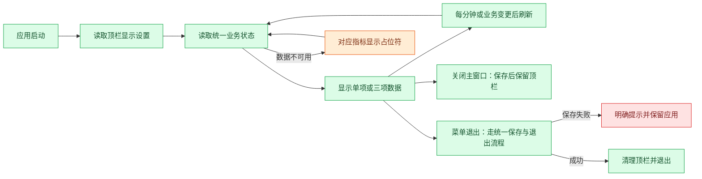

# F08 顶栏实时状态（第一期）

- 版本：v1（2026-11-05）。
- 状态：方案已讨论并授权写入文档，未授权实施。
- 范围：macOS 顶栏单一入口，支持显示一项或三项数据。
- 本对话仅讨论计划；本文不授权代码修改、安装依赖、提交、push 或发布。

## 目标

不打开主窗口，也能随时查看收入和上下班状态。第一期保持轻量：一个图标、简短数据、系统原生菜单，不做自定义展开面板。

## 显示模式

### 单项模式（默认）

默认显示下班倒计时，格式为小时:分钟：

```text
🐮 下班 01:23
```

可在菜单切换为以下任意一项：

- 下班倒计时。
- 今日已赚估算，例如 `🐮 ¥128.60`。
- 今日偷出时长，例如 `🐮 偷出 18分`。

### 三项模式（可选）

```text
🐮 ¥128.60 · 下班 01:23 · 偷出 18分
```

第一期固定数据和顺序：今日已赚估算、下班倒计时、今日偷出时长；不增加任意组合、拖动排序或多入口。

示意中的牛图标仅表达视觉意图；实现时使用适配 macOS 明暗顶栏的简洁图标，文字保持紧凑。具体宽度、小屏及刘海屏空间适配待用户验收，不保证系统始终有足够空间显示完整三项。

## 点击菜单

使用系统原生菜单，选项以勾选状态表达，不堆放解释段落。以下为结构示意，分组采用子菜单：

```text
显示模式          > 单项 ✓ / 三项
单项内容          > 下班倒计时 ✓
                    今日已赚（估算）
                    今日偷出时长
────────────────────────
打开狗牛
退出狗牛
```

- 三项模式下「单项内容」禁用；保留上次单项选择，切回后恢复。
- 「打开狗牛」恢复并聚焦已有主窗口；窗口已销毁时按现有入口重建，不重复打开多个主窗口。
- 显示模式与单项选择保存在本机，重启后恢复。
- 默认单项倒计时，避免默认常驻暴露收入；用户选择三项或收入后按其选择显示，不擅自切换。

## 数据与刷新

- 复用主程序已有收入、排班、考勤和偷出时间计算，不单独维护另一套计时与金额累计。
- 正常运行时每分钟刷新；打卡、薪资/排班/请假设置变化或影响统计的活动结束后立即刷新。
- 这里的「实时」指业务事件触发更新及分钟级展示，不承诺秒级动态或系统睡眠期间持续刷新。
- 收入显示两位小数，沿用现有金额口径与舍入规则；偷出时长第一期按完整分钟显示，不向上虚增。长时长的紧凑格式在实施方案中确认。
- 主窗口关闭或隐藏后，顶栏仍从统一业务状态获取数据，不能依赖主窗口渲染定时器。
- 系统唤醒、日期切换后重新按时间戳和当前日期计算，不累计定时器触发次数。
- 拉屎计时第一期不自动抢占顶栏；未来 F01 实施后，其有效时间通过现有偷出合计体现，专门的活动计时入口另行确认。

## 状态显示

| 情况 | 展示规则 |
| --- | --- |
| 正常工作时段 | 下班剩余小时:分钟 |
| 到达规定下班时间但尚未打卡下班 | 已到下班时间，不显示负数 |
| 实际已下班 | 已下班 |
| 今日休息 | 今日休息 |
| 薪资或排班配置不完整 | 无法确定的指标显示 `—`，菜单仍可打开主程序 |
| 收入数据不可用 | 收入显示 `—`，不伪造为 0 |
| 偷时间模式关闭 | 偷出项显示 `未开启`，不展示旧累计冒充当前结果 |
| 数据加载或读取失败 | 对应指标显示 `—`；保留打开主程序入口查看和处理问题 |

如现有业务还有请假、待补卡等特殊状态，实施前沿当前状态定义确认映射，不在顶栏重新推断；无法可靠确定的值显示占位。

## 应用生命周期

- 点击主窗口关闭按钮后保留顶栏与后台进程，明确改变原有退出语义；顶栏菜单提供可发现的「退出狗牛」。
- 主窗口关闭、应用退出均须沿用现有草稿保存与退出保护，不能直接销毁尚未保存的编辑状态。
- 「退出狗牛」走应用统一退出流程，保存失败或存在未完成活动时按既有规则处理；不得绕过保存和核对机制。
- 同一应用进程只创建一个顶栏实例；明确退出后清理图标、事件监听与刷新定时器。
- 本期不做开机自启；应用未运行或明确退出后不再展示状态。

## 技术方向与维护边界

前轮源码核对：项目基于 Electron，尚未接入 Tray；主进程现有受控命令与窗口来源校验围绕主窗口组织。实施前须重新核对当前实现。

- 主进程使用 Electron `Tray`、`setTitle` 和原生菜单，无需为本期增加第二个渲染窗口。
- 业务快照由统一来源产生；原生菜单切换显示选项不直接修改考勤或收入数据。
- 将展示格式、状态映射与刷新生命周期保持清晰边界，避免把规则塞入窗口构建函数。
- 如现有统一状态依赖主窗口，先提出具体拆分方案确认，不在本计划中隐含授权重构。
- 不引入第三方顶栏框架，不添加独立业务存储副本。

官方资料（2026-11-05 调研）：

- [Electron Tray：图标、标题与菜单接口](https://www.electronjs.org/docs/latest/api/tray/)。接口文档支持技术可行性，不代表本项目已接入或验证。
- [Electron Tray 教程](https://www.electronjs.org/docs/latest/tutorial/tray)。

## 流程



## 第一阶段不包含

- 自定义展开面板、桌面悬浮窗或 WidgetKit 系统小组件。
- 顶栏动画、滚动文案、轮播数据、秒级跳动或提示音。
- 顶栏快捷打卡、开始/结束拉屎，以及游戏入口。
- 开机自启、隐藏 Dock 图标、跨平台同等顶栏文字显示。
- 自动判断屏幕共享或自动隐藏隐私信息。

## 验收清单

- [ ] 默认单项倒计时，三项内容及顺序固定；切换、勾选和本地保存正确。
- [ ] 数值与主窗口同口径，分钟刷新和业务变更触发正确。
- [ ] 已到点、实际下班、休息日、配置缺失及读取失败状态不误导。
- [ ] 主窗口关闭后顶栏继续更新，重开不创建重复窗口或重复图标。
- [ ] 草稿保存与明确退出流程正常，退出失败不会丢失编辑状态。
- [ ] 睡眠唤醒、跨日、修改排班和活动结算后正确重算。
- [ ] 明暗外观、小屏/刘海屏及较长文字的实际可见性待用户验收。
- [ ] 实施时完成格式/状态/生命周期相关检查、类型检查和构建，检查唯一的本地实例；不以技术通过代替用户体验验收。

## 下一步

本文仅落盘已讨论的一期方向。开发前重新核对代码与分支，给出具体改动范围、特殊状态映射和保存/关闭处理方案，取得实施批准后再写代码。本轮不启动或重启应用。
