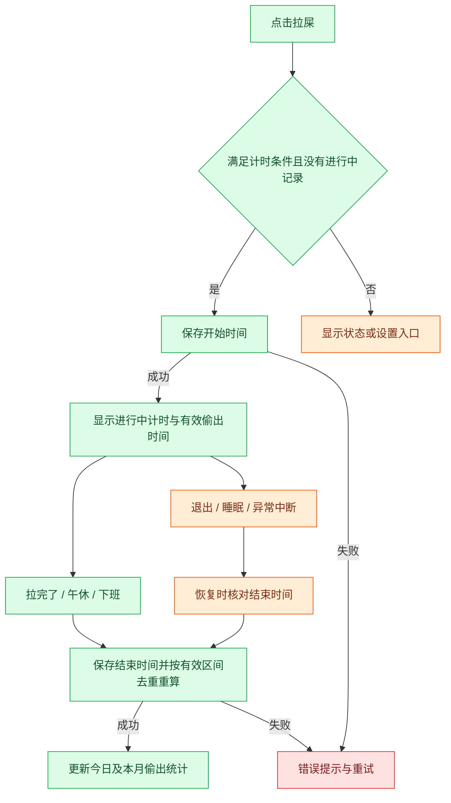
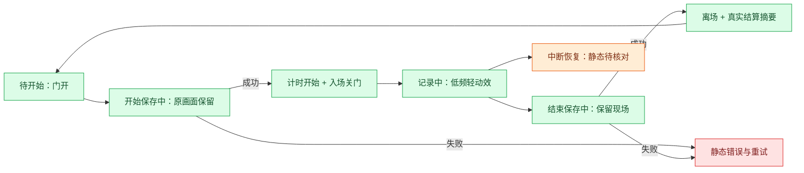

# F01 带薪拉屎

- 版本：v2（2026-11-05，补充趣味文案与动画候选）。
- 状态：需求计划，未实施；以下建议规则待后续确认。
- 授权：仅写计划，不授权应用代码修改、提交、push 或发布。

## 用户已明确的要求

新增「带薪拉屎」模块，点击「拉屎」后开始计时，计入偷出时间，并联动现有偷出统计。

## 建议的首版交互

可选首页卡片，模块库中可开启。主区使用马桶/小牛图形、计时数字和单一主按钮，不常驻说明段落。

| 状态 | 卡片内容 | 操作 |
| --- | --- | --- |
| 待开始 | 今日累计时长、今日对应金额估算 | 拉屎 |
| 记录中 | 本次时长、累计有效时长、估算金额 | 拉完了 |
| 保存中 | 原有内容与保存状态 | 按钮禁用，防止重复提交 |
| 保存失败 | 简短错误，保留操作上下文 | 重试 |
| 不满足条件 | 对应状态，例如尚未上班、午休中、已下班 | 开始按钮禁用，必要时提供设置入口 |

点击「拉屎」立即记录开始时间，保存成功后进入计时状态；不额外要求确认。点击「拉完了」保存结束时间并刷新累计。一天可以多次记录，同时只能有一条进行中的记录。

## 偷出时间与金额口径

以下为建议口径，实施前结合现有计薪与打卡模式确认：

1. 沿用偷时间模式开关，不偷偷自动开启；未开启时提供开启入口。未配置薪资时先引导设置。
2. 开启上下班打卡模式时，只有已经上班、尚未下班且不在午休/请假中的有效工作时段可开始；不启用打卡模式时，使用现有排班的有效工作时段，不凭空制造上班记录。
3. 有效拉屎时间为记录区间与现有可计薪工作窗口的交集；排除休息日、排班休息窗口及请假区间。提前到岗等非标准工作窗口首版不计入，避免改变现有计薪边界。
4. 本次计时展示实际经过时长；计入偷出统计的有效时长可能更短，详情按需解释差异。
5. 今日偷出总时间按现有偷出区间与有效拉屎区间取并集，重叠只算一次。不能简单在现有 `stolenSeconds` 上叠加整段时长。
6. 金额复用现有时间价值计算函数和舍入规则。拉屎金额是固定收入的时间价值拆分，不额外加工资，也不减少今日计薪收入。
7. 今日、本月偷出合计同步更新；明细新增「带薪拉屎」。分类归属须互斥或明确增量口径，保证明细与合计一致。
8. 首版建议与现有午休区间分开存储和展示，不能把拉屎直接当午休，避免改变午休和实际工作时长的既有含义；实际工时是否扣除拉屎时间留待确认。

例：10:00 点击拉屎，10:08 点击拉完了，8 分钟全部处于有效工作窗口且未与其他偷出记录重叠，则今日偷出增加 8 分钟，对应金额沿用现有口径估算，计薪收入不因此增加。

## 中断与恢复

- 连点开始或重复结束不得生成重复记录、重复累计；主进程校验状态，按钮禁用仅是交互反馈。
- 下班时建议在同一次持久化操作中结束进行中的拉屎记录，再生成下班小票；保存失败不展示成功结算。补录更早下班时间时重算有效区间。
- 午休开始时建议同时结束拉屎记录，避免出现两个互斥的进行中状态。
- 隐藏卡片不结束记录，重新开启后恢复同一状态；需要有可发现的进行中提示。
- 退出、崩溃或系统睡眠后，不将无人确认的长时间全部累计；重新打开时要求核对结束时间，待核对区间不进入正式合计。时间戳计时，不依赖渲染帧数。
- 跨日记录按本地自然日及有效工作窗口切分，未确认的跨日尾段不自动结算。
- 修改排班、请假、薪资或打卡记录后，以原始拉屎记录重新计算；不保存一份容易失真的累计金额。
- 误点开始应能取消本次，取消后不计入；建议详情支持修正结束时间和删除记录，重新计算合计。
- 系统时间回拨或异常结束时间不得产生负时长；保留记录并提示核对，不静默清空。

## 交互流程

## 趣味文案方案

风格建议：用「临时工位」「带薪蹲坑」等轻松职场梗，画面保持干净可爱。按钮始终使用明确动作「拉屎」「拉完了」；趣味短句放在状态位，每次最多一句，不取代计时、金额、错误或必要解释。不使用具象排泄物、羞辱或催促久蹲的文案。

### 首版推荐组合

| 场景 | 主文案 | 辅助内容与操作 |
| --- | --- | --- |
| 待开始 | 换个工位，继续领薪。 | 今日累计时长、估算金额；按钮「拉屎」 |
| 开始保存成功 | 临时工位，入座成功。 | 开始计时；按钮变为「拉完了」 |
| 进行中 | 人在隔间，薪在工位。 | 本次计时、有效偷出时间及估算金额 |
| 手动结束且保存成功 | 工位切回，轻装上阵。 | 本次有效时长、对应金额估算 |
| 本次没有有效时长 | 本次已记录，未计入偷出时间。 | 可展开原因；不播放收益动画 |
| 下班联动结束 | 今日蹲班已收工。 | 直接进入原定下班小票，不加一道弹窗 |
| 午休联动结束 | 蹲班结束，午休接棒。 | 状态转为午休，显示实际结束结果 |
| 误点取消成功 | 本次已取消。 | 不计入时长与金额，不播放庆祝 |

### 可替换的趣味短句库

以下是编辑候选，首版不必全部上线。待开始或每次新记录时择一，同一次记录内保持稳定，不滚动切换。

- 待开始：「工位坐累了？换个瓷的。」「有些会议，适合一个人开。」「下一站，个人办公室。」
- 进行中：「会议室：一人满员。」「门已关好，世界静音。」「今日工位，自带冲水。」「身体在忙，消息稍后。」
- 结束：「会议结束，不写纪要。」「从容出关，继续营业。」「这趟，轻装返回。」

### 数字与收益措辞

- 实时数字使用「本次用时 03:26」「有效偷出 03:26」「对应金额 ≈ ¥1.28」，不使用「额外赚了」「到账」等会被理解为新增工资的字眼。
- 结束反馈可写「本次偷出 8 分钟 · 对应约 ¥X.XX」，金额必须来自有效区间的现有计算结果。
- 金额显示为零或重叠后没有新增统计时，如实显示；不凑整、不设虚构最低收益。
- 本次时长与有效时长不一致时，提供按需详情「仅有效工作时段计入，重叠时段不重复计算」。

### 禁用、异常与恢复文案

必要状态用直白文案，避免用玩梗掩盖问题。

| 场景 | 文案 | 操作 |
| --- | --- | --- |
| 未开启偷时间模式 | 开启偷时间模式后可记录。 | 去设置 |
| 未配置薪资 | 先设置薪资，再估算时间价值。 | 设置薪资 |
| 打卡模式下尚未上班 | 上班打卡后可开始。 | 去打卡 |
| 午休、请假、非有效工作时段 | 午休中 / 请假中 / 当前不在有效工作时段 | 禁用开始 |
| 已下班 | 今日已下班。 | 禁用开始 |
| 开始保存失败 | 没能开始记录，请重试。 | 重试 |
| 结束保存失败 | 结束时间未保存，请重试。 | 重试；不先展示结算成功 |
| 中断后待核对 | 上次记录尚未结束，请核对结束时间。 | 核对时间 / 取消本次 |
| 时间异常 | 记录时间异常，请核对。 | 核对时间 |

## 动画方案

### 视觉方向：小牛的临时工位

采用简化侧面的马桶、小隔间门和小牛角色，延续项目现有配色与角色风格。小牛入座后由隔间门遮挡身体，仅露牛角或头部；不画排泄细节。卡片内完成全过程，不全屏遮挡，不自动播放声音。

| 阶段 | 动画设计 | 建议节奏与边界 |
| --- | --- | --- |
| 待开始 | 马桶与半开的隔间门静态展示，小牛站在门边 | 不循环招手，不靠持续晃动吸引点击 |
| 点击开始、保存中 | 按钮显示保存状态，小牛先留在门外 | 不提前关门或显示成功 |
| 开始保存成功 | 小牛走入、门轻轻合上，门牌翻成「使用中」 | 总计约 600–900ms；计时在成功后立刻显示，不等动画结束 |
| 进行中 | 牛角偶尔轻动，门牌保持「使用中」；可有一小段翻报纸动作 | 每 12–18 秒一次、每次不超过 1 秒；计时数字固定宽度，避免跳动挤压布局 |
| 点击结束、保存中 | 保持当前隔间画面，按钮禁用 | 保存失败保留现场和错误提示，不播放离场 |
| 结束保存成功 | 门打开，小牛走出、抖抖耳朵，门牌回到「空闲」 | 约 700–1000ms；结束摘要可立即阅读 |
| 有新增有效偷出时间 | 结算摘要出现后，纸片「8 分钟」轻移至累计数字，累计区轻亮一次 | 约 400–600ms；仅成功结算且统计确有增量时播放，不飘金币、不重复庆祝 |
| 午休或下班自动结束 | 门牌平稳切为空闲，短暂显示结果 | 不等待完整离场动画；下班小票优先呈现，避免双重庆祝叠加 |
| 取消记录 | 门牌复位、小牛回到门边 | 约 150–250ms，不展示收益 |
| 错误或待核对 | 保留静态角色和明确状态 | 不闪红屏、不抖动整张卡片；待核对不显示运行中的收益动画 |

### 尺寸、性能与无动画模式

- 小卡片：保留门牌/角色图标、计时、主按钮；隐藏装饰与趣味副文案，不挤掉数值和错误。
- 中大卡片：展示完整隔间场景，趣味短句一行；具体布局需后续交互方案确认。
- 减少动态效果开启时，改为静态图切换与直接更新数字；状态不依赖动画或颜色单独表达。
- 卡片不可见、窗口最小化或页面进入后台时停止装饰动画；业务计时由持久化时间戳计算。系统睡眠后的记录仍按前述核对规则处理。
- 动画必须可中断，快速操作不排队、不阻塞结束按钮或下班；重开应用不补播历史动画。
- 建议先复用现有小牛素材和动效机制，以少量姿态和门牌变化完成首版；素材不足先确认静态设计，不直接引入动画引擎或新依赖。
- 无障碍状态播报仅在开始、结束、失败等事件发生时触发，不逐秒朗读计时或金额。

### 动画与真实状态流程

### 文案与动画验收补充

- [ ] 所有趣味文案从属于状态表达，按钮保持明确动作；小尺寸不裁切关键数字和错误。
- [ ] 保存失败时没有成功动画、收益动画或虚假累计；重试不会重复播放结算或累计。
- [ ] 无有效增量、取消、历史重看均不播放收益动效。
- [ ] 午休/下班自动结束与原流程衔接顺畅，不新增强制确认或阻塞小票。
- [ ] 减少动态效果、切后台、隐藏卡片与重启后均有完整静态状态表达。
- [ ] 实际素材、布局、文案和动画节奏待用户验收，本文不代表视觉效果已验证。

## 现有实现依据与后续扩展位置

本次仅源码检查，未执行行为验证：

- `src/shared/board.ts`：首页模块 ID、尺寸及布局规则，新增卡片需按现有模块机制扩展。
- `src/shared/contracts.ts`：当前考勤有上下班事实及 `breaks` 午休区间；新记录建议保持独立类型，不复用午休语义。
- `app/income/src/attendance.js`：事实校验、考勤状态与区间处理；后续评估开始/结束及下班联动边界。
- `app/income/src/calculator.js`：当前偷出时间包含迟到、早退和午休；新增拉屎区间需统一去重计算。
- `src/renderer/features/attendance/Offwork.tsx`：当前工作区已有下班小票代码，联动须确保结算先完成。
- 持久化、备份导入、旧数据兼容及主进程命令校验必须纳入技术方案。未来新增同类休息活动应复用已验证的区间计算，不复制计薪逻辑；首版不提前建立通用活动平台。

## 验收清单

- [ ] 开始、实时展示、结束、一天多次记录与重复点击正确。
- [ ] 有效工作时段内的 8 分钟只增加 8 分钟偷出时间；收入不额外增加。
- [ ] 与午休、迟到、早退、请假、非工作时间重叠时不重复或错误计入。
- [ ] 偷时间模式、打卡模式、缺失薪资与未打卡等状态符合规则。
- [ ] 下班结算后的小票与首页及本月合计一致。
- [ ] 保存失败可重试，开始/结束及下班联动不产生半写入数据。
- [ ] 退出重开、睡眠、跨日、时间回拨、误点取消与历史修正可恢复。
- [ ] 旧数据、导入导出与重新计算保持兼容。
- [ ] 实施时完成相关业务测试、类型检查和构建，并按仓库要求检查唯一的本地实例；视觉与功能体验由用户验收。

## 开发前待确认

- 是否采用「小牛临时工位」视觉方向、首版推荐文案和上述动效节奏。

- 非打卡模式能否启用（本计划建议允许有效排班窗口内使用）。
- 休眠和异常退出后核对结束时间的具体交互。
- 实际工作时长是否扣除拉屎时间；本计划不默认改变现有定义。
- 是否采用上述自动结束、历史修正和明细归属规则。

确认需求与具体交互/技术方案后才进入实施；本文件写入不视为实施批准。
