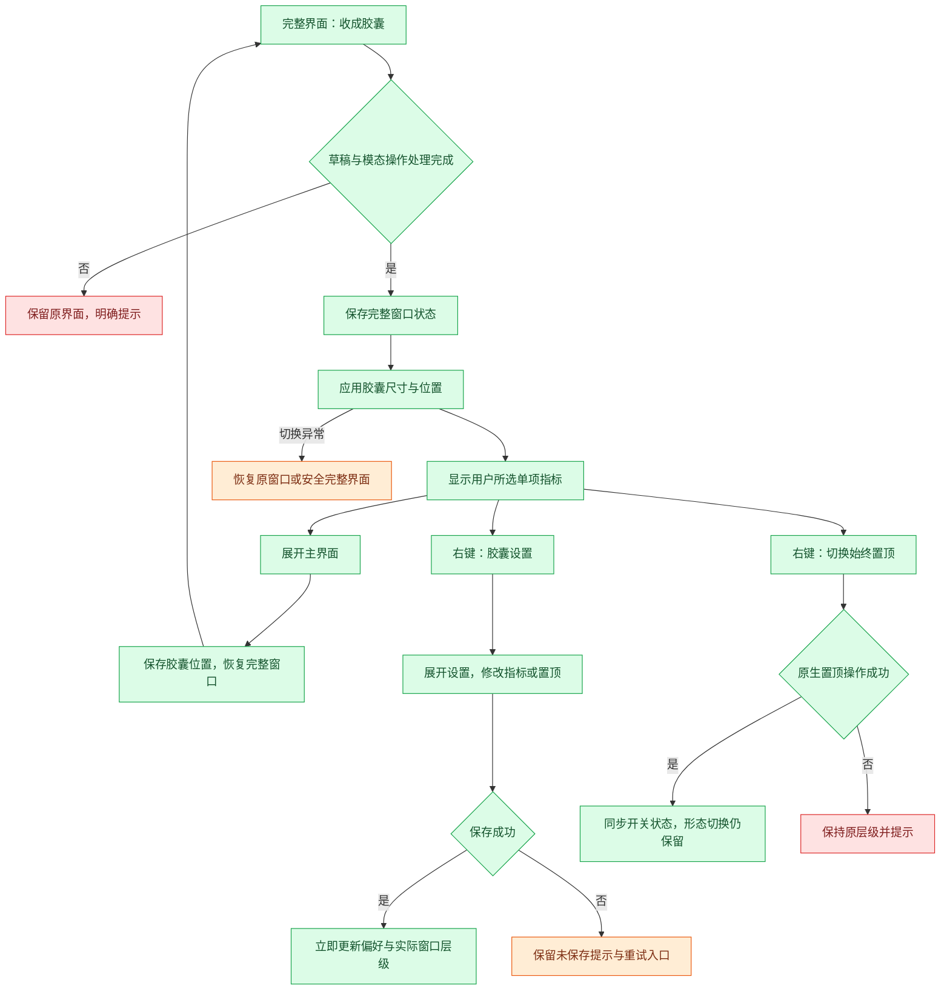
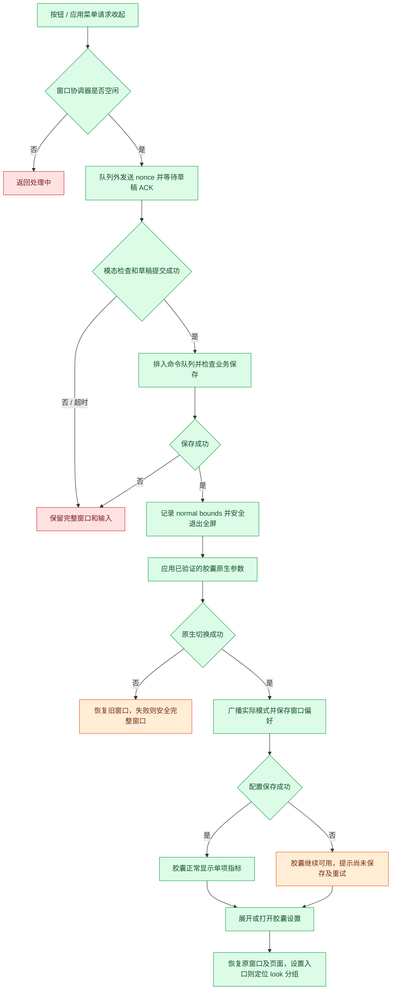
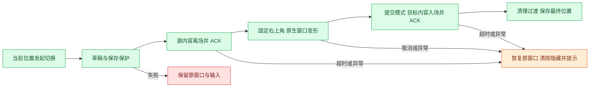

# F10 数据胶囊与悬挂置顶

- 优先级：**P0**（用户指定）。
- 版本：v8（2026-11-05）。不透明主题胶囊与稳定过渡底层；保留 v7 图标/hover 和 v5 右上锚点。
- 当前状态：用户已批准正式实施，本地实现完成，待用户视觉与功能体验验收；未提交、push、打包或安装。下文旧版说明保留为设计及验证历史；位置/动画以 v5 为准，设置布局以 v6 为准，主题文字/按钮反馈以 v7 为准，背景不透明与过渡时序以 v8 为准。
- 用户明确要求：收起后直接变成小胶囊；胶囊显示一项数据；数据在设置中自定义选择；像苹果便笺一样可以悬挂并保持最上层。
- 方案边界：下述尺寸、默认值、指标清单及恢复策略是具体设计建议，实施前确认。这里「自定义数据」指从现有指标中选择，不是编辑任意金额、编写公式或接入外部数据。

## 现状与本轮调整

本轮源码核对，未做界面体验验收：

- `src/main/main.ts` 的 `toggleCompact()` 当前只把高度改成 64，宽度仍来自主窗口；禁用缩放，没有真正的小胶囊尺寸。
- `src/renderer/App.tsx` 当前 compact 分支仅显示应用标题和展开按钮；此前文档所述“收入和倒计时”不符合当前基线，不支持设置选择单指标。
- `src/renderer/styles.css` 的 `.compact-bar` 全窗拖动，macOS 左侧固定留 80px，仍带主窗口布局假设。
- v1 提出的当前任务便签和二期贴边自动隐藏不再作为本轮主线。本轮明确为「完整主界面 ↔ 单数据胶囊」，悬挂是窗口置顶，不是边缘吸附或挂绳动画。

## 核心体验

工作时收成一个可拖动的小胶囊，看一项自己关心的数据；需要操作时展开原主界面。开启「始终置顶」后，即使焦点在其他普通应用窗口，狗牛仍保持在前。

```text
默认：   ╭───────────────────────────╮
         │ ⠿  ⏳ 下班 01:23:45    ↗  │
         ╰───────────────────────────╯

可选：   ╭───────────────────────────╮
         │ ⠿  ¥ 今日已赚 128.60    ↗  │
         ╰───────────────────────────╯
```

示意中的拖动柄、指标与展开按钮各有明确区域。实际使用系统适配图标；不要把示意字符当最终素材。

### 两种显示形态

| 形态 | 内容 | 窗口行为 |
| --- | --- | --- |
| 完整界面 | 当前已有首页、任务、设置等 | 保留正常窗口功能与编辑能力 |
| 小胶囊 | 一个指标图标、短标签、数值及展开控件 | 可拖动，固定紧凑尺寸，不承载表单和任务编辑 |

不增加独立便签编辑器或第三个中间长条形态。胶囊与完整界面使用同一个应用窗口切换，始终只有一个内容窗口，不复制业务数据或启动第二份应用。

## 胶囊尺寸与外观

- 建议默认内容区 240×44px；后续按实际字体校准，参考宽度 220–300px、高度 40–48px。
- 默认固定宽高，不随收入每秒变化伸缩，防止桌面上的胶囊抖动。超长状态优先短文案，再按需截断标签，不能把关键数字切成误导内容。
- 胶囊形圆角、轻边框和适度阴影；浅色、深色与跟随系统复用项目已有主题，不引入另一套配色。
- 不沿用完整窗口的宽度、900px 最小宽度或 macOS 固定左侧空白。
- 外框、系统按钮、透明角落与阴影能力须由平台原型核实。目标是胶囊外观；实现时不能仅画一个圆角元素而留下整块矩形窗口拦截点击。
- 数字使用等宽数字；单位不可省略，金额保留 `¥`，时长使用清晰的时分秒或带单位的紧凑格式。
- 平时保持展开按钮可见，不能只能通过悬停发现恢复入口；胶囊设置可通过右键菜单打开。

## 设置方案

建议在「设置 → 外观」新增「胶囊与悬挂」分组，优先用选项、开关和即时预览表达，不常驻长说明。

| 设置项 | 控件与建议默认值 | 行为 |
| --- | --- | --- |
| 胶囊显示 | 单选下拉，默认「下班倒计时」 | 一次仅选一项，预览图标、短标签和格式 |
| 始终置顶 | 开关，默认关闭 | 完整界面和胶囊都遵循该开关；切换形态不自动取消 |
| 胶囊位置 | 「恢复默认位置」按钮 | 仅重置胶囊坐标，不移动完整窗口或清除指标选择 |

- 选择后沿用现有设置保存方式，保存成功立即更新；失败保留可重试编辑值并明确显示未保存，不伪装已同步。
- 预览优先使用当前真实快照；尚无数据时用占位 `—` 并说明未配置，不用模拟收入冒充实际值。
- 设置页提供「收成胶囊」操作，保存完成后切换，立即体验所选指标。
- 右键胶囊提供「展开主界面」「胶囊设置」「始终置顶（勾选）」「恢复胶囊位置」。若提供退出项，必须走原有统一退出流程。
- 「胶囊设置」直接展开到对应设置分组，避免用户再找入口；该行为不改变指标选择。

### 指标清单与显示口径

第一版建议复用现有数据指标，采用固定清单；不提供公式或自定义字段。

| 可选指标 | 胶囊示例 | 数据来源与特殊状态 |
| --- | --- | --- |
| 下班倒计时（默认） | 下班 01:23:45 | 沿现有排班/考勤；已下班、今日休息等用真实状态代替数字 |
| 今日已赚（估算） | 今日已赚 ¥128.60 | 当前收入快照，金额来源与首页一致 |
| 本月已赚（估算） | 本月已赚 ¥8,256.30 | 当前收入快照；大额格式仍须可读，不自行改变计算 |
| 今日偷出时长 | 今日偷出 18分26秒 | 现有有效偷出秒数；模式未开启显示「偷时间未开启」 |
| 今日偷出金额（估算） | 今日偷出 ¥12.80 | 现有偷出金额，不是额外工资 |
| 今日任务完成度 | 今日任务 3/5 | 与首页同一日期范围与任务筛选口径；无任务显示「今日无任务」 |
| 今日已工作 | 已工作 04:12:08 | 复用现有实际工时定义，不自建扣除口径 |
| 当前时间 | 14:36:28 | 系统本地时间，随时区切换重算 |

尚未实施的带薪拉屎单次计时不进入首版指标选项；F01 上线后可作为新选项评估，不自动替换用户已选指标。收入、活动、精神状态变化均不得偷偷抢占胶囊内容。

指标名称允许短化，业务意义不能改变；完整名称与估算说明放在悬停提示和设置项中。数据未就绪显示相应短标签及 `—`，不能把未知值显示为 0。

## 交互规则

### 收起

1. 从主界面明确的「收成胶囊」按钮进入，沿用/替换原 compact 入口。
2. 先完成当前草稿保存；存在未处理模态操作时建议先处理或关闭，不把编辑器隐藏在胶囊背后。
3. 保存成功记录完整窗口边界与当前页面，再切换胶囊；失败停留原界面并给出重试，不丢输入。
4. 首次出现于当前屏幕工作区右上侧留出边距；之后恢复上次胶囊位置，不依赖 F08 顶栏是否已经实现。

### 拖动与展开

- 只有左侧柄与指定空白区可以拖动；展开按钮和指标文字不作为拖动区，避免点击和拖动竞争。
- 点击展开按钮恢复主界面原尺寸、位置与页面，不把主界面直接放大到胶囊所在位置。
- 双击数据区可作为展开的辅助操作，但不是唯一入口；一次点击不执行打卡、任务完成或其他写业务数据的动作。
- 键盘可以聚焦展开按钮并触发；右键菜单打开期间冻结尺寸切换，菜单关闭后再执行已选操作。
- 拖动释放后才持久化胶囊位置，避免每移动一个像素就写盘。
- 不做悬停自动展开、不自动贴边隐藏，防止用户只是路过鼠标就打断工作。

### 悬挂与焦点

- 「始终置顶」作为统一用户偏好，在完整界面和胶囊中持续生效；展开后也保持置顶，除非用户主动关闭。此规则替代 v1「展开取消置顶」。
- 与苹果便笺的“Float on Top”一致，目标是在普通应用窗口上方保持可见，不需要不断激活或抢焦点。
- 程序启动恢复用户上次选择，默认关闭；开关状态以窗口实际结果为准，原生调用失败则回到原值并提示。
- 不使用系统警报或屏幕保护层级，不覆盖锁屏、系统安全提示；全屏 Space 与多桌面可见性需实机核实，不能将「置顶」承诺成越过一切系统界面。
- 一期不强制在所有 Space 常驻；「跨桌面/全屏可见」若需要，应作为显式选项和后续方案。
- 关闭悬挂后恢复普通窗口层级，不隐藏窗口、不重置位置、不退出胶囊。

## 实时刷新与性能

- 可见胶囊的时间类指标建议每秒刷新，金额按现有快照频率展示；业务命令成功时立即同步，不新增每秒磁盘写入。
- 主进程统一业务状态为事实来源，渲染只负责展示；若现有快照不足以支撑每秒计算，应在技术方案明确安全的时间基准或主进程刷新方案，不能线性外推错误金额。
- 后台焦点在其他窗口时仍需更新可见胶囊；不得因普通失焦而冻结显示。
- 最小化、应用隐藏或系统睡眠时停止不必要的视觉刷新；恢复后按当前时间和业务事实重算，不补播动画或累计帧数。
- 胶囊即使不展示某项业务，也不能中断其记录；比如任务进度和活动计时仍由业务模块管理。

## 保存、兼容与恢复

建议区分并保存：显示模式（完整/胶囊）、指标 ID、置顶偏好、完整窗口边界、胶囊位置。具体存储契约在技术方案确认，不写入任务数据中。

| 场景 | 处理 |
| --- | --- |
| 原版本 compact 状态 | 迁移为新胶囊默认指标，旧长条宽度不直接复用 |
| 原窗口保存位置在屏外 | 将对应形态夹回当前有效工作区，保留可见展开入口 |
| 拔屏、缩放或显示器排列改变 | 分别校验两种形态坐标，不将两者覆盖为同一组 |
| 完整窗口最大化或全屏 | 记录原状态；进入胶囊前等待安全退出全屏，失败保持原形态；展开恢复顺序须技术验证 |
| 选项指向未知指标 | 回退默认倒计时；保留其他有效设置，提示设置已调整 |
| 统计数据不可读 | 显示占位及必要状态；可以展开处理，不能阻塞退出 |
| 置顶应用失败 | 原状态保持，显示简短错误；普通窗口继续可用 |
| 模式切换失败 | 保持或恢复切换前的可操作窗口，不能留下不可见的尺寸或失效按钮 |
| 设置或位置保存失败 | 当前窗口仍可操作，提示未保存并允许重试，不承诺重启可恢复 |
| 重启 | 成功载入时恢复上次形态与偏好，坐标校验后再显示；配置损坏回正常完整窗口 |

关闭胶囊不等于结束拉屎计时或下班。关闭/退出继续遵守项目已有生命周期和保存保护；F08 顶栏未实施时，不假设已有顶栏找回入口。菜单和系统应用入口必须仍能恢复窗口。

## 与 F08 顶栏的分工

- F08：系统顶栏文字，分钟级一项/三项，系统菜单。
- F10：桌面可拖动的小胶囊，单项可配置，时间类秒级显示，可选始终置顶。
- 两者可同时存在，但设置分别保存；更改胶囊指标不更改顶栏模式。
- 后续若二者共用数据格式化器，保持显示精度配置独立；不能为了复用强行让两者刷新频率一致。

## 外观与动画

- 收起/展开建议 150–220ms 尺寸与内容过渡，先保证两种布局不互相挤压；平台不支持平滑调整时直接切换，不引入新动画引擎。
- 不把大窗口文字压成一团再伸开；切换时用短淡出/淡入表达内容变化。
- 胶囊没有常驻蹦跳的小牛、滚动跑马灯或持续呼吸，避免常驻视觉干扰。
- 指标变更时保持窗口宽度和位置，轻量切换内容；每秒更新数字不播放翻牌或缩放。
- 图钉静态选中表达置顶，悬停提示完整操作；不靠颜色作为唯一状态。
- 减少动态效果开启时直接切换，所有状态与控制仍完整可用；默认无音效。

## 交互流程



设置持久化与原生置顶的提交顺序、失败时的偏好一致性，需要在技术方案确定具体恢复流程；不得因为图中顺序而声称已有事务保证。

## 代码扩展位置与职责（待实施前复核）

| 位置 | 预计职责 |
| --- | --- |
| `src/main/main.ts` | 模式切换、两套窗口边界、原生置顶、显示器变化与恢复；复用已有退出保护 |
| `src/shared/contracts.ts` | 胶囊偏好与受控命令/快照契约，拒绝未知指标与不合法坐标 |
| `src/shared/board.ts` 或独立胶囊指标定义 | 复用已存在且语义一致的指标，避免把胶囊窗口偏好塞进首页布局数据 |
| `src/renderer/App.tsx` 的 compact 分支 | 挂载专用胶囊呈现，保持完整窗口状态，复用业务快照 |
| 现有设置入口 | 「胶囊与悬挂」分组、单选指标、置顶开关和预览 |
| 专属胶囊组件/样式（路径待确认） | 拖动区、图标、标签、数字与展开控件，不复制首页整套卡片 |
| 现有格式化与动效偏好 | 金额/时间格式，浅深色，减少动态设置 |

沿用受控命令与主进程来源校验，不允许渲染传任意原生窗口参数；无需新增独立业务存储、后台服务或第三方窗口框架。窗口呈现参数是否可原位切换需先验证；如必须重建窗口，应单列草稿、焦点、加载失败和退出恢复方案再确认。

## 参考与证据边界

- [苹果便笺指南](https://support.apple.com/guide/stickies/welcome/mac)：官方描述支持“Float on Top”，参考其不因其他普通窗口激活而被遮住的行为，不复制完整便笺编辑产品。2026-11-05 阅读文档，未亲测本机行为。
- [Electron BrowserWindow](https://www.electronjs.org/docs/latest/api/browser-window/)：提供 `setAlwaysOnTop` 等窗口能力；接口存在不等于胶囊圆角、全屏与跨 Space 行为已通过验证。
- 本文指标为现有数据及建议扩展的显示映射，具体字段和特殊状态需实施前逐项核对。

## 验收清单

- [ ] 宽主窗口收起后真正变为小胶囊，无大片空白或矩形透明拦截区。
- [ ] 始终只显示一项数据，设置选择、保存、预览、重启恢复及非法选项回退正确。
- [ ] 每项数值与主页相同口径，特殊状态、缺失值、长数字与单位展示不误导。
- [ ] 普通失焦不冻结可见胶囊，睡眠与跨日恢复按事实重算。
- [ ] 拖动与按钮不冲突，展开入口始终可发现，键盘和右键菜单可操作。
- [ ] 完整界面与胶囊切换保持各自边界和当前页面，未保存草稿不丢失。
- [ ] 置顶在两个形态间保持，关闭置顶立即恢复；不抢焦点，失败不伪装成功。
- [ ] 多显示器、拔屏、缩放、全屏前后与屏外恢复符合明示范围。
- [ ] 明暗主题、减少动态效果和系统窗口控制区适配正确。
- [ ] 关闭/退出/重启不绕过保存与未完成活动处理，只有一个应用实例与内容窗口。
- [ ] 技术验证包含相关窗口状态、设置校验、格式化与恢复逻辑检查，以及类型检查、构建和唯一的本地实例启动检查。
- [ ] 视觉与用户功能体验由用户验收；不以构建通过替代胶囊尺寸、置顶及多屏体验通过。

## 开发前确认点

用户已明确的方向保持不变：小胶囊、单项可选数据、设置控制、悬挂置顶。待确认的具体建议为：默认倒计时、初始 240×44px、上述 8 项指标、两个形态共享置顶偏好以及不含贴边隐藏。

确认本方案及具体技术实现范围后再实施。本轮仅在本地完善计划文档，不提交、push、启动应用或实施代码。


---

## v3 详细技术方案

### 1. 基线、授权与实施顺序

- 功能 ID：F10；本轮为方案文档修改，功能代码修改累计 0 轮。
- 基线：main / origin/main = `77f94f7`；2026-11-05 已 fetch，无新上游提交。本地 `AGENTS.md` 为未跟踪的项目规则，保留不纳入提交。
- 上轮已快进同步 17 个提交；本轮逐项复核窗口、App、IPC、Repository、草稿与收入控制器，不能视为审查了全部上游代码。
- 本方案批准分为 A「原生可行性验证」和 B「业务集成」。建议先批准 A；A 的结果满足下述硬条件后再确认 B 的最终窗口参数。批准本文件不代表批准打包、安装、提交、push 或发布。
- 本文没有实际运行原型；API 文档与源码证据不能替代平台行为验证。

### 2. 已核实实现及复用边界

| 位置 / 符号 | 当前事实 | 本方案处理 |
| --- | --- | --- |
| `src/main/main.ts: toggleCompact` | 主进程内存保存 expanded，仅改高度为 64；最小尺寸 320×64 | 改为显式目标模式、串行切换、两套边界与失败恢复 |
| `main.ts: start / saveBounds / doQuit` | 主窗口最小 900×620；window-state.json 仅存完整窗口矩形，多处直接写 | 统一交给窗口状态模块；保持旧文件读取兼容 |
| `main.ts: invoke / methods` | 命令队列串行、来源校验、统一 Result 与业务快照 | 保留队列和安全边界，新增窗口专属命令与版本 |
| `src/renderer/App.tsx` | compact 仅标题；完整界面用 hidden 保留挂载；菜单直接调用 toggleCompact | 保留主界面挂载和页面状态；全部切换入口统一调度 |
| `src/renderer/state.ts: flushDrafts` | 收集 flusher 并等待领域队列；未等待无领域 pending | 窗口握手在命令队列外等待；主进程收到完成后再做仓库 flush |
| `hooks/useAutoDraft.ts / shared/draft-session.ts` | 已有草稿和保存结果模型 | 复用；仅检查本功能涉及的 flusher，不重写通用表单系统 |
| `app/income/src/controller.js` | 主进程控制器每秒 tick、重算和广播 | 不新增第二个收入时钟，不按秒写胶囊配置 |
| `src/renderer/board/metrics.ts` | 首页指标使用真实快照；任务为百分比、偷出为金额 | 复用来源和日期筛选，胶囊单独组合显示语义 |
| `src/main/repository.ts` | 业务快照带原子替换、保存队列、读取保护 | 不将窗口位置塞入业务快照，不修改迁移白名单 |
| `main.ts: requestSingleInstanceLock / requestQuit` | 已有应用单实例与退出握手 | 复用，不启动第二份应用、不把关闭变成后台隐藏 |

### 3. 先行关卡 A：单窗口原生能力

#### 3.1 推荐路径与硬条件

优先保留现有 BrowserWindow 和 webContents，切换尺寸、系统按钮和窗口层级，避免重建造成 React 草稿和选中日期丢失。完整界面的原生缩放、最大化、全屏能力保持可用。

胶囊尺寸以 DIP 为单位，初始内容区 240×44；记录 bounds 时明确是外框矩形，避免混用内容区尺寸。最终内容尺寸需测量系统装饰后的实际值。

第一轮只验证以下最小集合，尚不接入八项指标及正式配置迁移：

1. 原窗口缩为目标内容尺寸，macOS 隐藏系统按钮，展开时恢复；Windows 验证系统标题栏是否仍占空间。
2. 保持同一 webContents、完整界面正常缩放/最大化；收起前后焦点和主题正常。
3. 检查胶囊四角实际外观与点击区域；不能以 CSS 圆角或透明像素推断点击穿透成立。
4. 原生置顶开关生效、普通失焦不抢焦点；设置后读回实际层级状态。
5. 最大化、全屏进入/退出与多屏坐标恢复不留下不可操作窗口。

#### 3.2 已知限制与停止条件

Electron 官方窗口样式文档说明：透明窗口存在缩放限制，透明区域不自动穿透点击；不能为了胶囊将整个主窗口永久改成透明且不可缩放。`setShape` 仅 Windows/Linux 且为实验 API，不能作为 macOS 通用方案。

因此，**macOS 精确药丸外形、精确点击区域、同一可缩放窗口这三个目标目前尚无实测可行证据**。先测试现有 hiddenInset 原生圆角能否满足效果；不满足时，A 结束并报告结果：

- 可供用户选择的降级是紧凑原生圆角窗口，明确它不等同于精确药丸。
- 若必须严格药丸外形，另出 v4 比较原生扩展或独立胶囊窗口；双窗口、原生依赖、主窗口重建均不在本方案的自动回退范围。
- 不用反复隐藏/显示窗口或定时抢焦点模拟置顶；不使用逐像素鼠标轮询模拟穿透。
- A 中引入的实验代码仅服务该关卡；不通过则恢复原有窗口路径，不能把未完成原型当正式交付。

### 4. 模块划分与状态所有权

建议新增三个小型主模块，不引入第三方依赖：

| 文件 | 单一职责 |
| --- | --- |
| `src/shared/capsule.ts` | 指标枚举、偏好/状态类型、纯校验和纯数据映射；不依赖 Electron 或 React |
| `src/main/window-state.ts` | 配置读写、旧格式兼容、矩形与屏幕工作区校正、写入串行化 |
| `src/main/window-controller.ts` | 运行时切换状态机、原生窗口操作、草稿握手协调、菜单入口及恢复 |

主进程是窗口模式、实际置顶、配置保存结果的事实来源。渲染层只持有设置编辑值、等待状态和页面状态。将平台操作集中在 controller，禁止 App、菜单和启动恢复分别写一套逻辑。

运行状态拟定为：

```ts
type WindowMode = 'expanded' | 'capsule';
type WindowPhase = 'idle' | 'preparing' | 'applying' | 'restoring';
type CapsuleMetric =
  | 'countdown' | 'income-today' | 'income-month'
  | 'stolen-duration' | 'stolen-amount' | 'task-progress'
  | 'worked-today' | 'clock';

interface WindowPreferences {
  version: 1;
  revision: number;
  mode: WindowMode;
  metric: CapsuleMetric;
  alwaysOnTop: boolean;
  expanded: { bounds: Rectangle; maximized: boolean; fullscreen: boolean };
  capsule: { x: number; y: number } | null;
}
```

Rectangle 为 shared 内定义的有限数值类型，不泄露 Electron 对象。运行快照另外包含 phase、实际 mode/alwaysOnTop、savedRevision、dirty、warningCode；过渡状态、nonce、错误上下文不落盘。

原有 `Snapshot.compact` 在本轮保留为 `window.mode === 'capsule'` 的兼容派生值；两者只能由同一状态生成，避免双重真相。后续统一删除属于另一个清理范围。

### 5. 配置存储、兼容及多屏

- 文件：profile 下新增 `window-preferences.json`。独立于业务数据，不纳入现有业务导入/导出；换电脑后窗口偏好回默认是本期明确行为。
- 新文件有效时优先使用；不存在时读取旧 `window-state.json` 的完整窗口 bounds，并默认 expanded / countdown / 不置顶。
- 旧 compact 没有落盘事实，不能声称恢复其历史选择；新版本首次默认完整界面。
- 未知 metric 仅回退 countdown；不清除其他有效字段。未知高版本、损坏 JSON 保留源文件，使用安全完整窗口并发出警告，不启动时自动覆盖。
- 用户显式保存修复值前，先成功保留损坏配置备份；备份失败则维持只读恢复并提示，不覆盖损坏原件。
- 写入沿用现有 Repository 的方式：同目录临时文件、受限权限、文件同步、rename、读回校验；单独串行写队列，不直接复用业务 Repository 类及其迁移验证。
- 每个任务写入捕获不可变 revision；旧写入完成不能清除更新版本的 dirty。相同序列化内容不重复写；不因秒级快照更新 revision。
- 拖动停止使用 300ms move 去抖检测，Windows 可结合 moved；退出前 flush 最后坐标。该方式不是跨平台可靠的“鼠标释放事件”，文档明确允许拖动停顿时保存一次。
- 程序调用 setBounds 期间屏蔽 move/resize 保存，避免过渡尺寸污染两套边界。
- 完整窗口保存 normal bounds 加最大化/全屏标志；胶囊只保存位置，尺寸由当前版本常量决定。
- 监听 display-added / display-removed / display-metrics-changed；按相交面积选择有效屏幕，完全屏外时退到主屏。首次胶囊跟随主窗口所在屏右上角，边距建议 16 DIP。
- 将胶囊整体限制在 workArea；小屏完整窗口若不足 900×620，按当前屏临时放宽最小尺寸并保证系统控制区可达，不覆盖用户保存的正常大窗口尺寸。
- 只重置胶囊位置时不改变完整窗口 bounds、指标与置顶。最大化/全屏期间的屏幕变化同样走此校正函数。

### 6. IPC 与并发契约

沿用 preload 白名单、主 frame 来源校验、validPayload 和 Result，新增以下受控接口；渲染不得传任意 setBounds、路径或原生层级：

| 命令 / 事件 | 输入 | 结果与约束 |
| --- | --- | --- |
| `windowMode` | target: expanded/capsule，requestId | 显式目标，重复 expanded 不会再次收起；同目标过渡合并，不同目标忙时返回 WINDOW_BUSY |
| `capsulePreferences` | metric / alwaysOnTop patch，expectedWindowRevision，requestId | 只接受已知字段和枚举；乐观并发版本独立于 tasks/income/home |
| `resetCapsulePosition` | requestId | 主进程计算默认位置，不接受前端坐标 |
| `capsuleMenu` | 无或 requestId | 主进程创建原生菜单，菜单位置由可信窗口/光标计算 |
| `dogcow:prepare-window-mode` 事件 | 主进程 nonce、目标、原因 | 所有收起入口共用；不是可执行的任意 JS 消息 |
| `windowModeReady` | nonce、ready、blocker | 专用 ACK 通道；仅匹配当前主 frame 和当前等待 nonce |
| `dogcow:open-capsule-settings` 事件 | 一次性导航 ID | 先成功展开，再打开 look 分组并聚焦胶囊设置 |

注意：不能让 windowMode 在全局 commands 队列中等待 renderer.flushDrafts，同时草稿命令又排在其后，这会死锁。协调器的准备/等待在命令队列外；草稿 ACK 也不进入该队列。收到 ready 后才将原生提交阶段排入 commands，并在其中再次检查业务仓库保存结果及窗口 token。

所有入口共用一个过渡锁；偏好命令、屏幕事件、退出操作也经 controller 协调。退出具有优先级，取消尚未提交的切换并清除 timer/nonce；迟到 ACK、重复请求和旧导航事件不能触发新的切换。原生右键菜单打开时暂缓模式切换，关闭回调后再执行选择的意图。

应用菜单的收起操作也走握手；不再直接调用 toggleCompact。现有 compact 命令可临时适配到协调器，界面和菜单全部迁移完成后移除旧白名单条目，避免长期保留两套行为。

### 7. 草稿与模态保护

1. 收起请求进入 preparing，禁用重复切换，给 renderer 发送一次性 nonce；等待上限 5 秒，超时保留完整窗口。
2. renderer 先检查阻挡模态：新建任务、周任务、补卡、业务确认、小票等保持打开并拒绝收起，提示先完成或关闭。不能仅查询通用 dialog 后一律关闭。
3. 外观设置中的「收成胶囊」允许作为明确入口：先 flush 已注册草稿，确认成功才关闭设置；其他模态不自动关闭。
4. 调用现有 flushDrafts，异常也转为 ready=false；无领域 pending 和尚未注册的编辑不能被假定已保存，逐项核对现有编辑入口。
5. ACK 返回只代表草稿提交完成；主进程在提交阶段再 repo.flush，要求 dirty/error/readError 均不阻碍保存，否则停留完整界面。
6. 进入 applying 后短暂阻止新的编辑命令并保留输入；由于 UI 保持挂载，切换失败可恢复设置和页面。不要在收起时销毁 App 或整个设置树。
7. 小胶囊下不展示业务模态和庆祝动画；已有业务照常运行，恢复时同步当前事实，不积压播放秒级动画。

`useAutoDraft` 是否严格检查 applied/persisted、未注册编辑是否存在，属于实施前的定向核实点；发现独立缺陷需另列修复方案，不以本方案授权全面改写草稿系统。

### 8. 原生切换与置顶事务

#### 收起

- capturing：保存当前 normal bounds、最大化/全屏标志和可恢复的 UI 状态引用。
- 若全屏，监听 leave-full-screen 后继续，3 秒未完成则失败；不把 setFullScreen 返回当完成事件。最大化先 unmaximize，再应用胶囊尺寸。
- 应用关卡 A 确认的系统按钮、最小尺寸、可缩放属性和胶囊位置；核对实际 bounds 与 mode，广播最终状态。
- 置顶偏好独立保留，模式切换不隐式改变。
- 若设置窗口参数失败，按原生操作逆序恢复之前状态；恢复也失败时尝试安全完整窗口并记录二次失败，必要时用系统错误对话框提示，不能静默报成功。

#### 展开

- 先恢复可缩放、完整窗口最小尺寸及系统控件，再设置校正后的 normal bounds；最后恢复最大化或等待全屏进入完成。
- 普通展开恢复原页面；「胶囊设置」明确覆盖为设置 → 外观，恢复后 focus 对应控件。
- 主动点击展开允许聚焦；每秒数据更新、移动保存和置顶切换不得 focus/show 以抢焦点。

#### 置顶与保存顺序

1. 校验 patch 与 expectedWindowRevision，保存旧偏好和实际原生状态。
2. 调用 setAlwaysOnTop，读回 isAlwaysOnTop。调用失败/读回不符：保持旧偏好，尽力恢复旧层级，返回失败；恢复失败报告实际值。
3. 原生成功后提交内存偏好并增加 revision，尝试配置写盘。
4. 写盘成功：applied=true / persisted=true；写盘失败：applied=true / persisted=false、dirty=true，UI 按实际值展示，提示“本次已生效，尚未保存”，允许重试。不要为写盘失败反复改变已生效层级。
5. 模式切换与位置保存也采用“当前可用状态 + 明确未保存”的约定。业务草稿保存失败则不同：它发生在原生切换之前，必须阻止收起。

完整界面和胶囊共享普通 floating 层级；不启用所有 Space、系统警报层级或屏保层级。重试只执行当前未保存配置，不重新执行打卡等业务命令。

### 9. 指标与显示映射

所有数字取同一 Snapshot；不线性外推收入。独立纯函数返回 `{label, value, tooltip, status}`，settings 预览和 Capsule 复用；不修改首页已存在的指标语义。

| 指标 ID | 数据来源 | 空值/特殊状态 |
| --- | --- | --- |
| countdown | income.snapshot.remainingSeconds / status | calculationError 或未配置为 —；rest-day/after-work/leave-day 等映射状态；待补卡显示待补卡，避免假倒计时 |
| income-today | earnedToday | 非有限数字为 —，不变为 0；tooltip 标估算 |
| income-month | earnedMonth | 同上；金额带 ¥ 和两位小数 |
| stolen-duration | stolenSeconds | stealMode 关闭显示“偷时间未开启”；开启但无快照为 — |
| stolen-amount | stolenAmount | 同上，tooltip 说明不是额外工资 |
| task-progress | matchesDate(task, localDate(income.now))，done 数 / 总数 | 无任务“今日无任务”；taskError 时为 —，不能用空任务伪造成功 |
| worked-today | elapsedSeconds | 复用计算器 actual 工时；不再自行扣除午休/请假 |
| clock | income.now 转本地时间 | income.now 无效为 —；恢复/时区切换后请求主进程 tick |

八项均使用稳定 ID，不将用户可编辑标题当枚举。时间和金额必须校验有限数值。时长非负并使用现有 formatDuration；大额不使用未经约定的“万”缩写，优先缩短标签，仍放不下则显示短占位并用 tooltip 展示完整值，不截断数字冒充完整金额。

当前文案“今日已工作”遵循现有 actual 定义，若产品需要排除某类已计工时，属于计算口径变更，不在本功能内。

### 10. 渲染结构与性能

- 新增 `features/capsule/Capsule.tsx`、`CapsuleSettings.tsx` 和 `capsule.css`；Appearance 只负责挂载设置分组。
- 使用现有 Lucide 图标、Button/Switch/FormSelect、主题变量、等宽数字和减少动态偏好，不新建 UI 库。
- 拖动区仅柄与空白，文字/按钮为 no-drag；右键菜单保持原生，展开按钮键盘可用，focus 样式清晰。
- Capsule 常挂载但按模式切换可见；主界面继续保留 React 状态。胶囊模式隐藏背景 Scene 和庆祝呈现，避免隐藏界面继续做无意义动画。
- 预览只显示真实数据或明确占位，不加入长解释文案；估算说明放 tooltip。
- 主进程收入控制器继续每秒 tick，不能因为隐藏 UI 停掉业务。最小化/隐藏时仅暂停不必要的视觉呈现；恢复先刷新事实再显示。
- 不全局禁用 backgroundThrottling 来解决失焦问题；先验证现有主进程推送在可见失焦窗口持续渲染。若确需改动调度，补充针对性证据后更新方案。
- 不在切换时卸载整棵 App；不为设置预览创建第二个收入控制器；不把 nativeTheme 的背景设置覆盖到已验证的胶囊窗口策略。
- 默认直接切换原生 bounds，内容 150ms 内淡入淡出；先保证无布局闪烁，不承诺跨平台原生尺寸动画。减少动态开启时直接切换。

### 11. 错误契约与诊断

在 Result 新增可选 `errorCode` / `correlationId`，不复用现有 `code`（补卡 token 等已经使用）。保留 applied、persisted、message；窗口快照返回实际状态。

统一错误定义和用户文案映射放 shared/capsule.ts；主进程操作边界只记录一次结构化诊断：operation、stage、errorCode、cause/code、correlationId、requestId、平台、窗口 revision。保留必要异常链用于本机诊断；不记录任务内容、收入、绝对用户目录或整个 payload。未知错误显示“操作未完成，请重试”，保留关联标识。

| 交互 / 失败节点 | errorCode | 用户反馈 / 恢复 | 验证 |
| --- | --- | --- | --- |
| 参数、未知 metric | WINDOW_INVALID_INPUT | 拒绝提交，保留编辑值；旧配置未知指标用默认并警告 | 枚举、额外字段、NaN、超大坐标 |
| 偏好版本冲突 | WINDOW_REVISION_CONFLICT | 刷新事实，保留用户编辑值，由用户重试 | 菜单与设置竞争 |
| 切换正在进行 | WINDOW_BUSY | 显示处理中，不执行第二次切换 | 连点与目标冲突 |
| 模态/草稿校验失败 | WINDOW_DRAFT_BLOCKED | 留在原入口，完成或关闭后再试 | 新建任务、无效表单 |
| renderer 未响应 | WINDOW_PREPARE_TIMEOUT | 保留完整窗口，允许重试 | ACK 丢失、迟到 ACK |
| 业务保存失败 | WINDOW_DATA_SAVE_FAILED | 不收起，保留输入，走现有重试保存 | repo.flush false/readError |
| 全屏退出超时 | WINDOW_FULLSCREEN_TIMEOUT | 不进入胶囊，保留可操作完整窗口 | 无 leave-full-screen |
| 原生置顶失败 | WINDOW_TOPMOST_FAILED | 展示实际层级，提示未能置顶 | 抛错、读回不一致 |
| 原生尺寸切换失败 | WINDOW_MODE_FAILED | 恢复切换前状态 | setBounds/按钮恢复故障 |
| 恢复也失败 | WINDOW_RESTORE_FAILED | 安全完整窗口/系统对话框，保留诊断 | 连续原生操作失败 |
| 偏好写入/备份失败 | WINDOW_PREFERENCES_SAVE_FAILED | 当前状态保留，明确未保存，手动重试 | 临时文件、rename、读回失败 |
| 配置损坏/未知版本 | WINDOW_PREFERENCES_INVALID | 安全完整窗口，原文件保留，显式修复 | 损坏 JSON、未知 version |
| 指标业务读取失败 | 沿用 taskError/calculationError | 显示 —，可展开处理，不阻碍退出 | 错误快照 |

不自动无限重试；操作异常不伪装成成功。重试入口复用当前命令和保存函数，不建另一个恢复引擎。退出失败仍遵循已有取消/重试/明确放弃流程，窗口配置未保存需加入同一提示语义。

### 12. 关键流程图



### 13. 修改清单与维护性检查

| 文件 | 新增/调整内容 | 防止范围扩张 |
| --- | --- | --- |
| shared/capsule.ts | 类型、默认值、校验、显示数据、错误映射 | 不混入首页布局与薪资计算 |
| main/window-state.ts | 配置文件、兼容、串行保存、位置校正 | 不改业务快照 schema/导入协议 |
| main/window-controller.ts | 状态机、原生模式、握手、置顶、菜单 | 不再在 main.ts 增加多个散落的窗口分支 |
| main/main.ts | 初始化 controller、注册受控 IPC、接入快照/退出/屏幕事件 | 取消旧多处 window-state 写入，保持应用启动与业务调度职责 |
| shared/contracts.ts | Snapshot.window、可选错误字段、Method/Bridge 事件 | 原 Result.code 语义保留 |
| preload/index.cts | 白名单、prepare/ACK、设置导航订阅及清理 | 不暴露 ipcRenderer 或任意 channel |
| renderer/state.ts | 握手注册、错误转换、nonce 清理 | 不在业务队列内递归等待自己 |
| renderer/App.tsx | Capsule 挂载、统一入口、模态守卫、设置定位 | 保留页面/日期与任务完成庆祝逻辑 |
| board/Appearance.tsx | 新增设置 section | 不重构既有主题/背景编辑 |
| features/capsule/* | 胶囊、设置、样式 | 预览和实际展示同一组件/映射来源 |
| styles.css | 去除旧 compact 的全窗拖动和 macOS 80px 假设 | 不更改无关布局规则 |
| tests/desktop/capsule*.test.mjs | 状态、持久化、握手与指标针对性测试 | 不引入大型 UI 自动化套件 |

正式实现复核无重复窗口保存、无重复指标时钟、无双重 compact 真相、无菜单绕过保存。以后新增指标只改指标定义/格式化与对应测试；平台窗口调整只改 controller；配置迁移只改 window-state。仅为这三种变化提供边界，不构建通用插件系统。

### 14. 验证计划与用户验收

A 阶段的技术验证按第 3 节执行，记录本机 OS/Electron 版本、参数、实际窗口尺寸、webContents 是否保持、限制与结论。只运行一个项目实例；不主动做大量截图或批量 UI 遍历。胶囊外观和点击区域体验由用户确认，agent 记录可验证的原生状态。

B 阶段的逻辑测试覆盖：

- 配置正常/旧格式/损坏/未知版本、有限数值与屏外坐标、多屏拔除和小屏校正。
- 保存并发、新写入期间旧 revision 完成、写盘失败、损坏源文件保护。
- 重复目标幂等、busy、退出竞争、nonce 超时/迟到/复用、无草稿队列死锁。
- 模态阻挡、草稿失败、业务保存失败、原生切换失败、恢复再失败、置顶读回不一致。
- 八项指标正常/未知值/0/超大金额、未配置、任务读取失败、休息/请假/待补卡、跨日和时区更新。
- 旧页面/选中日期保持，设置导航只消费一次；本功能不改薪资公式与任务完成口径。

执行 `npm run typecheck`、`npm run build` 和相关 desktop 测试；若修改到共用草稿/退出逻辑，补跑对应已有测试。不因本功能重复扩大到所有业务组合。完成实现后依本地规则启动/重启唯一 `npm run dev` 实例，检查日志和进程；依赖缺失再按批准范围执行 npm ci。

用户实际入口验收顺序：

1. 主界面收成胶囊，确认尺寸、拖动、展开按钮、主题；展开恢复原页面及窗口。
2. 外观设置逐项切换指标，比较首页数据和特殊状态；关闭应用重开验证持久化。
3. 胶囊/完整窗口分别开启置顶，切到其他普通应用，确认不被遮挡、不抢焦点。
4. 带未完成编辑或业务模态收起，确认输入保留、操作提示明确。
5. 最大化、全屏、拔屏/缩放、睡眠恢复，确认窗口能找回、可见数据继续更新。

本机可验证 macOS；Windows 原生标题栏、点击区域、最大化等须 Windows 实机独立验收，不能用纯状态机测试宣称通过。Linux/Wayland 不列为本期承诺平台。

### 15. 待确认范围与尚未验证项

- 建议先确认关卡 A：验证单窗口外观/交互可行性；不包含正式业务接入。
- B 的建议产品参数：240×44 DIP、默认 countdown、8 项固定指标、置顶默认关闭且两种形态共享、不做贴边隐藏、窗口配置不随业务备份迁移。
- 尚未验证：严格药丸及点击区域的 macOS 可行路径、Windows 原生行为、各草稿入口的完整覆盖、全屏与多屏实际时序。
- 若 A 不满足严格外观要求，须展示结果并确认 v4；不能把降级、双窗口或原生扩展作为默认已批准行为。
- 本轮只完成技术方案文档，A/B 均未实施，也未获得功能实施批准。

### 16. 官方资料与证据限制

2026-11-05 查阅：

- [Electron BrowserWindow](https://www.electronjs.org/docs/latest/api/browser-window)：窗口尺寸、置顶读回、系统按钮、形状 API 与平台限制。
- [Electron Custom Window Styles](https://www.electronjs.org/docs/latest/tutorial/custom-window-styles)：透明窗口、缩放与点击区域限制。
- [Electron Window Customization](https://www.electronjs.org/docs/latest/tutorial/window-customization)：原生窗口定制入口。

以上是当前官方文档，项目锁定 Electron 45.2.2；实施时以锁定版本类型/API 和本机实际行为核实。文档不是已完成的平台原型证据。


## v3 A 执行结果（2026-11-05）

用户已批准并执行 A，B 未批准/未实施。详见 [可行性验证报告](capsule-feasibility.md)。基础尺寸、恢复、置顶、全屏进出及同一 webContents 已实测；现有 hiddenInset + CSS 圆角未达到严格药丸外形和点击区域要求，A 整体关卡未通过。按既定停止条件，不继续正式业务集成，等待决定接受原生圆角紧凑窗口，或另出严格药丸的 v4 方案。


## v4 扁胶囊预览（2026-11-05）

- 用户已确认本轮仅调整隔离预览，不代表批准正式业务集成。
- 新尺寸 240×32 DIP，数值 12px、标签 11px、图标 14px、展开按钮点击区 24×24px。接受原生角落少量露出，不再要求精确药丸点击轮廓；关键数值与按钮不裁切。
- 运行方式：退出已有狗牛后执行 `node_modules/.bin/electron scripts/probes/capsule.cjs --preview`。preview 模式跳过全屏等自动能力测试，直接留在小窗口，使用统一浅绿背景代替诊断洋红背景。
- 倒计时为示例数据，不连接正式考勤；悬停标签说明隔离预览。展开按钮可展开探针窗口，应用菜单可重新收起/退出。
- 原生 bounds/content 均实测 240×32，同一 webContents 保持，当前为置顶预览。截图可见数值和展开图标完整；视觉和可读性待用户确认。
- 本轮探针新增 1 轮，任务累计 3 轮；业务代码未修改。node --check 与 git diff --check 通过。
- 上轮 Windows、多屏拔插、正式草稿保护等边界仍未验证；本轮没有扩大验证范围。


## v4 本地实施与交付记录（2026-11-05）

- 授权：用户“技术方案可实施，注意代码后续可维护性”。批准范围为 v3 技术方案与 v4 原生圆角/240×32 调整。
- 分支：main / origin/main = 77f94f7；各修改轮次 fetch，无上游更新；既有文档、探针和本地 AGENTS.md 保留。
- 修改轮数：本轮正式实现 6 轮，任务累计 9 轮（含探针 3 轮）。编译纠正、验证后并发/保存保护复核均计入，没有调整薪资公式。
- 已实现：8 项指标、独立窗口偏好存储、两套边界、置顶、原生右键菜单、明确展开入口、草稿握手、并发去重、配置损坏保护、正常/异常恢复与日志。
- 可维护性：shared/capsule.ts 负责类型/纯格式化/错误映射；main/window-state.ts 负责配置；main/window-controller.ts 负责原生状态机；renderer/features/capsule 负责预览与设置。去除旧 toggleCompact、旧窗口保存分支及 compact-bar 样式，保留 compact 仅作为模式派生兼容字段。未新增依赖、收入计时器或业务数据存储键。
- 最终技术检查：npm run build（含双端类型检查）通过；胶囊与既有草稿相关 15 项测试通过；git diff --check 通过。全套 npm test 379 项中 377 通过、2 失败：未改动的 build-dependencies.test.mjs 中 temp 补丁未应用、Windows installer/packager 的 ASAR 解析路径不一致。未修改依赖或将该失败隐瞒为通过。
- 本地启动：首次被该仓库遗留 Python legacy preview 占用 5180 阻挡；核实其 cwd 为本仓库后停止旧预览，再 npm run dev 成功。安装版经菜单安全退出；当前唯一开发实例运行，使用原有 DogCow-dev 独立数据目录，不覆盖安装版 DogCow。启动无新增异常，AX 已观察到“收成胶囊”入口。
- 体验入口：主界面顶部收成胶囊；设置 → 外观 → 胶囊与悬挂。开发数据与安装版分开，开发版数值可能不同。
- 用户视觉与实际功能体验：待用户验收，未替代用户进行批量 UI 验收。真实 Windows 窗口、跨 Space/多屏拔插、睡眠恢复和所有原生失败场景尚未实机覆盖；状态机替身测试不等同于这些场景通过。
- 遗留：2 项构建依赖检查失败独立保留；上述平台边界和用户体验待验收。需要修复依赖时另出具体方案，不扩张本次范围。


## v5 当前位置右上锚点与完整过渡（已批准并实施）

### 批准范围与规则变更

用户要求“当前位置展开当前位置收起，并且有完整的过渡动画”，补充以右上角为锚点，随后明确“实施吧”。本轮在原 F10 范围内完成以下覆盖：

- 每次切换固定当前窗口右边界与顶部；收起向右上收拢，展开向左下扩展。展开恢复上次普通窗口尺寸与页面，不返回历史坐标。
- 拖动胶囊后从新位置展开；目标限制在当前窗口所在显示器工作区。空间不足时只校正必要边界，校正融入同一段原生动画。
- 全屏/最大化先退出系统状态，再从退出后的实际窗口执行过渡；显式展开为普通窗口，不自动再进最大化/全屏。启动和异常回退仍可恢复此前已保存的系统状态。
- 安装版与开发版可以并存；只重启开发进程，不关闭安装版。本轮未更改本地 AGENTS.md 文件。

### 时序与职责

1. 原有草稿握手和保存保护保持，锁定一次模式切换。
2. 发出带 nonce 的 exit 消息，源内容以 opacity/transform 离场 70ms。
3. 渲染层隐藏复杂布局但保持 React 组件状态；回复 ACK，附带系统/应用减少动态偏好。
4. 主进程临时放宽最小尺寸至 1×1，避免目标主窗口最小宽度使动画提前跳大；隐藏系统控件并执行边界过渡。
5. macOS 使用 setBounds(target, true)，等 resized 完成事件并验证实际边界；缺失事件时 1500ms 上限核实实际终点，未到达则失败恢复。Windows 使用 240ms、16ms 调度的 ease-out 插值，按右边界及宽度计算 x，不逐帧广播业务快照。
6. 原生完成后恢复目标窗口控件/可缩放属性，广播目标模式；等渲染层经过 React 布局提交后执行 enter 110ms，再回复 ACK。
7. 清理动画、恢复交互，保存最终位置。减少动态效果时省略内容动画与原生插值，仍完成握手和状态校验。

整体目标约 350–450ms；macOS 窗口段时长由系统控制，不将目标时长冒充实测帧率或耗时保证。

新增/调整职责：

| 位置 | 职责 |
| --- | --- |
| shared/capsule.ts: anchoredBounds / WindowTransition | 右上锚点纯几何计算、受控过渡消息契约 |
| main/window-animation.ts | 原生动画、非 macOS 插值、完成核对与取消清理 |
| main/window-controller.ts | 串联保存、内容离场、原生变形、目标入场及异常回退 |
| preload / contracts / main IPC | 新增受来源校验的 windowTransitionReady ACK，绕开命令队列避免互锁 |
| renderer/features/capsule/window-transition.ts | 内容 WAAPI 动画、减少动态偏好、nonce/代际保护和隐藏状态清理 |
| capsule.css | 原生变形期间隐藏布局、右上 transform-origin、禁止过渡期间操作 |

失败或退出时取消原生调度、清除 timer/监听、唤醒等待中的 ACK，并通过 reset 消息解除隐藏；沿用 WINDOW_MODE_FAILED / WINDOW_RESTORE_FAILED，不创建新的平行错误系统。过渡中不记录中间边界，不逐帧 setState，不添加动画依赖，不把业务页面截图存盘。



### 实施与验证记录

- 上游 main/origin/main 仍为 77f94f7，各轮 fetch 无更新；保留已有未提交工作。本轮新增 3 轮，任务累计 12 轮（含早期探针）。
- 最终 npm run build（双端类型检查和生产构建）通过；25 项胶囊/窗口动画/内容握手/已有草稿相关测试通过；git diff --check 通过。
- 覆盖：右上锚点往返、拖动后展开、屏幕边界、负坐标显示器、重复目标合并、草稿保护、内容失败恢复、减少动态、原生取消及清理、非 macOS 插值固定右边界。原生 API 在单元测试中使用替身，不等同于所有系统实机通过。
- 开发实例实际执行一轮展开/收起，AX 最终分别出现完整主界面与胶囊展开按钮；保存的 expanded bounds 为 x878/y195/1280×820，capsule 为 x1918/y195，两者右边界均为 2158，证明该次往返位置一致。日志无新增切换错误。
- 改写 preload 时发生过短暂 HMR 新旧桥接不一致；重新编译及开发进程重载后已恢复，上述实际切换走的是新桥接。未为此改动开发服务器或安装版。
- 安装版 PID 28362 在本轮开始与结束检查均存活；开发实例由现有 npm run dev 管理并加载最新代码。本轮未关闭安装版、未提交/push、未打包。
- 全套测试上轮 379 中 377 通过、2 项构建依赖检查失败的记录仍保留；本轮针对受影响范围验证，没有重跑或修复无关依赖。
- 维护性复核：几何计算、原生动画、内容动画和切换调度各有单一入口；复用原有保存/错误/并发机制，未重复实现薪资计时、业务状态或窗口偏好存储。取消和最终 reset 保证不会有永久隐藏的过渡状态。
- 用户视觉、流畅度与功能体验待验收；没有帧率采样或性能录屏，不声称全程无掉帧。Windows 实机、多屏拔插与系统睡眠等原有边界仍未覆盖。


## v6 主题胶囊与纯样式预览（已批准并实施）

- 授权：用户确认 v6「主题胶囊＋纯样式预览」方案；仅本地实现，不包含提交/push/打包。上游 fetch 无更新，main/origin/main 仍为 77f94f7。
- 胶囊：保持 240×32、12px 数字与 11px 标签；薄边框/内高光，展开按钮透明且无独立方形底座/外阴影，悬停显示轻底色。按八项指标使用对应图标，弱化拖动柄，金额完整保留。
- 主题：新增 renderer/features/capsule/capsule-theme.ts，集中维护全部现有背景预设的色调映射；明暗模式决定明度。自选纯色柔化处理，图片使用中性色，不读取图片像素、不增加偏好存储。实际胶囊和设置预览共用 palette 和呈现组件；窗口内部底色同步该 surface。
- 设置：预览居中展示真实尺寸与当前数据、标记主题名和明暗模式，不含展开按钮或拖动柄、不承载窗口操作。移除设置中的收成胶囊/恢复位置按钮；主界面及右键菜单仍保留相应功能。统一使用现有 FormSelect / Switch；表单共用对齐线，窄布局下上下排列。失败时保留编辑值并显示重试，保存中的开关/下拉禁用。
- 本轮涉及 Capsule.tsx / capsule.css / capsule-theme.ts、App 的设置挂载参数，未改原生窗口控制、动画和业务计时。保留原有草稿保存守卫，未添加依赖。
- 本轮 3 轮，任务累计 15 轮；首次类型检查纠正 effect 清理返回值类型，随后对比度检查发现自选纯黑背景+浅色模式标签不足 4.5:1，调整后所有检查通过。
- 最终 npm run build（含类型检查）通过；28 项相关测试通过，包含预览无窗口控制、表单复用、全部主题及自选颜色极值的标签/数值对比度，以及既有动画/草稿/窗口恢复回归。文字对比度均至少 4.5:1。git diff --check 通过。
- 开发实例通过 Vite HMR 加载最新组件，日志无新增运行异常；AX 已观察到新设置区：样式预览/主题名/真实数值/统一数据下拉/置顶开关，无展开或收起按钮。未代替用户进行整套主题视觉验收。
- 安装版 PID 28362 本轮保持运行，未关闭或重启；开发实例维持原进程。原有 2 项构建依赖检查失败，以及 Windows/多屏/睡眠等实机边界继续保留。
- 用户验收入口：设置 → 外观 → 胶囊与悬挂；在现有背景及显示模式切换时核对预览和真实胶囊。视觉观感待用户确认。


## v7 展开按钮、主题文字与轻透效果（已批准并实施）

- 用户批准 v7 图标/hover/文字配色及约 92% 不透明度的轻透方案；未批准发布/打包/提交/push。当前 main/origin/main 仍为 77f94f7，fetch 无更新。
- 展开按钮换为 Lucide Maximize2；保持 24×24 点击区。可 hover 设备上底色/图标提亮，图标 1.08 倍轻放大；按下 0.96 倍，140ms。disabled 不触发变形；系统减少动态效果或应用关闭动效时不执行缩放。全胶囊仅轻增强边框，不改变尺寸和锚点。
- 数值、标签、图标、按钮使用同一主题色映射，数值与标签分别保留主次对比。统一在 capsule-theme.ts 计算，不分散维护预览和真实窗口颜色。
- 背景层使用 surface + alpha EB（235/255，约 92%）；文字与图标保持不透明，没有设置整个窗口或胶囊父容器 opacity。设置预览同步轻透底色且仍不含窗口操作按钮。

### 原生可行性与平台边界

2026-11-05 在 macOS 26.5 / arm64 / Electron 45.2.2 上，用独立临时 userData、单个 hiddenInset 透明窗口验证：

| 阶段 | 原生结果 |
| --- | --- |
| 创建透明窗口 | 1000×700，resizable=true，opacity=1 |
| 收为胶囊 | 240×32，resizable=false |
| 恢复完整窗口 | 1000×700，resizable=true |
| 最大化/还原 | 最大化生效，随后回到 1000×700 |
| 全屏进出 | 收到 enter/leave-full-screen，退出后 resizable=true、normal bounds 恢复 |

探针未加载业务数据，已退出。其记录只能证明当前机器/版本的基本正常路径，不保证其他 macOS、显卡或所有异常场景。未进行透明像素数值采样或帧率测量，也不声称已实现原生毛玻璃。

macOS 正式窗口启用 transparent=true，原生背景使用透明色；完整界面仍由原有实底内容覆盖，胶囊状态的 body 背景透明，只有胶囊 surface 层带 alpha。主题切换保留原生透明背景，不再写回不透明窗口底色。Windows/其他平台不启用原生 transparent，保留柔和实底回退；不启用系统警报层级、不创建第二个业务窗口。

官方资料：[Custom Window Styles](https://www.electronjs.org/docs/latest/tutorial/custom-window-styles) 说明透明窗口存在缩放和平台限制；本期仅在经过本机测试的 macOS 路径启用。[BrowserWindow](https://www.electronjs.org/docs/latest/api/browser-window) 用于原生背景/窗口能力核对。未来跨平台扩展仍需对应实机验证。

### 验证、维护性与交付

- 本轮 3 轮，任务累计 18 轮；包含样式实现、针对性叠色测试和验证后标签颜色调整。
- 最终 npm run build（含类型检查）通过；28 项相关测试通过。增强现有 appearance 测试，在全部预设/自选颜色极值的明暗模式下，与黑/白背板合成后检查标签/数值对比度至少 4.5:1，并确认新图标及预览无控制按钮。初测纯白/light/黑背板下标签不足，调整染色比例后通过。git diff --check 通过。
- 正式开发窗口实际收起、展开均恢复可操作状态；轻透胶囊已截图观察，未宣称用户视觉认可。没有对安装版执行任何退出/重启：PID 28362 在前后检查均存活。
- 先通过菜单安全退出开发版并停止其旧启动进程，完成隔离验证后重新 npm run dev；当前仅一个开发实例运行，Vite 端口 5180，日志无新增异常。
- 维护性：原生透明开关与背景色选择集中在 main.ts，颜色/背景 alpha 集中在 capsule-theme.ts；actual/preview 复用 Capsule，不增加新偏好、第三方依赖或业务计时器。
- 已有 2 项构建依赖检查失败保持记录；其他平台原生透明、不同 macOS 的透明+缩放稳定性、多屏/睡眠和 hover 视觉体验仍待覆盖。


## v8 取消透明并修复展开闪烁（已批准并实施）

用户报告展开闪一下；源码核实两处冲突：macOS 胶囊透明 body 的高优先级规则覆盖了 morph 底色，且胶囊卸载会清除 body 的主题色变量。用户表示透明无所谓，并确认 v8 不透明修复方案。

### 变更

- 移除原生 transparent 窗口开关和透明原生背景；所有平台恢复默认不透明窗口。
- 删除半透明 surface、alpha 常量及 macOS body 透明覆盖，真实胶囊与设置预览均使用实底；保留 v7 主题文字、Maximize2 图标和 hover/按下反馈。
- 将 body 的主题底色所有权从 Capsule 移至持续挂载的 App，用 useLayoutEffect 在绘制前更新；模式切换不再触发胶囊卸载清色。
- 过渡开始时锁定独立 --window-transition-surface，贯穿离场、原生变形及入场；正常完成、失败或卸载时统一清理。
- 目标内容保持隐藏直至模式提交，先创建并暂停入场动画于 opacity=0，再解除隐藏，下一帧播放。取消/减少动态路径维持原语义。
- 不改变右上锚点、业务保存保护、设置和指标口径，不增加依赖。

### 验证与边界

- main/origin/main = 77f94f7，fetch 无更新；保留所有既有改动。本轮 1 轮，任务累计 19 轮。
- npm run build（含类型检查）通过，29 项相关测试通过，git diff --check 通过。新增回归校验“pause → reveal → play”顺序及 source 主题变量移除后 backing color 仍保留，完成后清理。
- 既有主题对比度测试调整为当前实底语义，移除不再适用的透明叠色断言；图标与无操作预览检查保留。
- 开发窗口已重载新原生配置，实际完成一次收起/展开，最终界面可操作，运行日志无新增错误。安装版 PID 28362 保持存活，未操作安装版。
- 这是源码时序及操作链路验证；没有逐帧录屏，不能代替用户确认闪烁已消失。闪烁视觉体验待用户复核。
- 原有 2 项构建依赖检查失败和 Windows/多屏/睡眠等实机边界保留，未提交/push/打包。
