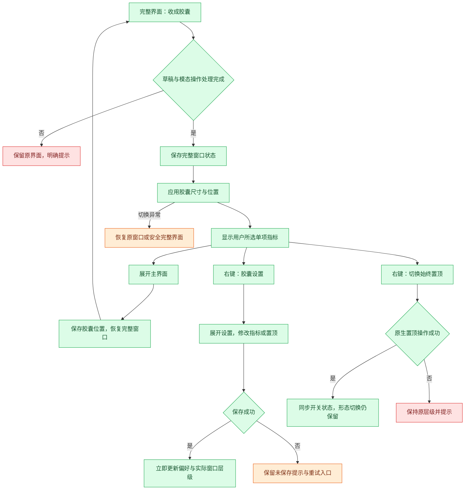

# F10 数据胶囊与悬挂置顶

- 优先级：**P0**（用户指定）。
- 版本：v2（2026-11-05）。本版本替代 v1 的任务便签长条方向。
- 状态：完整交互计划，未实施；用户已授权计划文档提交并 push；不代表授权代码实施。
- 用户明确要求：收起后直接变成小胶囊；胶囊显示一项数据；数据在设置中自定义选择；像苹果便笺一样可以悬挂并保持最上层。
- 方案边界：下述尺寸、默认值、指标清单及恢复策略是具体设计建议，实施前确认。这里「自定义数据」指从现有指标中选择，不是编辑任意金额、编写公式或接入外部数据。

## 现状与本轮调整

本轮源码核对，未做界面体验验收：

- `src/main/main.ts` 的 `toggleCompact()` 当前只把高度改成 64，宽度仍来自主窗口；禁用缩放，没有真正的小胶囊尺寸。
- `src/renderer/App.tsx` 现有 compact 分支固定显示收入和下班倒计时，不支持设置选择单指标。
- `src/renderer/styles.css` 的 `.compact-bar` 全窗拖动，macOS 左侧固定留 80px，仍带主窗口布局假设。
- v1 提出的当前任务便签和二期贴边自动隐藏不再作为本轮主线。本轮明确为「完整主界面 ↔ 单数据胶囊」，悬挂是窗口置顶，不是边缘吸附或挂绳动画。

## 核心体验

工作时收成一个可拖动的小胶囊，看一项自己关心的数据；需要操作时展开原主界面。开启「始终置顶」后，即使焦点在其他普通应用窗口，狗牛仍保持在前。

```text
默认：   ╭───────────────────────────╮
         │ ⠿  ⏳ 下班 01:23:45    ↗  │
         ╰───────────────────────────╯

可选：   ╭───────────────────────────╮
         │ ⠿  ¥ 今日已赚 128.60    ↗  │
         ╰───────────────────────────╯
```

示意中的拖动柄、指标与展开按钮各有明确区域。实际使用系统适配图标；不要把示意字符当最终素材。

### 两种显示形态

| 形态 | 内容 | 窗口行为 |
| --- | --- | --- |
| 完整界面 | 当前已有首页、任务、设置等 | 保留正常窗口功能与编辑能力 |
| 小胶囊 | 一个指标图标、短标签、数值及展开控件 | 可拖动，固定紧凑尺寸，不承载表单和任务编辑 |

不增加独立便签编辑器或第三个中间长条形态。胶囊与完整界面使用同一个应用窗口切换，始终只有一个内容窗口，不复制业务数据或启动第二份应用。

## 胶囊尺寸与外观

- 建议默认内容区 240×44px；后续按实际字体校准，参考宽度 220–300px、高度 40–48px。
- 默认固定宽高，不随收入每秒变化伸缩，防止桌面上的胶囊抖动。超长状态优先短文案，再按需截断标签，不能把关键数字切成误导内容。
- 胶囊形圆角、轻边框和适度阴影；浅色、深色与跟随系统复用项目已有主题，不引入另一套配色。
- 不沿用完整窗口的宽度、900px 最小宽度或 macOS 固定左侧空白。
- 外框、系统按钮、透明角落与阴影能力须由平台原型核实。目标是胶囊外观；实现时不能仅画一个圆角元素而留下整块矩形窗口拦截点击。
- 数字使用等宽数字；单位不可省略，金额保留 `¥`，时长使用清晰的时分秒或带单位的紧凑格式。
- 平时保持展开按钮可见，不能只能通过悬停发现恢复入口；胶囊设置可通过右键菜单打开。

## 设置方案

建议在「设置 → 外观」新增「胶囊与悬挂」分组，优先用选项、开关和即时预览表达，不常驻长说明。

| 设置项 | 控件与建议默认值 | 行为 |
| --- | --- | --- |
| 胶囊显示 | 单选下拉，默认「下班倒计时」 | 一次仅选一项，预览图标、短标签和格式 |
| 始终置顶 | 开关，默认关闭 | 完整界面和胶囊都遵循该开关；切换形态不自动取消 |
| 胶囊位置 | 「恢复默认位置」按钮 | 仅重置胶囊坐标，不移动完整窗口或清除指标选择 |

- 选择后沿用现有设置保存方式，保存成功立即更新；失败保留可重试编辑值并明确显示未保存，不伪装已同步。
- 预览优先使用当前真实快照；尚无数据时用占位 `—` 并说明未配置，不用模拟收入冒充实际值。
- 设置页提供「收成胶囊」操作，保存完成后切换，立即体验所选指标。
- 右键胶囊提供「展开主界面」「胶囊设置」「始终置顶（勾选）」「恢复胶囊位置」。若提供退出项，必须走原有统一退出流程。
- 「胶囊设置」直接展开到对应设置分组，避免用户再找入口；该行为不改变指标选择。

### 指标清单与显示口径

第一版建议复用现有数据指标，采用固定清单；不提供公式或自定义字段。

| 可选指标 | 胶囊示例 | 数据来源与特殊状态 |
| --- | --- | --- |
| 下班倒计时（默认） | 下班 01:23:45 | 沿现有排班/考勤；已下班、今日休息等用真实状态代替数字 |
| 今日已赚（估算） | 今日已赚 ¥128.60 | 当前收入快照，金额来源与首页一致 |
| 本月已赚（估算） | 本月已赚 ¥8,256.30 | 当前收入快照；大额格式仍须可读，不自行改变计算 |
| 今日偷出时长 | 今日偷出 18分26秒 | 现有有效偷出秒数；模式未开启显示「偷时间未开启」 |
| 今日偷出金额（估算） | 今日偷出 ¥12.80 | 现有偷出金额，不是额外工资 |
| 今日任务完成度 | 今日任务 3/5 | 与首页同一日期范围与任务筛选口径；无任务显示「今日无任务」 |
| 今日已工作 | 已工作 04:12:08 | 复用现有实际工时定义，不自建扣除口径 |
| 当前时间 | 14:36:28 | 系统本地时间，随时区切换重算 |

尚未实施的带薪拉屎单次计时不进入首版指标选项；F01 上线后可作为新选项评估，不自动替换用户已选指标。收入、活动、精神状态变化均不得偷偷抢占胶囊内容。

指标名称允许短化，业务意义不能改变；完整名称与估算说明放在悬停提示和设置项中。数据未就绪显示相应短标签及 `—`，不能把未知值显示为 0。

## 交互规则

### 收起

1. 从主界面明确的「收成胶囊」按钮进入，沿用/替换原 compact 入口。
2. 先完成当前草稿保存；存在未处理模态操作时建议先处理或关闭，不把编辑器隐藏在胶囊背后。
3. 保存成功记录完整窗口边界与当前页面，再切换胶囊；失败停留原界面并给出重试，不丢输入。
4. 首次出现于当前屏幕工作区右上侧留出边距；之后恢复上次胶囊位置，不依赖 F08 顶栏是否已经实现。

### 拖动与展开

- 只有左侧柄与指定空白区可以拖动；展开按钮和指标文字不作为拖动区，避免点击和拖动竞争。
- 点击展开按钮恢复主界面原尺寸、位置与页面，不把主界面直接放大到胶囊所在位置。
- 双击数据区可作为展开的辅助操作，但不是唯一入口；一次点击不执行打卡、任务完成或其他写业务数据的动作。
- 键盘可以聚焦展开按钮并触发；右键菜单打开期间冻结尺寸切换，菜单关闭后再执行已选操作。
- 拖动释放后才持久化胶囊位置，避免每移动一个像素就写盘。
- 不做悬停自动展开、不自动贴边隐藏，防止用户只是路过鼠标就打断工作。

### 悬挂与焦点

- 「始终置顶」作为统一用户偏好，在完整界面和胶囊中持续生效；展开后也保持置顶，除非用户主动关闭。此规则替代 v1「展开取消置顶」。
- 与苹果便笺的“Float on Top”一致，目标是在普通应用窗口上方保持可见，不需要不断激活或抢焦点。
- 程序启动恢复用户上次选择，默认关闭；开关状态以窗口实际结果为准，原生调用失败则回到原值并提示。
- 不使用系统警报或屏幕保护层级，不覆盖锁屏、系统安全提示；全屏 Space 与多桌面可见性需实机核实，不能将「置顶」承诺成越过一切系统界面。
- 一期不强制在所有 Space 常驻；「跨桌面/全屏可见」若需要，应作为显式选项和后续方案。
- 关闭悬挂后恢复普通窗口层级，不隐藏窗口、不重置位置、不退出胶囊。

## 实时刷新与性能

- 可见胶囊的时间类指标建议每秒刷新，金额按现有快照频率展示；业务命令成功时立即同步，不新增每秒磁盘写入。
- 主进程统一业务状态为事实来源，渲染只负责展示；若现有快照不足以支撑每秒计算，应在技术方案明确安全的时间基准或主进程刷新方案，不能线性外推错误金额。
- 后台焦点在其他窗口时仍需更新可见胶囊；不得因普通失焦而冻结显示。
- 最小化、应用隐藏或系统睡眠时停止不必要的视觉刷新；恢复后按当前时间和业务事实重算，不补播动画或累计帧数。
- 胶囊即使不展示某项业务，也不能中断其记录；比如任务进度和活动计时仍由业务模块管理。

## 保存、兼容与恢复

建议区分并保存：显示模式（完整/胶囊）、指标 ID、置顶偏好、完整窗口边界、胶囊位置。具体存储契约在技术方案确认，不写入任务数据中。

| 场景 | 处理 |
| --- | --- |
| 原版本 compact 状态 | 迁移为新胶囊默认指标，旧长条宽度不直接复用 |
| 原窗口保存位置在屏外 | 将对应形态夹回当前有效工作区，保留可见展开入口 |
| 拔屏、缩放或显示器排列改变 | 分别校验两种形态坐标，不将两者覆盖为同一组 |
| 完整窗口最大化或全屏 | 记录原状态；进入胶囊前等待安全退出全屏，失败保持原形态；展开恢复顺序须技术验证 |
| 选项指向未知指标 | 回退默认倒计时；保留其他有效设置，提示设置已调整 |
| 统计数据不可读 | 显示占位及必要状态；可以展开处理，不能阻塞退出 |
| 置顶应用失败 | 原状态保持，显示简短错误；普通窗口继续可用 |
| 模式切换失败 | 保持或恢复切换前的可操作窗口，不能留下不可见的尺寸或失效按钮 |
| 设置或位置保存失败 | 当前窗口仍可操作，提示未保存并允许重试，不承诺重启可恢复 |
| 重启 | 成功载入时恢复上次形态与偏好，坐标校验后再显示；配置损坏回正常完整窗口 |

关闭胶囊不等于结束拉屎计时或下班。关闭/退出继续遵守项目已有生命周期和保存保护；F08 顶栏未实施时，不假设已有顶栏找回入口。菜单和系统应用入口必须仍能恢复窗口。

## 与 F08 顶栏的分工

- F08：系统顶栏文字，分钟级一项/三项，系统菜单。
- F10：桌面可拖动的小胶囊，单项可配置，时间类秒级显示，可选始终置顶。
- 两者可同时存在，但设置分别保存；更改胶囊指标不更改顶栏模式。
- 后续若二者共用数据格式化器，保持显示精度配置独立；不能为了复用强行让两者刷新频率一致。

## 外观与动画

- 收起/展开建议 150–220ms 尺寸与内容过渡，先保证两种布局不互相挤压；平台不支持平滑调整时直接切换，不引入新动画引擎。
- 不把大窗口文字压成一团再伸开；切换时用短淡出/淡入表达内容变化。
- 胶囊没有常驻蹦跳的小牛、滚动跑马灯或持续呼吸，避免常驻视觉干扰。
- 指标变更时保持窗口宽度和位置，轻量切换内容；每秒更新数字不播放翻牌或缩放。
- 图钉静态选中表达置顶，悬停提示完整操作；不靠颜色作为唯一状态。
- 减少动态效果开启时直接切换，所有状态与控制仍完整可用；默认无音效。

## 交互流程



设置持久化与原生置顶的提交顺序、失败时的偏好一致性，需要在技术方案确定具体恢复流程；不得因为图中顺序而声称已有事务保证。

## 代码扩展位置与职责（待实施前复核）

| 位置 | 预计职责 |
| --- | --- |
| `src/main/main.ts` | 模式切换、两套窗口边界、原生置顶、显示器变化与恢复；复用已有退出保护 |
| `src/shared/contracts.ts` | 胶囊偏好与受控命令/快照契约，拒绝未知指标与不合法坐标 |
| `src/shared/board.ts` 或独立胶囊指标定义 | 复用已存在且语义一致的指标，避免把胶囊窗口偏好塞进首页布局数据 |
| `src/renderer/App.tsx` 的 compact 分支 | 挂载专用胶囊呈现，保持完整窗口状态，复用业务快照 |
| 现有设置入口 | 「胶囊与悬挂」分组、单选指标、置顶开关和预览 |
| 专属胶囊组件/样式（路径待确认） | 拖动区、图标、标签、数字与展开控件，不复制首页整套卡片 |
| 现有格式化与动效偏好 | 金额/时间格式，浅深色，减少动态设置 |

沿用受控命令与主进程来源校验，不允许渲染传任意原生窗口参数；无需新增独立业务存储、后台服务或第三方窗口框架。窗口呈现参数是否可原位切换需先验证；如必须重建窗口，应单列草稿、焦点、加载失败和退出恢复方案再确认。

## 参考与证据边界

- [苹果便笺指南](https://support.apple.com/guide/stickies/welcome/mac)：官方描述支持“Float on Top”，参考其不因其他普通窗口激活而被遮住的行为，不复制完整便笺编辑产品。2026-11-05 阅读文档，未亲测本机行为。
- [Electron BrowserWindow](https://www.electronjs.org/docs/latest/api/browser-window/)：提供 `setAlwaysOnTop` 等窗口能力；接口存在不等于胶囊圆角、全屏与跨 Space 行为已通过验证。
- 本文指标为现有数据及建议扩展的显示映射，具体字段和特殊状态需实施前逐项核对。

## 验收清单

- [ ] 宽主窗口收起后真正变为小胶囊，无大片空白或矩形透明拦截区。
- [ ] 始终只显示一项数据，设置选择、保存、预览、重启恢复及非法选项回退正确。
- [ ] 每项数值与主页相同口径，特殊状态、缺失值、长数字与单位展示不误导。
- [ ] 普通失焦不冻结可见胶囊，睡眠与跨日恢复按事实重算。
- [ ] 拖动与按钮不冲突，展开入口始终可发现，键盘和右键菜单可操作。
- [ ] 完整界面与胶囊切换保持各自边界和当前页面，未保存草稿不丢失。
- [ ] 置顶在两个形态间保持，关闭置顶立即恢复；不抢焦点，失败不伪装成功。
- [ ] 多显示器、拔屏、缩放、全屏前后与屏外恢复符合明示范围。
- [ ] 明暗主题、减少动态效果和系统窗口控制区适配正确。
- [ ] 关闭/退出/重启不绕过保存与未完成活动处理，只有一个应用实例与内容窗口。
- [ ] 技术验证包含相关窗口状态、设置校验、格式化与恢复逻辑检查，以及类型检查、构建和唯一的本地实例启动检查。
- [ ] 视觉与用户功能体验由用户验收；不以构建通过替代胶囊尺寸、置顶及多屏体验通过。

## 开发前确认点

用户已明确的方向保持不变：小胶囊、单项可选数据、设置控制、悬挂置顶。待确认的具体建议为：默认倒计时、初始 240×44px、上述 8 项指标、两个形态共享置顶偏好以及不含贴边隐藏。

确认本方案及具体技术实现范围后再实施。本次仅更新并提交、push 计划文档，不启动应用或实施代码。
