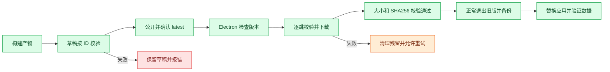

# R01/R02 自动发布与应用内更新修复

- 方案：v1，用户已确认修复、发布和替换正式安装版。
- 基线：main/origin/main = d27c018，修改前各轮 fetch 无更新。保留用户已授权的方案归档，AGENTS.md 继续仅本地保留。
- 本轮目标版本：3.0.5；修复代码累计至 23 轮（含此前功能实现及发布准备）。

## 已定位原因

R01：工作流创建草稿和上传附件后调用 releases/tags 接口，该接口仅查询 published release，返回 404，公开步骤未执行。此前 v3.0.4 为按 ID 手动完成发布。

R02：安装版 3.0.2 UI 已识别 v3.0.4，但显示通用下载错误；安装包内的 updater 使用 net.fetch + redirect:manual。本机 Electron 45.2.2 实测该调用抛出 Redirect was cancelled，而 Node fetch 和 net.request 均收到 GitHub 的 302。

## 实现边界

- scripts/publish-release.mjs：按 ID 管理草稿、精确校验产物与目标提交、公开后验证 tag/latest。重复运行不覆盖异源产物。
- src/main/update-transport.ts：小型 Electron GET 适配器；不自行跟随下载跳转，继续由 ReleaseUpdater 校验受信域。处理 redirect/response/error/abort，流式缓冲 8 MiB 上限。
- src/main/release-updates.ts / shared/contracts.ts：检查、下载、校验阶段错误码及关联标识；沿用缓存、大小和散列校验及残留清理，不改业务数据格式。
- src/main/main.ts：只将更新器的 fetch 注入改为新适配器，不影响其他网络调用。
- 更新相关及发布测试：覆盖草稿按 ID 核验、错误产物不发布、不同提交不覆盖、原生 close 先于 redirect、流式响应、取消、中断、缓冲限制和失败阶段反馈。

## 当前验证

- 类型检查和生产构建通过；4 项 Python 检查通过。
- 发布/下载相关 15 项测试通过。
- 使用真实 Electron 新适配器，模拟 current=3.0.2，在隔离临时目录完整下载 v3.0.4 的 138332063 字节 DMG，更新器状态 ready；installer() 再次 SHA-256 复验通过。未向正式版数据目录写入该实验结果。
- 待完成：干净环境全套测试、v3.0.5 自动发布、实际新包下载核验、正式版数据备份、替换与新安装版入口核对。完成证据记录在本次交付回复。
- Windows、不同系统网络代理、跨版本用户体验仍不视为全部验收通过。
